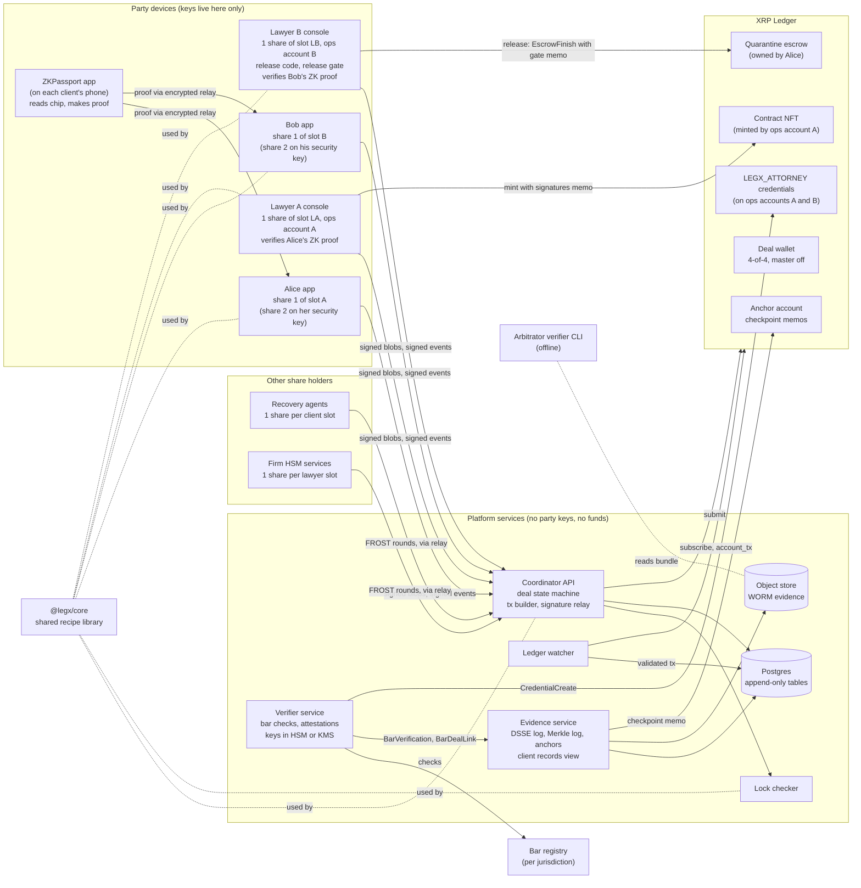
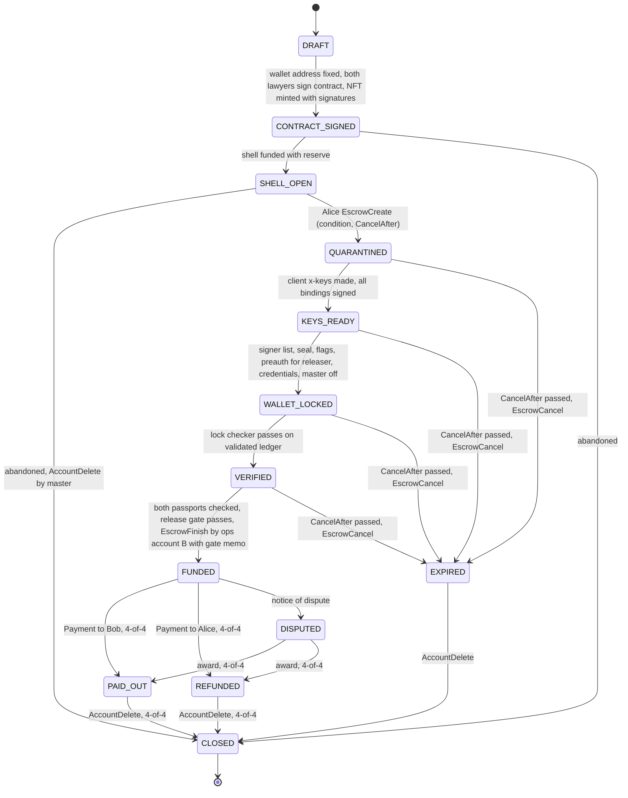
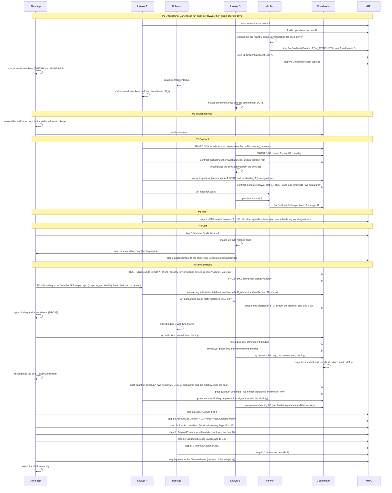
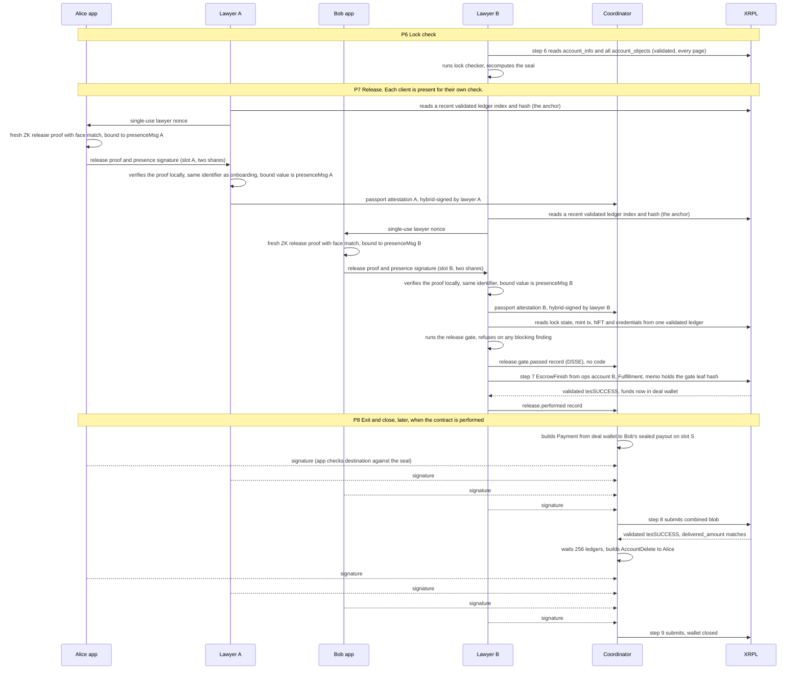

# Two-Key Deal Wallet on the XRP Ledger: System Design

Version: 1.0 (draft for build)
Date: 24 Oct 2026
Owner: Yash
Code prefix used in tags and packages: `legx` (a working name, easy to change)

This document is written to be handed to Claude Code. It explains what the system does, why each choice was made, and exactly how to build and test it. Section 0 tells Claude Code how to use it.

**One version.** This is version 1.0, and it is the only version. Every tag ends in `/v1` and means the recipe in this document. There is no older recipe to support: nothing has been deployed. Earlier drafts are not described here, except where Appendix A's starting code still follows them.

**What version 1.0 contains, beyond the basic deal wallet:**

1. **Lawyer-signed contract.** Only the two lawyers sign the contract, with the keys that control the money. The NFT holds a seal over their signatures (D16 to D18).
2. **Bar checks.** Every lawyer is checked against a bar registry, and the check is linked to each deal (D19).
3. **Sealed release account.** The release account is bound to Bob's lawyer and sealed (D20).
4. **Passports at every release, by zero-knowledge proof.** Both clients prove their passports again at release, with a fresh proof from their own phone (D21, D26). The platform never sees passport data; the client's own lawyer sees only the identity facts disclosed at onboarding. The lawyer's chip read is the fallback.
5. **Threshold keys.** Every signer slot is a FROST 2-of-3 key, so a lost phone does not freeze the money and no device ever holds a whole key (D25).
6. **Post-quantum by default.** Every record carries a classical and a post-quantum signature, each slot has a post-quantum binding, and backups use a hybrid post-quantum key exchange (D27).
7. **Records and traces.** Every step leaves a client record and an engineering trace (section 8).

---

## 0. How to use this document (for Claude Code)

Build in the order of the milestones in section 14. Each milestone has a "done when" test list. Do not start a milestone until the previous one is green. `IMPLEMENTATION.md` turns these milestones into 7 phases with parallel lanes, a tech stack, and a test-first task list. Follow it for the build.

Rules for the build:

1. **Never touch Mainnet.** All work runs on a local standalone ledger, Testnet or Devnet. Never reuse a key across networks. Mainnet, Testnet and Devnet have no `NetworkID` field, so a transaction signed for one can be replayed on another with the same keys ([common fields](https://xrpl.org/docs/references/protocol/transactions/common-fields)).
2. **No service ever holds money, a party or lawyer key, the release code, or a raw passport.** The server side builds unsigned transactions, relays signatures and checks the ledger. Private keys live only on client devices and lawyer devices. There are three exceptions, and each lives in an HSM or a cloud KMS, never in code or env files: the evidence log key, the verifier attestation key, and the verifier issuer account key.
3. **Every hash and signed message carries a versioned tag** such as `legx/dealseal/v1`, and uses the length-prefixed `tupleHash` from `@legx/core`. Never hash two things without a tag and length prefixes. Never sign raw bytes. The one exception is a DSSE envelope, which signs its own pre-authentication encoding (PAE).
4. **Trust only validated ledgers.** Ignore any result that is not `validated: true` ([reliable submission](https://xrpl.org/docs/concepts/transactions/reliable-transaction-submission)). All ledger reads for one decision come from **one** validated ledger. Measure freshness against the ledger `close_time`, never a local clock.
5. **Read amounts from `meta.delivered_amount`, never from `Amount`** ([partial payments](https://xrpl.org/docs/concepts/payment-types/partial-payments)).
6. **The code in Appendix A is tested.** It ran in a scratch project with xrpl.js 5.3.0, @noble/curves 2.4.0, @noble/hashes 2.4.0, fast-check 4.10.2 and Vitest 5.0.5. All 32 tests pass, and `tsc` is clean. Start the repo by copying it in.
7. **An earlier version of the integration test in Appendix B ran green on 24 Oct 2026.** It ran against `rippleci/xrpld:3.4.1` in standalone mode, three times in a row, including T-A-07. Section 11.2 lists what the harness needed. That flow was shorter than the one in this document. Updating it to the full flow (T-I-01) is the first task of milestone M1.
8. Items marked **[CHECK]** were not confirmed against a live source. Confirm each one with a test before relying on it.
9. **Verify Ed25519 strictly** (`zip215: false`) everywhere, including in `verifyMultisigned`.

---

## 1. What the system does

### 1.1 The story

Alice wants to pay Bob for a deal. They are in different countries and do not trust each other. Each has a lawyer.

The system gives them a shared wallet on the XRP Ledger, called the **deal wallet**. Think of it as a safe with four locks. Alice holds one key, Alice's lawyer holds one, Bob holds one and Bob's lawyer holds one. The safe opens only when all four turn their keys. Nobody alone can move the money, and no company in the middle ever holds it.

Before any deal, each lawyer is checked against an official bar registry. A verifier service records the check and gives the lawyer's firm account a ledger badge, `LEGX_ATTORNEY`.

The deal runs in six stages:

1. **Wallet address.** Alice's device makes the setup key for the deal wallet. The wallet's address is now known, but it holds no XRP yet.
2. **Contract.** The contract names the deal wallet's address. **Only the two lawyers sign it.** Each lawyer signs with the same key that will control the money. Clients agree on paper with their own lawyer, and on the ledger when they accept their party badge. Lawyer A's firm account then puts a token (an NFT) on the ledger. It holds a seal over the contract and both lawyers' signatures.
3. **Holding pen.** Alice puts the money into a ledger escrow, called the **quarantine**. It can only go to the deal wallet. It needs a secret release code that only Bob's lawyer knows. If the deal never starts, the ledger gives Alice her money back after a few days.
4. **Keys and lock.** Each person's key is a threshold key: it is split into three shares, and any two can sign. A client's shares sit on their phone, on a separate security key (or second device), and with an independent recovery agent, so a lost phone does not lose the key. Each client also proves their passport with a zero-knowledge proof made on their own phone. The deal wallet is then locked so only all four keys together can move anything. The original setup key is switched off for good.
5. **Release.** Bob's lawyer checks the lock on the ledger. **Both clients then prove their passports again**, each to their own lawyer, with a fresh zero-knowledge proof made on their own phone and tied to a fresh ledger value. Nobody sees the passport itself. (If the client's document is not supported, or the contract demands it, the lawyer reads the chip instead.) Bob's lawyer's console refuses to release unless every check passes: the lock, the contract seal, both passports, both bar checks and both attorney badges. If all pass, he uses the release code to move the money from the holding pen into the deal wallet. Only his sealed firm account can do this. The money lands in a safe that Alice still holds a key to.
6. **Exit.** The money leaves only one of two ways: to Bob (deal done) or back to Alice (deal off). Both need all four signatures. If the parties fight, an arbitrator decides. All four then sign as the award says. If someone refuses, the award is enforced in court (see open decision O1). At the end, the wallet is closed and its small deposit returns.

Every step leaves a signed, time-stamped record for the client, and a trace for engineers. Every record carries a classical and a post-quantum signature, so it stays valid evidence even after quantum computers arrive. If there is ever a dispute, the system can hand an arbitrator one evidence bundle that proves who did what and when.

### 1.2 What it is not

- It is not a custodian. It never holds funds or keys.
- It is not a payment rail. Alice and Bob bring their own XRP.
- It does not judge disputes. Arbitrators do. The system only gives them clean evidence.
- It does not put any personal data about clients on the ledger. Only salted fingerprints go there, for both identity methods (6.2). Law firms are different: their part in a deal is public (D24).

### 1.3 Who knows what

| Party | Knows | Never learns |
|---|---|---|
| Alice's device | share 1 of her slot key, her enrollment keys, her identity salt, her passport data inside the ZKPassport app, the shell setup key (until it is wiped). Share 2 is on her security key or second device. | Bob's secrets, any lawyer share |
| Alice's lawyer | share 1 of lawyer slot A, operations account A, the contract, the identity facts Alice disclosed at onboarding (name, date of birth, nationality), an encrypted copy of Alice's identity salt. Alice's raw passport data only in the chip fallback path. | any client share, Bob's identity |
| Bob's device | share 1 of his slot key, his enrollment keys, his identity salt, his passport data inside the ZKPassport app. Share 2 is on his security key or second device. | Alice's secrets |
| Bob's lawyer | share 1 of lawyer slot B, operations account B (the releaser), the release code, the contract, the identity facts Bob disclosed at onboarding, an encrypted copy of Bob's identity salt. Bob's raw passport data only in the chip fallback path. | any client share, Alice's identity |
| Recovery agent (one per client) | one share of that client's slot key | any other share, any passport |
| Firm HSM service (one per firm) | one share of its lawyer's slot key | any client share |
| Verifier service | bar records, the per-deal bar salts, its own attestation key and issuer account key (in an HSM or KMS) | any passport, any party or lawyer key, the release code |
| Coordinator service | public keys, unsigned transactions, public commitments | any private key, any passport data, the release code |
| Ledger | public keys, hashes, the escrow, the money, which law-firm accounts take part | anything personal about clients |
| Arbitrator (only in a dispute) | whatever a party chooses to open: a passport record and salt, a contract clause and its proof | private keys |

By default (the zero-knowledge method), no lawyer sees raw passport data; each lawyer sees only the identity facts its own client disclosed to it. In the chip fallback path, each lawyer's console reads only its own client's passport and keeps no raw passport data after the check. Only the attestation leaves the console, and it carries the commitment and the check results, never the passport.

---

## 2. Glossary (plain words)

- **XRPL / the ledger.** A public database that thousands of servers agree on every 3 to 5 seconds. Money and rules live there.
- **Account / wallet.** An address on the ledger that can hold XRP. It is controlled by keys.
- **Master key.** The first key an account is born with. We switch it off after setup.
- **Signer list.** A rule on an account: "these keys, with these weights, must sign together." Ours: four keys, weight 1 each, all four needed (quorum 4).
- **Escrow.** Money parked on the ledger with rules for release. Ours needs a secret code and has a give-back time.
- **Release code (preimage).** A 32-byte random secret. Its fingerprint (SHA-256 hash) is set on the escrow. Showing the code unlocks the escrow.
- **Hash / fingerprint.** A short, fixed-size summary of data. Change one letter and the hash changes completely.
- **Commitment.** A hash of data plus a random salt. It hides the data, but the owner can later prove what was inside.
- **x-key.** A client's slot key for one deal: a FROST group key whose three shares sit on the phone, on a separate security key or second device, and with the recovery agent.
- **Deal seal.** One hash that ties together the contract, all four public keys, all four identity commitments, the four signer accounts, the quorum, and the two payout addresses. It is stored on the deal wallet.
- **Salt.** A random number mixed into a hash so nobody can guess what was hashed.
- **Share.** One piece of a threshold key. Any two of a slot's three shares can sign together; one share alone cannot. The whole key is never assembled.
- **FROST.** The standard threshold signing scheme (RFC 9591) we use. Its signatures are ordinary Ed25519 signatures, so the ledger cannot tell them apart.
- **Zero-knowledge proof.** A proof that a statement is true ("this is a genuine passport, and its holder is over 18") that reveals nothing else.
- **Deal-scoped identifier.** A number the passport proof gives that is the same for one passport within one deal, and different across deals.
- **ML-DSA and X-Wing.** Post-quantum standards: ML-DSA signs (FIPS 204), and X-Wing is a hybrid encryption key exchange (ML-KEM-768 plus X25519).
- **Coordinator.** Our server. It builds transactions and passes signatures around. It holds no keys and no money.
- **Shell.** The deal wallet before it is locked: an empty account with only its setup key.
- **Multisig.** A transaction signed by several keys from a signer list.
- **Sequence and slot.** Every account numbers its transactions 1, 2, 3. Two transactions with the same number can never both happen. We use one number (the "slot") for both possible exits.
- **Ticket.** A reserved transaction number, set aside for later.
- **DepositAuth.** An account setting: "only accounts I approved can send me money."
- **Domain.** A free field on an account (up to 256 bytes). We store the contract root and deal seal there.
- **Reserve.** XRP an account must keep locked to exist: 1 XRP, plus 0.2 XRP for each object it owns.
- **DSSE.** A simple, standard wrapper for a signed record. It signs the bytes exactly as stored.
- **Merkle tree.** A way to hash many items into one fingerprint, so you can later prove one item is included by showing a few hashes.
- **Ed25519.** A modern signature method. XRPL supports it.
- **Credential.** A ledger badge issued by an account to another. The receiver must accept it. Acceptance is a public "yes, this is me."
- **Validated ledger.** A ledger version the network has agreed on. It cannot change.
- **Drops.** One XRP is 1,000,000 drops.
- **Operations account.** A law firm's own funded XRPL account. Lawyer A's account mints the contract NFT. Lawyer B's account is the only one that may release the quarantine (the **releaser**).
- **Lawyer slot key.** The lawyer's FROST 2-of-3 key for one deal (6.4). It signs the contract and sits on the deal wallet's signer list.
- **Signed-contract seal.** One hash over the contract root, the wallet address and both lawyers' keys and contract signatures. It is stored in the NFT.
- **Verifier service.** Our service that checks a lawyer against a bar registry and issues the `LEGX_ATTORNEY` credential. It never sees a passport.
- **Passive authentication.** The ICAO 9303 check that the passport chip data carries a valid signature from the issuing country.
- **Active or Chip Authentication.** ICAO 9303 checks that the real chip is present, not a copy of its data.
- **Presence statement.** A message the client's slot key signs, and the client's release proof binds, during the passport check. It includes a fresh ledger hash, so it shows the client's own phone took part at that moment.
- **Release gate.** The checklist Bob's lawyer's console runs before it builds the `EscrowFinish`. Every blocking item must pass.

---

## 3. Design decisions and why (read before coding)

These decisions came out of research done on 24 Oct 2026 against the rippled source code, xrpl.org docs, RFCs and audits. Several earlier ideas changed. The table shows each final rule and the reason.

| # | Decision | Why |
|---|---|---|
| D1 | Open an **empty deal wallet (shell) before** Alice funds the escrow. | `EscrowCreate` fails with `tecNO_DST` if the destination account does not exist. The check is in `EscrowCreate::preclaim` ([source](https://github.com/XRPLF/rippled/blob/develop/src/libxrpl/tx/transactors/escrow/EscrowCreate.cpp)). So the shell must exist first. It holds only the reserve until release. |
| D2 | Protect the escrow with a **sealed release code held by Bob's lawyer**. | Before the lock, whoever opened the shell controls it. The code stops an early release into an unlocked wallet. XRPL escrows support only PREIMAGE-SHA-256 conditions ([escrow](https://xrpl.org/docs/concepts/payment-types/escrow)). |
| D3 | **Four signers, weight 1 each, quorum 4:** Alice's x-key, Alice's lawyer key, Bob's x-key, Bob's lawyer key. | "Each side's lawyer holds the legal authority to release." XRPL multisig is flat: "a multi-signature cannot be used as part of another multi-signature" ([multi-signing](https://xrpl.org/docs/concepts/accounts/multi-signing)). So each lawyer is a direct signer. The ledger then records exactly who signed. Signer accounts do not need to be funded ([SignerListSet source](https://github.com/XRPLF/rippled/blob/develop/src/libxrpl/tx/transactors/account/SignerListSet.cpp)). |
| D4 | **Only Bob's lawyer's operations account may finish the escrow.** The wallet turns on DepositAuth and pre-approves exactly that one account. | In plain words: once DepositAuth is on, the wallet accepts money only from itself or from accounts it approved. rippled checks the account that *sends* the `EscrowFinish`, not the escrow's owner ([CredentialHelpers.cpp](https://github.com/XRPLF/rippled/blob/develop/src/libxrpl/ledger/helpers/CredentialHelpers.cpp)). So a stranger who sees the code cannot finish it. We do not make the finish 4-of-4: then Alice could refuse to sign after verification and wait for her automatic refund, a free way to walk away. The money lands in a wallet Alice still co-controls, so letting Bob's lawyer release it costs her nothing. Open decision O8 keeps the 4-of-4 version as an option. |
| D5 | **Never reveal key inputs to an arbitrator.** Prove identity with a new zero-knowledge proof that has the same deal-scoped identifier (or, in the chip path, by opening a commitment), plus a signed binding statement. | In the first draft, the arbitrator recomputed the key from the passport token. Anyone who can recompute a key this way also gets the private key. Now keys are threshold keys made by DKG, and no single place ever holds the whole key. |
| D6 | Store only a **salted commitment** of the passport, never a plain hash. | Passport data has little randomness, so a plain hash can be guessed offline. A 256-bit random salt makes guessing hopeless. |
| D7 | **The quarantine holds XRP**, not RLUSD or USDC, for now. | Escrowing a trust-line token needs the issuer flag `lsfAllowTrustLineLocking`. As decoded from issuer flags on 24 Oct 2026, neither RLUSD nor USDC has it set **[CHECK with `account_info`]** ([TokenEscrow](https://xrpl.org/docs/references/protocol/transactions/types/escrowcreate)). |
| D8 | **Mint the contract NFT from lawyer A's operations account, never from the deal wallet** (see D18). | An account that owns NFT pages, or minted NFTs not yet burned, cannot be deleted (`tecHAS_OBLIGATIONS` in [AccountDelete.cpp](https://github.com/XRPLF/rippled/blob/develop/src/libxrpl/tx/transactors/account/AccountDelete.cpp)). |
| D9 | **Both possible exits (pay Bob, refund Alice) use the same sequence slot.** An exit counts only if its result is `tesSUCCESS` and `delivered_amount` matches. | Two transactions with the same Sequence or Ticket can never both be validated ([tickets](https://xrpl.org/docs/concepts/accounts/tickets)). So even in a race, money leaves once. A failed exit (a `tec` result) still uses up the slot, so both candidates are then rebuilt on the next slot. |
| D10 | **No ledger clock after funding.** Deadlines are contract terms. A stuck deal goes to arbitration. | Agreed earlier. The money then sits in an account, which has no timeout. Section 15 lists an optional backstop. |
| D11 | **Ed25519 keys everywhere on the ledger, each one a FROST 2-of-3 group key** (6.4). | Deterministic signatures, the xrpl.js default, and FROST produces plain Ed25519 signatures that any RFC 8032 verifier accepts ([RFC 8032](https://www.rfc-editor.org/rfc/rfc8032), [RFC 9591](https://www.rfc-editor.org/rfc/rfc9591)). |
| D12 | **Evidence events are DSSE envelopes**, hash-chained per deal, logged in an RFC 9162 Merkle log, with checkpoints anchored on the XRPL. In plain words: each record is signed exactly as stored, linked to the one before it, and summed into one public fingerprint that is posted on the ledger. | DSSE signs exact bytes, so there is no JSON-reformatting argument in court ([DSSE](https://github.com/secure-systems-lab/dsse/blob/master/protocol.md)). Merkle logs give small inclusion proofs ([RFC 9162](https://www.rfc-editor.org/rfc/rfc9162.html)). |
| D13 | **The lock turns on all four DisallowIncoming flags** (NFT offers, checks, payment channels, trust lines). | Without them, any stranger could attach a check, channel, offer or trust line to the wallet. That stalls verification and blocks closing the account, because these objects are obligations ([AccountSet](https://xrpl.org/docs/references/protocol/transactions/types/accountset)). |
| D14 | **The lock checker uses an allow-list, not a block-list.** Every object the wallet owns must be expected, and `OwnerCount` must match. | An independent review found a drain path a block-list missed: a buy offer for an NFT, created by the shell before the lock, could pay Alice later, because NFT buy offers do not set funds aside. Allow-lists fail closed when XRPL adds new object types. |
| D15 | **The deal seal includes both payout addresses** (and destination tags) and both lawyers' keys and commitments. | Otherwise nothing on the ledger says where the money may go, and apps have nothing to compare an exit with. |
| D16 | **Only the two lawyers sign the contract.** Each signs with the same lawyer slot key that sits on the deal wallet's signer list (6.4, 6.6). | The keys that sign the contract are then provably the keys that control the money. Clients show assent on the ledger by accepting their party credential (step 5f), and on paper with their own lawyer. |
| D17 | **The deal wallet's address is fixed before the contract is signed**, and the contract names it. | Alice's device makes the shell key first, so the address is known before the account holds any XRP. The contract names the wallet, and the wallet's `Domain` names the contract: a two-way link. |
| D18 | **The NFT is minted only after both lawyers sign**, by lawyer A's operations account. Its URI holds the signed-contract seal. A memo on the mint holds both lawyer public keys and both signatures. The deal stores the NFTokenID and the mint transaction hash. | Anyone can check the signatures from the ledger alone. The mint transaction stays in ledger history even if the NFT is later burned. Memos are limited to 1 KB in total ([common fields](https://xrpl.org/docs/references/protocol/transactions/common-fields)); this memo is 195 bytes. |
| D19 | **Every lawyer is bar-verified at onboarding**, and again when the last check is more than 30 days old. The verifier records a signed `BarVerification` and then issues the XRPL credential `LEGX_ATTORNEY` to the lawyer's operations account. For each deal, the verifier also signs a `BarDealLink` that ties the verification to the lawyer slot key and bar commitment (6.16). | XRPL credentials are native ledger badges: an issuer creates one, the subject must accept it, and it can carry an expiry and a URI ([credential entry](https://xrpl.org/docs/references/protocol/ledger-data/ledger-entry-types/credential)). The per-deal link is needed because the bar commitment uses a fresh salt for each deal (6.2). |
| D20 | **Each lawyer has a funded operations account.** A binding statement ties each operations account to its lawyer's per-deal key and bar commitment, and **both operations accounts go into the deal seal** (6.6). Bob's lawyer's operations account is the `releaserAccount`. | Before this, the release account was not in the seal, so nothing proved it belonged to Bob's lawyer. Now it is sealed and tied to a verified bar record. |
| D21 | **Both passports are checked at release, with the client present** (6.10, 6.15). By default, each client makes a fresh zero-knowledge passport proof on their own phone, with the same deal-scoped identifier as at onboarding and bound to a fresh ledger value. In the chip fallback path, the client's own lawyer reads the chip: it must pass ICAO 9303 passive authentication and open the sealed commitment, and, when the chip supports it, Active or Chip Authentication. The client's x-key co-signs a presence statement. The client's own lawyer signs the attestation. Bob's lawyer's console refuses to release unless both attestations pass the release gate (6.17). | Passive authentication checks the issuing country's signature on the chip data, so it proves the data came from a real passport. Active or Chip Authentication proves the real chip is present, not a copy ([ICAO Doc 9303](https://www.icao.int/publications/doc-series/doc-9303)). The client's own lawyer must already identify the client, so the raw passport reaches no one else. **Known trade-off:** Alice's side must take part in her check, so Alice's side can stall the release until `CancelAfter` and get her refund. This is the walk-away that D4 avoids. D4 does not change. The stall is a threat in 10.1 and open decision O9. By default, the contract treats a refusal of the release-time passport check as a breach, decided in arbitration. |
| D22 | **The release carries a ledger link to its checks.** The `EscrowFinish` has one memo: `MemoType` = hex(utf8(`legx/release-gate/v1`)), `MemoData` = the 32-byte leaf hash of the `release.gate.passed` envelope, which lawyer B signs. | Anyone who reads the ledger can follow the release to the exact checks behind it. Memos are limited to 1 KB in total ([common fields](https://xrpl.org/docs/references/protocol/transactions/common-fields)). |
| D23 | **Keep the DepositPreauth by account** (exactly one entry, for `releaserAccount`). Also require the releaser's `LEGX_ATTORNEY` credential in the release gate. Do not set `CredentialIDs` on the `EscrowFinish`. | Account preauth is already tested and simple. A preauth by credential would let any holder of that credential finish the escrow. |
| D24 | **Law firms are public; clients are not.** The mint memo, the NFT and the `LEGX_ATTORNEY` credential publicly link law-firm accounts to deals. Clients stay unnamed. | Firms must know this before they join. Invariant I7 and the threat table record it. |
| D25 | **Every signer slot is a FROST 2-of-3 threshold key** made by DKG (6.4). | A lost phone or a departed partner no longer freezes the money or forces a ledger change. A stolen device alone cannot sign. The ledger still sees four Ed25519 keys, so D3's "which slot signed" record stays. |
| D26 | **Zero-knowledge passport proofs are the default identity method; the lawyer's chip read is the fallback** (6.10). | A web page cannot read a passport chip, but it can show a QR code for the ZKPassport app. The passport reaches nobody. Neither proof library proves the chip is present, so a contract that needs that uses `identityPolicy: "chip"`. |
| D27 | **Post-quantum protection by default, everywhere the ledger allows** (6.13): hybrid Ed25519 plus ML-DSA-65 evidence signatures, a post-quantum binding per slot, hybrid checkpoints, X-Wing for backups and share transport. | XRPL has no post-quantum signatures yet. Evidence must stay valid for years, and encrypted backups can be stored now and broken later. |

---

## 4. Architecture

### 4.1 Components



| Component | Job | Holds secrets? |
|---|---|---|
| `@legx/core` | The published recipe: hashing, commitments, FROST key generation (DKG), deal seal, signed-contract seal, condition encoding, lock check, passport attestation check, release gate, Merkle proofs. Pure functions, no network. Used by every other part, so all sides compute the same bytes. | No |
| Party app (Alice, Bob) | Takes part in the FROST key generation, holds share 1 and works with the client's security key or second device (share 2), requests zero-knowledge passport proofs from the ZKPassport app, signs binding, post-quantum binding and presence statements and transactions. | Yes, on device only |
| Lawyer console | Holds one share of the lawyer slot key (hardware-backed) and the operations account key. Signs the contract, approves steps, signs. Checks its own client's zero-knowledge proof at release and signs the attestation. Reads the passport chip only in the fallback path (6.15). Lawyer B also makes and holds the release code, runs the release gate, and submits the release from operations account B. | Yes, on device only |
| Coordinator API | Runs the deal state machine, builds unsigned transactions, collects and combines signatures, submits blobs. | No |
| Lock checker | Reads the validated ledger and runs the checklist in section 6.9. | No |
| Ledger watcher | Follows the deal accounts, records validated transactions, feeds the state machine. | No |
| Verifier service | Checks each lawyer against a bar registry, signs `BarVerification` and `BarDealLink` records, and issues `LEGX_ATTORNEY` credentials from its issuer account. Never sees a passport. | Its attestation key and issuer account key, in an HSM or KMS |
| Evidence service | Stores signed events, runs the Merkle log, anchors checkpoints, builds evidence bundles, serves the client records view (8.10). | Only its own log-signing key, in an HSM or KMS |
| Arbitrator verifier | Offline tool that checks a bundle with no network calls. Zero-knowledge proofs are re-checked from the recorded registry answer and circuit files in the bundle, which a ledger checkpoint anchored at the time (6.10). An arbitrator may also check those roots against the chain, which is the one optional online step. | No |
| ZKPassport app (third party) | Reads the passport chip on the client's phone and makes the zero-knowledge proof. | The client's passport data, on the client's phone |
| Recovery agent (independent) | Holds one share of a client slot. Signs only on the client's authenticated recovery request. Never the client's lawyer. | One share |
| Firm HSM service | Holds one share of a lawyer slot. Co-signs only transactions that match the deal seal. | One share, in an HSM |

### 4.2 Deployment shape

- One TypeScript monorepo. Node 22.12+ (Vitest 5 needs it).
- Postgres for working state, an object store with WORM retention (S3 Object Lock, compliance mode) for evidence.
- An OpenTelemetry Collector for traces, logs and metrics (section 8.6).
- Mobile apps sign in native code where possible (section 6.4).
- `@legx/core` must run in browsers. Its `src/` has no `Buffer`, no `node:*` import and no other Node-only global. It uses `Uint8Array` with the `@noble/hashes` and `@scure/base` helpers. A lint rule and a browser smoke test enforce this.
- `/health` is unsigned. It shows only each port's name, profile and ok or fail state, never data or keys.

---

## 5. Deal lifecycle

### 5.1 State machine



**Safety rules the state machine must never break** (each one has tests in section 12):

- **I1.** Funds enter the deal wallet only after `WALLET_LOCKED` and `VERIFIED`. Only the sealed `releaserAccount` (lawyer B's operations account) can release them.
- **I2.** Every outflow after the lock carries all four signatures.
- **I3.** The master key is off, and there is no regular key and no delegate, before funding.
- **I4.** The deal seal on the ledger equals the seal recomputed from the parties' public data.
- **I5.** At most one exit is ever validated.
- **I6.** `CLOSED` is final.
- **I7.** No personal data about a client appears on the ledger, in the evidence log's entries, or in a trace, in readable form. Law-firm accounts are public on purpose (D24).
- **I8.** Funds enter the deal wallet only after the release gate (6.17) passes on one validated ledger: the lock, the signed contract, both passports with the client present, both bar checks, both attorney credentials and both operations-account bindings. The `EscrowFinish` names the gate record in its memo.

### 5.2 Setup sequence (phases P0 to P5)

Step numbers match the transaction catalogue in section 7.3. Phases group the steps.

| Phase | What happens | Steps |
|---|---|---|
| P0 Onboarding | Each lawyer funds an operations account. The verifier checks the bar and issues `LEGX_ATTORNEY`. Every share holder makes enrollment keys (6.3). Each lawyer makes a bar commitment. | 0a, 0b |
| P1 Wallet address | Alice's device makes the shell setup key. The wallet address is now known. | none |
| P2 Contract | The two lawyer slots run FROST key generation (6.4). The contract names the wallet address. Both lawyers sign it (6.12). Both operations accounts are bound (6.14). The verifier signs both `BarDealLink` records (6.16). | none |
| P3 Mint | Lawyer A's operations account mints the NFT with the signed-contract seal and the signatures memo. | 1 |
| P4 Fund | Alice funds the shell, then creates the quarantine escrow. | 2, 3 |
| P5 Lock | FROST key generation for the two client slots, zero-knowledge onboarding proofs, bindings, the deal seal, post-quantum bindings, then the lock steps. `Domain` = `01` + root + seal. DepositPreauth names `releaserAccount`. | 5a to 5g |



**Signing in the lock steps.**
- Steps 5a to 5e are signed by the shell setup key. Step 5g is also signed by the shell setup key (or its regular key). A multisigned `AccountSet` with `asfDisableMaster` returns `tecNEED_MASTER_KEY` (validated, fee spent), so 5g is the one lock step the four FROST slots cannot sign.
- Step 5f is single-signed by each client's FROST pair (phone plus second authenticator). The client's XRPL account is the slot account: its key is the slot's FROST group key (6.4). There is no separate account key. The signer allow-list has one entry for it: `CredentialAccept` with `Account` = this slot's account, `Issuer` = the sealed deal wallet and `CredentialType` = the sealed type, and no other fields.
- **A stranger's trust line before 5c.** Seen on xrpld 3.4.1: a trust line opened to the shell before step 5c costs the shell no reserve, and the shell cannot remove it. The stranger removes it with a `TrustSet` of limit 0 that also sets `tfSetNoRipple`, because an account without DefaultRipple keeps the line otherwise. Until then the lock checker blocks. Setting the DisallowIncoming flags right after step 2 is still an open proposal (Appendix B, DQ-3).

### 5.3 Verify, release and exit (phases P6 to P8)

| Phase | What happens | Steps |
|---|---|---|
| P6 Lock check | Lawyer B reads the wallet from one validated ledger and runs the lock checker. | 6 |
| P7 Release | Both passports are checked with the client present: a fresh zero-knowledge proof by default (6.10), or the lawyer's chip read (6.15). The release gate runs (6.17). Lawyer B releases with the gate memo. | 7 |
| P8 Exit and close | All four sign one exit on slot S, then close the wallet. | 8, 9 |



### 5.4 Unhappy paths

| Situation | What happens |
|---|---|
| The deal is abandoned before funding | The shell is closed with its setup key (`AccountDelete`) after 256 ledgers. |
| Keys never made, or the lock check fails | Bob's lawyer never reveals the code. After `CancelAfter`, anyone sends `EscrowCancel`; the money returns to Alice. If the shell was already locked, closing needs all four; if one side refuses, only the reserve (about 2 XRP) is stuck. |
| One party goes silent after funding | Money waits in the deal wallet. The contract's deadline and arbitration clause apply. All four sign per the award. See open decision O1 for a backstop. |
| A stranger sends the wallet an escrow | It cannot move the wallet's money, so the checker only warns. But an escrow blocks `AccountDelete` until it is finished or cancelled. The wallet can finish a time-only escrow itself (4-of-4). A conditional escrow must wait for its `CancelAfter`; the reserve waits with it. |
| A lawyer is replaced by a lawyer from another firm | The new lawyer is bar-verified, gets a `LEGX_ATTORNEY` credential, binds an operations account and gets a `BarDealLink`. The new lawyer signs the contract, and lawyer A's operations account mints a new NFT with a new signed-contract seal. All four sign a `SignerListSet` that swaps the lawyer key. In the next 4-of-4 step they write the new seal v2 to `Domain`. If lawyer B is replaced before release, a 4-of-4 `DepositPreauth` also swaps `releaserAccount`. The ledger keeps the full history. The old signed-contract NFT stays on lawyer A's operations account, because it is minted without `tfBurnable`. The gate reads the NFT by the sealed hash, so the extra NFT is harmless, and the evidence log records the replacement. The escrow condition cannot change, so the old lawyer B hands the 32-byte release code to the new lawyer B, encrypted with X-Wing HPKE (kind `release-code-handover`), as a logged evidence event. The code never appears in clear outside the two consoles. If the old lawyer B is unavailable, the escrow expires at `CancelAfter` and refunds Alice. The new lawyer B then makes a new code and condition for a new escrow. |
| A passport check fails at release (bad signature, unknown CSCA, changed data, expired document, commitment does not open, chip authentication fails) | The release gate blocks. Bob's lawyer does not release. The client can try again with the same passport. If the passport was replaced since the commitment was made, the old commitment cannot open: all four sign a 4-of-4 `AccountSet` with a new seal v2 that holds the new commitment and binding, or the deal waits for `CancelAfter` and starts again. |
| Alice's side refuses or stalls the passport check (D21 trade-off) | The release gate cannot pass. After `CancelAfter`, the money returns to Alice. By default the contract treats this refusal as a breach, decided in arbitration (O9). The evidence log records each request for the check and each refusal. |
| A passport attestation is older than its freshness window (1 hour by default) by ledger time | The gate blocks with `PASSPORT_A_OK` or `PASSPORT_B_OK`. The client does the check again. |
| A bar check is older than 30 days, or the `LEGX_ATTORNEY` credential expired | The gate blocks. The verifier checks the bar again and signs a new `BarVerification`. It sends `CredentialDelete`, then a new `CredentialCreate`, and the operations account accepts it. The verifier signs a new `BarDealLink` that names the new verification. |
| A device is lost | After the recovery delay, the slot signs with the security-key share and the recovery agent's share (6.4). A repair gives the new phone a share, and a refresh follows. If the phone may be in an attacker's hands together with the security key, the slot key is rotated on the ledger instead. The ledger does not change. If two of the three shares are lost, the slot cannot sign, and the money waits for arbitration (DQ-6, O1). |
| A client's passport is not supported by ZKPassport, or the client cannot install the app | The lawyer uses the chip path (6.15), if the deal's `identityPolicy` allows it. |
| ZKPassport's registry or certificate files are unreachable at release | The release flow retries. The lawyer can switch to the chip path if the policy allows it. Nothing is released until a check passes. |
| A lawyer leaves the firm, and another lawyer of the same firm takes over | The firm refreshes the lawyer slot's shares to the new lawyer. The group key, the signer list and the contract signatures stay valid. The new lawyer's bar record gives a new `LC`, so the verifier checks the bar and signs a new `BarDealLink`, and all four slots sign a 4-of-4 `AccountSet` that writes the new seal to `Domain`. |
| Two exits signed at the same time | Both use slot S. Only the first validated one counts. The other fails with `tefPAST_SEQ`. |
| An exit fails with a `tec` result (for example the payout account requires a destination tag) | No money moves, but slot S is used up. Both candidates are voided, slot S+1 is recorded, and signatures are collected again. Apps check the destination with `account_info` before signing to avoid this. |

---

## 6. Algorithms

Every algorithm below is in `@legx/core` (Appendix A) and has tests. Each one says **what**, **why**, **the exact recipe**, and **which test proves it**.

Common building block: **length-prefixed tuple hashing.**

```
LP(x)             = uint32_be(len(x)) || x
tupleHash(tag, p) = SHA-256( LP(utf8(tag)) || LP(p1) || LP(p2) || ... )
```

Why: length prefixes stop two different field lists from producing the same bytes. This is the idea behind NIST TupleHash ([SP 800-185](https://csrc.nist.gov/pubs/sp/800/185/final)), done with SHA-256 because phones and servers have hardware for it. The tag gives domain separation, so a hash made for one purpose can never be passed off as another. XRPL does the same with its own 4-byte prefixes ([basic data types](https://xrpl.org/docs/references/protocol/data-types/basic-data-types)); we use our own ASCII tags and never reuse XRPL's.

**Encoding rules for every tuple hash in this document** (settled after the independent Python reference found ambiguities):
- **Public keys** are the 33-byte XRPL form: `0xED` plus 32 bytes for Ed25519, or the 33-byte compressed secp256k1 key. Never the 32-byte raw Ed25519 key.
- **Hashes, commitments, seals, ledger hashes, nonces and salts** are raw bytes (32 bytes each), never hex text.
- **Strings** are UTF-8 bytes: XRPL classic addresses, payout strings, roles, sides, slot names (`"A"`, `"LA"`, `"B"`, `"LB"`), tags and method names. A deal-scoped identifier `N_side` is the UTF-8 of the decimal string the ZKPassport SDK returns.
- **Integers** are 4-byte big-endian (`uint32_be`) unless stated.
- **Hex in ledger fields** is uppercase: URIs, memo types and data, `Domain`.
- **A "leaf hash"** is SHA-256 of a DSSE envelope's exact stored bytes (8.1).
- **Sorted address lists** are sorted by the bytes of their UTF-8 strings. Classic addresses are ASCII, so this equals JavaScript's default sort.
- **`roles` in `slotPolicy`** is the role names joined by `","`, in the order of the table in 6.4: `"phone,second-authenticator,recovery-agent"` for client slots, and `"console,firm-hsm,partner"` for lawyer slots.
- **`pqKeyHash_slot = tupleHash("legx/pq-keyset/v1", [pqPub_1, pqPub_2, pqPub_3])`**: the slot's three holder ML-DSA-65 public keys (raw FIPS 204 encoding), in the role order above.
- **Clause bytes (6.1):** CRLF becomes LF; a lone CR is refused; a byte-order mark is removed only at the start; the Merkle split is RFC 9162's largest power of two smaller than the leaf count.
- **`bar_number_sha256`** in a `BarVerification` is SHA-256 of the normalized bar number's UTF-8 bytes.
- **Bar numbers** are trimmed and uppercased, and may hold only `A` to `Z`, `0` to `9` and `-`; anything else is refused before hashing. **Payout tags** are base-10 integers from 0 to 4294967295 with no leading zeros; anything else is refused.
- **Golden vectors** for every recipe live in `tools/py-ref/vectors/`, written from this text alone. The TypeScript code must match them.

### 6.1 Contract root (Merkle tree over clauses)

**What.** The contract is split into clauses. Each clause gets a random 32-byte salt. A Merkle tree over the clauses gives one 32-byte **contract root**.

**Why.** In a dispute, a party can prove one clause to the arbitrator without showing the rest. The per-clause salt stops the arbitrator guessing hidden clauses, since standard legal wording is predictable. The tree uses the RFC 9162 rules: leaves are hashed with a `0x00` prefix and inner nodes with `0x01`, which blocks second-preimage tricks ([RFC 9162 §2.1](https://www.rfc-editor.org/rfc/rfc9162.html)).

**Recipe.**
```
leafData(i)  = LP("legx/clause/v1") || uint32_be(i) || LP(salt_i) || LP(clauseBytes_i)
leafHash     = SHA-256(0x00 || leafData)
nodeHash     = SHA-256(0x01 || left || right)
contractRoot = RFC 9162 Merkle Tree Hash over leafData(0..n-1)
proof(i)     = { i, n, salt_i, clause_i, audit path }   // about log2(n) hashes
```
`clauseBytes_i` is the clause as UTF-8 text: normalize to Unicode NFC, use `\n` line endings, strip a byte-order mark, keep trailing spaces, and add no final newline. If clauses are JSON, use RFC 8785 JCS bytes ([RFC 8785](https://www.rfc-editor.org/rfc/rfc8785)). Lawyer A fixes the clause order; the order is part of the root.

**Tests.** T-P-02 (every inclusion proof verifies), T-P-03 (any clause proves alone; changed clause or salt fails), T-U-04 (empty tree root equals SHA-256 of empty input, per RFC 9162).

### 6.2 Identity commitments

Each client slot carries one identity commitment, `C_side`, made by the identity method the deal allows (`identityPolicy` in the seal, 6.6).

**Zero-knowledge method (the default, 6.10).** `C_side = tupleHash("legx/zk-identity/v1", [zkSalt32, utf8(N_side)])`, where `N_side` is the deal-scoped unique identifier from the client's ZKPassport proof, and `zkSalt32` is a fresh 32-byte salt. The client keeps the salt with share 2, and a copy is encrypted to the client's own lawyer. The salt stops anyone who once read the passport chip from linking the person to the deal, and destroying it crypto-shreds the link. The platform never sees passport data. The client's own lawyer sees only the facts disclosed to them at onboarding (6.10).

**Chip method (the fallback, 6.15).** `C_side = tupleHash("legx/passport-commit/v1", [salt32, passportRecord])`, with a fresh 32-byte salt per deal from the OS random source. `passportRecord = LP(DG1) || LP(EF.SOD)`: the chip's data group 1 (the MRZ data) and its security object, each exactly as read from the chip, including the outer tag and length bytes. No trimming.

**Why, for the chip method.**
- Only `C` goes in the deal seal and in the credential. The salt hides the record. A slow hash such as Argon2 would not help: no hash speed protects a guessable value on a public ledger, but a 256-bit unknown salt does. (Argon2 is for human secrets like PINs; see [OWASP](https://cheatsheetseries.owasp.org/cheatsheets/Password_Storage_Cheat_Sheet.html).)
- A fresh salt per deal means the same person in two deals has two unrelated commitments.
- Including EF.SOD matters. DG1 alone is just text anyone could type. EF.SOD carries the issuing country's signature over DG1. When a commitment is opened, the arbitrator runs ICAO 9303 passive authentication: check the SOD signature against that country's signing certificate, and check DG1's hash inside the SOD ([ICAO 9303](https://www.icao.int/publications/doc-series/doc-9303)).

**Lawyers** use the same shape with their bar record: `LC = tupleHash("legx/bar-commit/v1", [salt32, utf8(jurisdiction + ":" + barNumber)])`. The jurisdiction is an ISO 3166 code with an optional subdivision (`US-CA`), so it never contains `:`. For each deal, the lawyer gives the verifier this salt, so the verifier can open `LC` against the bar number it checked and sign the `BarDealLink` (6.16).

**Tests.** T-U-05 (binding fails if the commitment changes), T-U-28 (the zero-knowledge commitment).

### 6.3 Participant enrollment keys and the key directory

**What.** Every share holder in a slot (6.4) has its own enrollment key pair: one Ed25519 key and one ML-DSA-65 key (6.13), made on its own device, authenticator, HSM or service. Enrollment keys sign every key-generation and signing message, and HPKE with X-Wing (6.13) encrypts the private ones.

**The key directory cannot be chosen by the coordinator.** An earlier draft let the coordinator publish everyone's enrollment keys. A hacked coordinator could then swap in its own key for the recovery agent or the firm HSM, run key generation in their place, and keep a share. So each enrollment key is **pinned out of band** before key generation:
- **A client's own holders** (the phone and the second authenticator, 6.4) pin each other by scanning a QR code between the two devices.
- **Service holders** (recovery agents, firm HSM services) publish their enrollment keys in a signed list at a well-known HTTPS address, and anchor the list's hash on the ledger from their own XRPL account (a memo). A firm's list is signed from its operations account, which holds the `LEGX_ATTORNEY` credential (6.16). The client's app and the lawyer's console check every key they are shown against that anchor.
- **The `enrollment_key` table is append-only,** and every key's hash enters the evidence log (and so a ledger checkpoint) before the key is used.

**Why.** FROST key generation needs authenticated broadcast and private round-2 messages. It needs no trusted setup, but it does need every participant to know whose keys they are talking to.

**Tests.** T-U-22 (a message with a bad or unpinned enrollment key is refused), T-U-29 (key-directory swap by the coordinator is detected).

### 6.4 Slot keys: FROST 2-of-3 threshold keys

**What.** Each of the four signer slots (A, LA, B, LB) is a **FROST(Ed25519, SHA-512)** group key ([RFC 9591](https://www.rfc-editor.org/rfc/rfc9591)), made with a distributed key generation (DKG), so no holder ever has the whole private key. The ledger sees four ordinary Ed25519 keys, so the flat 4-of-4 signer list and its "which slot signed" record (D3) do not change.

| Slot | Share 1 | Share 2 | Share 3 | Normal signing | Recovery (6.4, recovery rules) |
|---|---|---|---|---|---|
| Client (A or B) | the phone | a **separate** authenticator: a FIDO2 security key with the PRF extension, or the client's second device | an independent recovery agent | shares 1 + 2 (phone plus a tap of the security key, or an approval on the second device) | 2 + 3, or 1 + 3, after the recovery delay |
| Lawyer (LA or LB) | the lawyer's console | the firm's HSM service | a partner of the firm | shares 1 + 2, with the lawyer's approval | 2 + 3, after the recovery delay |

```
group key   = FROST DKG, threshold 2, 3 participants (noble ed25519_FROST)
slot pubkey = 0xED || group public key        // the XRPL key in the signer list
slotPolicy  = tupleHash("legx/slot-policy/v1", [utf8(slot), uint32_be(2), uint32_be(3),
                utf8(roles)])                 // "phone,second-authenticator,recovery-agent" or "console,firm-hsm,partner"
signing     = round 1 commitments, round 2 signature shares; the slot's primary holder aggregates,
              checks every share (verifyShare), then checks the result with verifyXrplKeySig (strict, 6.8)
```
`slotPolicy_side` goes into the deal seal (6.6). It holds the threshold and the kinds of holder, not the verifying shares, because a refresh changes those and the seal must not change. The verifying shares of each share epoch are in the `frost.dkg.completed` and `frost.refreshed` events (8.1).

**Key generation rules.**
1. Every holder's enrollment key is pinned out of band (6.3).
2. Round 1 is an echo broadcast. After round 1, every holder signs the hash of the full round-1 transcript, and aborts if any other holder saw a different one.
3. Round-2 shares travel encrypted with X-Wing HPKE and signed by the sender. A holder that receives a share that fails its check publishes a signed complaint holding the signed ciphertext and the decrypted share. It also reveals the complainant's per-holder session decryption key for that DKG, so anyone can decrypt the signed ciphertext and check the share against the sender's Feldman commitments. The DKG then aborts and restarts with fresh randomness, so revealing the bad share costs nothing. A holder who complains repeatedly, or a sender named repeatedly, is excluded and investigated out of band.
4. Before the slot key enters the seal, the slot **test-signs** one fixed message with each of its three pairs. All three signatures must verify. This proves every holder has a working share. The message is `tupleHash("legx/frost-test-sign/v1", [sessionId, utf8(slot), slotPub, uint32_be(i), uint32_be(j), edPub_1, edPub_2, edPub_3])`, with the holders' Ed25519 enrollment keys (33-byte form) in role order, so the slot key itself binds them: the gate accepts a lawyer's attestation signer only if that slot's test signatures verify over its registered Ed25519 keys (OD-21, I-S-G2).
5. The `frost.dkg.completed` event holds the transcript hash, every holder's signature over it, the verifying shares, and the three test signatures.

**Signing rules.**
- **Nonces live in memory only,** are used once and are then zeroed. Server holders (recovery agents, firm HSMs) store each commitment under a unique ID and mark it used in one atomic database step before they release a signature share. Their nonces never leave the HSM.
- **Every holder decodes the exact message itself** before it signs a share. It signs only:
  - XRPL multisign messages for this deal wallet, of an allowed transaction type, whose destination and amount match the seal;
  - tagged `tupleHash` messages on an allow-list: bindings (6.5), contract signatures (6.12), presence statements (6.15), post-quantum cross-signatures (6.13), operations bindings (6.14) and gate records (6.17);
  - one `CredentialAccept` shape, for step 5f: `Account` = this slot's account, `Issuer` = the sealed deal wallet and `CredentialType` = the sealed type, with no other fields.
- **A second holder never signs on its own say-so:**
  - The firm HSM signs only with a user-verified WebAuthn approval by the lawyer over the same message hash.
  - The client's second authenticator signs only after the client approves on it.
  - The coordinator only relays. It cannot forge a signature, and `verifyShare` names any holder that sends a bad share.

**Recovery rules.**
- **Client recovery** (shares 2 + 3, or 1 + 3) starts only with a fresh zero-knowledge passport proof (at most 10 minutes old by ledger time) with the same deal-scoped identifier as onboarding (6.10), plus a face match.
- **Lawyer recovery** (shares 2 + 3) starts only with a request signed by the firm's operations account.
- **A 72-hour recovery delay** follows. The old device and both lawyers are notified. The old device can cancel during the delay. The evidence log records every step.

**Refresh and repair.**
- A **refresh** (a zero-sum re-sharing, with every received sub-share checked against the sender's Feldman commitments) changes all shares but keeps the group key, so the ledger and the seal do not change. It is **hygiene, not revocation.** Old shares still combine with each other. Each holder signs a deletion statement, but nobody can prove a deletion.
- A **repair** issues a fresh share to a new device without the old one: two holders help the new holder rebuild a share, as in ZF FROST's `repairable` module. A refresh follows.
- **If a share is known to be stolen** (not merely lost), the slot key must be **rotated on the ledger**:
  1. a new DKG;
  2. a 4-of-4 `SignerListSet`;
  3. a new seal;
  4. for a lawyer slot, new contract signatures and a new NFT.

  This is the only real revocation.
- **A slot that loses two of its three shares** can no longer sign. Its key cannot be rotated either, because rotation needs that slot. The money then waits for arbitration and a court order (O1). Keeping the three shares in separate places makes this rare. DQ-6 remains open for this case.

**Code integrity.**
- **Who serves the code.** In a web app, whoever serves the page code could copy decrypted shares. So the signing code, meaning the key vault and FROST, is a versioned, reproducible static bundle with a published hash. It is served from a separate origin that the coordinator cannot change, and runs in an iframe that the app talks to only through `postMessage` with a fixed message schema. So the app's own page never holds a decrypted share. The vault refuses to run if its own hash does not match the published release.
- **Production.** A native app or a browser extension is the stronger option for production (O18).

**What this protects, honestly.**
- **Protected against:**
  - losing the phone (recovery);
  - theft of the phone alone (it has share 1 only);
  - theft of stored, encrypted shares;
  - a departing partner (refresh);
  - one dishonest holder (it cannot sign alone).
- **Not protected against:**
  - an attacker who holds both the client's phone and their security key;
  - malicious code on the phone at the moment of signing, when share 2 sits behind a security key: a FIDO2 key cannot compute FROST shares, so the phone decrypts share 2 (with the key's PRF output) inside the vault for that one signature. Only the second-device option keeps share 2 on separate hardware, because that device computes its own signature share. Code integrity (below) is the defence for the security-key option;
  - malicious signing code that both of the client's devices run (hence code integrity above);
  - a holder who keeps an old share and later steals a second old share.

**Verified on 24 Oct 2026.**
- rippled 3.4.1 (standalone) validated a 4-slot multisigned payment in which every signature was a 2-of-3 FROST signature from a different pair (`tesSUCCESS`).
- Key generation took about 88 ms per slot, and one signature about 25 ms, in Node.
- A forged share, a reused nonce, and a signature over the wrong transaction were all refused.
- A hand-written refresh kept the group key, the new shares signed, and an old share mixed with a new one failed.

**Why.**
- A lost phone no longer freezes the money.
- No single device can sign.
- A partner leaving a firm becomes a refresh.
- FROST signatures are plain Ed25519 signatures, and noble's `@noble/curves` 2.4.0 already ships `ed25519_FROST`, so no new crypto library enters the browser.

**Replaces** the per-deal `dealSecret`, its HKDF derivation and the public deal stamps from earlier drafts. Deal binding now comes from the binding statement (6.5), signed by the group key.

**Risks.**
- noble's FROST arrived in April 2026 and has no independent audit.
- Refresh and repair are written by us (noble has neither) and are unaudited.
- A FIDO2 key with PRF adds cost and setup for clients. A passkey synced to the same phone is allowed only as a labeled "single-device mode", which loses the theft protection. The recovery code is labeled "single-device mode" unless the client confirms it is kept off the phone (on paper or on another device). The app asks, and records the answer in the vault metadata.

**Tests.**
- T-U-21: RFC 9591 Appendix E.1 and the ZF vectors.
- T-U-22: signing rules: every pair signs; strict verification; a reused nonce, a second share for one commitment, a bad share, or an unpinned key is refused; a holder refuses an off-list message.
- T-U-23: refresh, with Feldman sub-share checks.
- T-U-29: the DKG transcript echo, complaints, and test-signing with all three pairs.
- T-U-30: repair.
- T-U-31: approvals and recovery: the HSM refuses without the lawyer's approval; recovery waits out the delay; the old device can cancel.
- T-I-11: FROST multisig on the ledger.

### 6.5 Binding statement

**What.** Each slot signs, with its group key (a FROST signature by two of its shares):
```
bindMsg = tupleHash("legx/binding/v1", [contractRoot, C_side, slotPub_side, utf8(side)])
bindSig = FROST(Ed25519).sign(bindMsg)        // a plain Ed25519 signature
```
Lawyers sign the same shape with side `"LA"` or `"LB"` and `C` = their bar-record commitment `LC` (6.2).

**Why.** This is the "a valid signature is also the identity check" property, done safely. The arbitrator checks three things: the identity commitment matches (a new zero-knowledge proof with the same deal-scoped identifier, or an opened chip commitment that passes passive authentication); the binding signature verifies under the slot key; and that key's address is in the deal wallet's signer list. No private key or share is ever revealed. Verify Ed25519 in strict RFC 8032 mode (`zip215: false`). noble's default is the looser ZIP-215 rule, so pass the option every time ([noble-curves](https://github.com/paulmillr/noble-curves)).

Store `SHA-256(bindSig)` as uppercase hex in the credential URI (7.3, step 5e), and keep the full signature in the evidence log. Each slot also signs a post-quantum binding over the seal (6.13).

**Tests.** T-U-05 (good signature passes; tampered commitment fails).

### 6.6 Deal seal

**What.** One seal, tag `legx/dealseal/v1`. Fields, in this order:
```
dealSeal = tupleHash("legx/dealseal/v1", [
  contractRoot, signedContractSeal, utf8(walletAddress),
  xPubA, xPubB,                    // the client slots' 33-byte XRPL public keys (FROST group keys, 6.4)
  C_A, C_B,                        // clients' identity commitments (6.2)
  utf8(idMethodA), utf8(idMethodB),     // "zkpassport" or "nfc-chip"
  utf8(identityPolicy),            // "zk", "zk-or-chip" or "chip" (6.10)
  lawyerPubA, lawyerPubB,          // the lawyer slots' 33-byte XRPL public keys (FROST group keys)
  LC_A, LC_B,                      // lawyers' bar-record commitments
  utf8(lawyerOpsA), utf8(lawyerOpsB), utf8(releaserAccount),
  slotPolicyA, slotPolicyLA, slotPolicyB, slotPolicyLB,     // FROST share policies (6.4)
  pqKeyHashA, pqKeyHashLA, pqKeyHashB, pqKeyHashLB,         // SHA-256 of each slot's three holder ML-DSA-65 keys (6.13)
  utf8(join(",", sort(signerAccounts))),   // the four classic addresses, JavaScript default string sort
  uint32_be(quorum),               // 4
  utf8(payoutA),                   // Alice's refund address: "rAddr" or "rAddr:tag"
  utf8(payoutB)                    // Bob's payment address:  "rAddr" or "rAddr:tag"
])
Domain (on the deal wallet) = 0x01 || contractRoot || dealSeal     // 65 bytes; Domain max is 256
```
`dealSeal` throws if `releaserAccount !== lawyerOpsB`. A payout tag is an integer from 0 to 4294967295, written in base 10 without leading zeros. The address sort is a plain string sort. It is not the numeric AccountID sort that rippled uses for `Signers` (6.8). Do not mix them up.

**Why.** One number an arbitrator can recompute to confirm that this contract, these people, these keys, these law-firm accounts and these payout addresses belong together. It names the release account, so the ledger proves that it belongs to Bob's lawyer (D20). It names each slot's FROST share policy and post-quantum key, so an arbitrator knows which shares could sign for a slot and which post-quantum key speaks for it. It names the signed contract and the wallet itself, which closes the two-way link of D17. The plain contract root sits next to it in `Domain`, so someone with the contract can find the wallet directly. Signer accounts are sorted so order does not matter. Everything else, including which key is A and which is B, does matter. `Domain` holds up to 256 bytes ([AccountSet](https://xrpl.org/docs/references/protocol/transactions/types/accountset)). It is written during the lock, while the setup key is still on. After that, changing it needs all four signatures, and the ledger history keeps every old value.

Every signing app recomputes the seal from the public data before signing anything, and compares an exit's destination with `payoutA` or `payoutB`.

**Tests.** T-U-06 (order of signer accounts does not matter; swapping A and B, changing the quorum, or changing a payout address or tag changes the seal), T-U-14 (the seal changes when any of its 29 fields changes, including `releaserAccount`, either operations account, `signedContractSeal`, a slot policy, a post-quantum key hash or the identity policy; it throws when `releaserAccount !== lawyerOpsB`).

### 6.7 Sealed release code (escrow condition)

**What.** Bob's lawyer makes `preimage` = 32 random bytes.
```
Condition   = A0 25 80 20 <SHA-256(preimage)> 81 01 20      // 39 bytes
Fulfillment = A0 22 80 20 <preimage>                         // 36 bytes
```

**Why.** This is the PREIMAGE-SHA-256 crypto-condition, the only type XRPL escrows accept. The byte layout was checked against the `five-bells-condition` library for preimage lengths 0 to 125. rippled caps a preimage at 128 bytes, but the short length form above only works up to 125, so always use exactly 32 bytes, as the official samples do ([sample](https://github.com/XRPLF/xrpl-dev-portal/blob/master/_code-samples/escrow/js/send-conditional-escrow.js)).

**Fee.** rippled charges `base x (33 + floor(fulfillmentBytes / 16))`, plus `base` per signer if multisigned ([EscrowFinish.cpp](https://github.com/XRPLF/rippled/blob/develop/src/libxrpl/tx/transactors/escrow/EscrowFinish.cpp)). With a 36-byte fulfillment at a 10-drop base, single-signed by lawyer B: 10 x 35 = **350 drops**. (If O8 picks a 4-of-4 finish: 390 drops.) xrpl.js rounds up instead of down and gets slightly more, a harmless overpay.

**Who sees the code.** Only Bob's lawyer, until he submits the finish himself (decision D4). The coordinator never sees it. Once submitted, the code is public. That is fine: funds can only go to the escrow's `Destination`, and with DepositAuth on, only the one pre-approved account can finish.

**Tests.** T-U-01 (known vector: 32 zero bytes give condition `A025802066687AADF862BD776C8FC18B8E9F8E20089714856EE233B3902A591D0D5F2925810120`), T-U-02 (fee is 350 single-signed, 390 with 4 signers).

### 6.8 Multisignature check

**What.** Before submitting, the coordinator checks every signature in the combined blob. The set of signers must equal the four expected accounts exactly, with no duplicates and none missing. Then, for each `Signer`: the public key must derive to the listed account, and the signature must verify over `encodeForMultiSigning(tx, account)`.

All XRPL-key signature checks go through one helper, `verifyXrplKeySig(pubHex, msg, sigHex)` in `src/verify.ts`. It is used by `verifyMultisigned` and by the operations-account binding (6.14):
- Ed25519 keys (`ED` prefix): strip the prefix byte and verify strictly over `msg` (`zip215: false`). The Appendix A version of `verifyMultisigned` does not pass `zip215: false` yet. That is a bug to fix in W3.
- secp256k1 keys: DER form, low-S, over SHA-512Half(`msg`).

**Why.** xrpl.js 5.3.0 `verifySignature` does not handle multisigned blobs (it throws "missing a signature"; seen in testing). rippled also rejects a `Signers` array that is not sorted by numeric AccountID ("Unsorted Signers array", [STTx.cpp](https://github.com/XRPLF/rippled/blob/develop/src/libxrpl/protocol/STTx.cpp)); `xrpl.multisign()` sorts for us, and a test confirms it.

**Tests.** T-U-07 (good blob passes; changed amount fails; a blob with one valid signature fails), T-U-08 (signers come out sorted by AccountID), T-U-20 (a non-canonical Ed25519 signature that ZIP-215 accepts is rejected by both `verifyXrplKeySig` and `verifyMultisigned`).

### 6.9 Lock checker

**What.** A pure function over `account_info` and **every page** of `account_objects` (follow `marker` until it is gone), all from one **validated** ledger. It returns named findings. A finding is either blocking or a warning. Every blocking finding must pass before Bob's lawyer releases the money.

It is an **allow-list**: the wallet may own only the objects below, and anything else fails closed.

| Finding code | Rule |
|---|---|
| `MASTER_DISABLED` | `Flags & 0x00100000` |
| `DEPOSIT_AUTH_ON` | `Flags & 0x01000000` |
| `DISALLOW_NFT_OFFER`, `DISALLOW_CHECK`, `DISALLOW_PAYCHAN`, `DISALLOW_TRUSTLINE` | `Flags` has `0x04000000`, `0x08000000`, `0x10000000`, `0x20000000` |
| `NO_REGULARKEY`, `NO_NFTOKENMINTER`, `NO_MINTEDNFTOKENS`, `NO_AMMID`, `NO_VAULTID`, `NO_LOANBROKERID`, `NO_SPONSOR...` | these account fields are absent or zero |
| `DOMAIN_IS_SEAL` | `Domain` is 65 bytes and equals `01 || contractRoot || dealSeal`, recomputed locally |
| `RELEASER_IS_OPS_B` | the expected `releaserAccount` equals the sealed `lawyerOpsB` |
| `ONE_SIGNER_LIST`, `SIGNERS_MATCH_KEYS` | exactly one list; its accounts are exactly the addresses derived from the four sealed public keys, weight 1 each |
| `QUORUM_MATCH`, `QUORUM_NEEDS_EVERY_SIGNER` | quorum is 4, and equals the sum of the weights on the ledger |
| `ONE_PREAUTH`, `PREAUTH_ONLY_RELEASER` | exactly one DepositPreauth entry, for the sealed `releaserAccount` (lawyer B's operations account), with no credential rules |
| `CREDENTIAL_SUBJECT_EXPECTED`, `CREDENTIAL_ACCEPTED` | credentials issued by the wallet go only to Alice and Bob, and both are accepted |
| `TICKET_ALLOWED` | no Tickets before funding; after funding, only the recorded exit-slot ticket |
| `UNEXPECTED_OWNED_<TYPE>` | any other object the wallet owns (for example an `NFTokenOffer`, `Delegate`, `Offer`, `Check`, `DID`) |
| `OWNER_COUNT_MATCHES` | the account's `OwnerCount` equals the objects counted above, so nothing is hidden |
| `QUARANTINE_PRESENT`, `ESCROW_AMOUNT_AND_CONDITION` | Alice's escrow to the wallet exists with the agreed amount and condition |
| `NO_FINISH_DELAY_TRAP` | that escrow has no `FinishAfter` that could block release |
| `CANCEL_AFTER_MARGIN` | its `CancelAfter` is at least the validated `close_time` plus 86,400 seconds (one day) at check time |
| warnings: `FOREIGN_INCOMING_ESCROW`, `INCOMING_<TYPE>` | objects other accounts own that point at the wallet. They cannot move its money, so they do not block release, but they must be cleared before closing. |

**Why.** After the setup key is off, the only way to move money must be the four keys. This list is how Bob's side proves that before it lets the money in. Two findings came from an independent review:
- NFT buy offers do not set funds aside. They are only checked when someone accepts them. So a buy offer created by the shell before the lock could later pay Alice from the funded wallet ([NFTokenAcceptOffer](https://xrpl.org/docs/references/protocol/transactions/types/nftokenacceptoffer)). The allow-list catches it.
- `account_objects` is paged. Someone could push a bad object onto a later page by first creating many cheap ones. Reading every page and matching `OwnerCount` catches it.

Disabling the setup key needs an alternative key (a signer list or regular key), or it fails with `tecNO_ALTERNATIVE_KEY` ([AccountSet.cpp](https://github.com/XRPLF/rippled/blob/develop/src/libxrpl/tx/transactors/account/AccountSet.cpp)), which is why the signer list goes first.

**Expected values.** `Expected` holds the sealed `lawyerOpsA`, `lawyerOpsB` and `releaserAccount`, in addition to the signer keys, `Domain`, credential subjects and the escrow. The allow-list, every page, and the `OwnerCount` match apply as above.

**Tests.** T-U-09 (good wallet passes); T-A-01 to T-A-06, T-A-08 to T-A-10, T-A-16 and T-A-19 to T-A-25 (each attack trips its named finding); T-A-22 (a stranger's escrow is only a warning); T-A-28a (DepositPreauth for an account that is not the sealed releaser).

### 6.10 Zero-knowledge passport proofs (the default identity method)

**What.** By default, a client proves their passport with a zero-knowledge proof made on their own phone. The proof shows these things:
- the passport carries a valid issuing-country signature (passive authentication inside the circuit);
- it does not expire before the deal can end;
- the facts the contract asks for (for example, age 18 or more);
- a **unique identifier scoped to this deal**, `N_side`. The same passport gives the same identifier within one deal, and unlinkable identifiers across deals.

The platform never sees passport data. The client's own lawyer sees only what is disclosed to them at onboarding (below).

**Library.** [ZKPassport](https://docs.zkpassport.id) (`@zkpassport/sdk` 0.19.x, Apache-2.0, Noir circuits with UltraHonk proofs). Our web app builds a request and shows it as a QR code or deep link. The ZKPassport phone app reads the chip, makes the proof on the phone, and returns the result through an encrypted relay.

**Two proofs per client:**
```
domain      = "legx.app"   // always passed explicitly to new ZKPassport(domain); never the page origin.
                           // The identifier depends on it, so a tunnel or app URL change must not change it.
scope       = "legx/v1/" || dealId
onboarding  = request(scope)
                .gte("age", 18) [.nationality, per contract]
                .disclose("firstname", "lastname", "birthdate", "nationality")   // to the client's own lawyer only
                .gt("expiry_date", date(CancelAfter) + 30 days)                  // SDK 0.19: gt("expiry_date", date)
                .bind("custom_data", hex(tupleHash("legx/zk-onboard/v1", [contractRoot, slotPub_side])))
              -> proof_onboard_side, N_side, disclosed facts
release     = request(scope)                  // same scope, so the same N_side
                .gte("age", 18) [.same facts as onboarding]
                .facematch("strict")          // default on (O12); SDK 0.19: facematch("strict")
                .bind("custom_data", hex(presenceMsg_side))   // 6.15: seal, fresh ledger hash, lawyer nonce
              -> proof_release_side; must give N_side again
C_side      = tupleHash("legx/zk-identity/v1", [zkSalt32, utf8(N_side)])   // 6.2
```

**Who verifies.**
- **Onboarding (phase P5).** The client's own lawyer verifies the onboarding proof in their console. Before the slot key exists, the proof binds the contract root and the planned slot key. The disclosed name, date of birth and nationality go to that lawyer only, encrypted with X-Wing (6.13), for the lawyer's know-your-client duties. The proof set is split: the public proofs go in `zk_proof`, and the disclosure proof (names in clear) is stored as an attachment encrypted to the client's own lawyer (X-Wing, kind `zk-disclosure`). The verification runs in that lawyer's console, which opens the box. The server's ZK route checks only the public proofs and never receives the disclosure in clear. The lawyer signs an onboarding attestation (`identity.onboarded`). Only then do `C_side` and `idMethod_side = "zkpassport"` go into the seal.
- **Release (phase P7).** The client's own lawyer verifies the release proof and checks four things:
  - the identifier gives the sealed `C_side`;
  - the bound value equals `presenceMsg_side`;
  - the ledger anchor in it is fresh;
  - the face match passed.

  Then the lawyer signs the passport attestation (6.15).
- **Bound data.** It is at most 506 bytes. The SDK does not check this when it builds a request, only when it proves, so our code checks the length before it shows the QR code.

**Trust anchors (pinned and recorded).** Verification uses these settings:
- `verifierMode: "local"`, never the hosted fallback, which sends proofs to a third party;
- registry roots read from at least two Ethereum RPC providers;
- a pinned SDK version.

Each attestation records:
- the chain ID, block number and hash, registry address and root;
- the circuit manifest version and the verification-key hashes;
- the identifier type;
- `devMode`.

In the production profile, the release gate and the arbitrator's verifier refuse:
- the Sepolia test registry (chain ID 11155111);
- mock identifier types;
- `devMode: true`.

The recorded roots and files go into the next evidence checkpoint, which is anchored on the XRPL. So the arbitrator can trust them later without trusting our database.

**Offline re-verification by an arbitrator.**
- **How:** `verify()` accepts injected registry and file loaders at run time, through `config` (`rpcUrl`, `circuitManifestUrlGenerator`, `packagedCircuitUrlGenerator`, and others).
- **What the bundle stores:** the recorded registry answer and the circuit files (about 73 KB of proofs per client).
- **Tested on 24 Oct 2026:** a proof re-verified with all outside network access blocked.
- **Why the record is trustworthy:** the recorded registry answer is only as trustworthy as the bundle that holds it, and the ledger anchor gives it that trust.

**Changes in mid-deal.**
- **The passport.** The onboarding proof shows that the passport does not expire before `CancelAfter` plus 30 days. A client who renews their passport anyway gets a new identifier.
- **ZKPassport's identifier formula.** It changes if the recorded circuit version changes the identifier derivation.
- **Switching to the chip path.** All three of these cases mean switching identity method, which needs a 4-of-4 seal update.
- **A refusal to sign that update** counts like a refusal of the release-time passport check (O9).

**Disputes.**
- **The person:** the arbitrator gets the client's identity from the client's own lawyer. The lawyer holds the onboarding disclosure and the onboarding attestation, and both are in the evidence log.
- **The passport:** a new proof with the same scope is optional extra evidence. It cannot be required, because an expired or renewed passport cannot make one.

**Fallback: the lawyer reads the chip (6.15, `method: "nfc-chip"`).** It is used in two cases:
- the client's document or phone is not supported;
- the contract requires proof that the chip is present.

Neither ZKPassport nor Self proves chip presence. They prove that the prover holds the chip data, and the face match reduces that gap. Only the chip path checks Active or Chip Authentication. The deal's `identityPolicy` (in the seal) says which methods are allowed: `"zk"`, `"zk-or-chip"` or `"chip"`.

**Testing without real passports.**
- **The demo.** The ZKPassport app's developer mode offers "Zero Knowledge Republic" mock passports, and `devMode: true` accepts their proofs. The demo uses this.
- **Automated tests: mock passports.** `createMockPassport()` comes from the `@zkpassport/utils` version that SDK 0.19.2 depends on (0.40.0-beta.2, nested; it is not in 0.39.0).
- **Automated tests: headless proving.** ZKPassport's own repository has a headless prover script (`packages/e2e/src/prove.ts`). Vendored as a development tool, it proves in about 10 s and verifies in about 0.65 s in Node.
- **What mocks cover.** Mock identifiers differ per passport and per scope, and are stable for the same passport, domain and scope. So the identifier tests run in CI on mocks. The real (non-mock) identifier formula needs one recorded real-passport run.

**Why.**
- A web page cannot read a passport chip, but it can show a QR code.
- The platform never handles passport data.
- The per-deal identifier links onboarding and release to the same passport, without linking deals to each other.

**Risks.**
- ZKPassport is pre-1.0 and has no published external audit. Self (audited by zkSecurity in 2025) is the alternative, but its verifier runs on the Celo chain.
- Verification at release needs Ethereum RPC and ZKPassport's file servers. The release flow retries.
- The ZKPassport phone app is closed source and updates itself.

**Tests.**
- T-U-28: onboarding and release proofs from mock passports:
  - a good pair passes;
  - each of these fails with its own reason: a wrong scope, a wrong domain, a wrong bound value, bound data over 506 bytes, a different identifier, an expired document, an expiry before `CancelAfter` plus 30 days, a failed face match, `devMode` or a Sepolia root in production;
  - T-U-28c: one recorded real-passport run.
- T-U-32: trust anchors are recorded, and offline re-verification passes from the recorded inputs.
- T-I-12: the full flow with mock passports.

### 6.11 Randomness and secret handling

- Random bytes only from `crypto.getRandomValues` or the OS (`SecRandomCopyBytes`, `SecureRandom`, `getrandom`). Never `Math.random`.
- Compare secrets in constant time (`crypto.timingSafeEqual`).
- Zero secret buffers after use. In Rust use the `zeroize` crate.
- Libraries: `@noble/curves` and `@noble/hashes` v2 (Trail of Bits audited noble-curves v2.3.0 in Aug 2026), which xrpl.js itself uses through ripple-keypairs ([noble-curves](https://github.com/paulmillr/noble-curves), [ripple-keypairs](https://github.com/XRPLF/xrpl.js/blob/main/packages/ripple-keypairs/package.json)). Do not use noble's BLAKE3 or Argon2 for anything critical; they were outside the hashes audit. FROST comes from `ed25519_FROST` in `@noble/curves` 2.4.0, and post-quantum algorithms in the browser from `@noble/post-quantum` 0.7.1. Neither has an independent audit yet (6.4, 6.13); servers use Node's built-in ML-DSA and ML-KEM or KMS instead.

### 6.12 Signed-contract seal (W1, `src/signedContract.ts`)

**What.** Only the two lawyers sign the contract (D16). Each signs with the lawyer slot key (6.4) that also sits on the deal wallet's signer list. The contract names the wallet address (D17).
```
contractSigMsg(role) = tupleHash("legx/contract-sign/v1",
                         [contractRoot, utf8(walletAddress), utf8(role)])        // role = "LA" | "LB"
contractSig_role     = FROST(Ed25519).sign(contractSigMsg(role))   // by the lawyer slot key, two shares (6.4)
signedContractSeal   = tupleHash("legx/signed-contract/v1",
                         [contractRoot, utf8(walletAddress),
                          lawyerPubA, contractSig_LA, lawyerPubB, contractSig_LB])  // pubs are 33-byte XRPL keys (0xED prefix)
NFT URI              = hex(utf8("legx:sc:v1:" + upperHex(signedContractSeal)))
Mint memo MemoType   = hex(utf8("legx/contract-sigs/v1"))
Mint memo MemoData   = hex(0x01 || lawyerPubA(33) || sigLA(64) || lawyerPubB(33) || sigLB(64))      // 195 bytes
```
Exports: `signContract`, `buildSignedContractSeal`, `encodeMintMemo`, `decodeMintMemo`, and `verifySignedContract({ contractRoot, walletAddress, lawyerPubA, lawyerPubB }, memoHex, uriHex)`.

`verifySignedContract` takes the **sealed** lawyer keys as input. It must:
1. reject a memo whose keys differ from the sealed lawyer keys, so a client key or any unsealed key is an error;
2. verify both signatures strictly (strip the `ED` prefix byte first);
3. recompute the seal and compare it with the seal in the URI.

**Why.** The keys that sign the contract are then provably the keys that control the money. The URI is 75 bytes, under the 256-byte limit ([NFTokenMint](https://xrpl.org/docs/references/protocol/transactions/types/nftokenmint)). The memo is 195 bytes, under the 1 KB memo limit ([common fields](https://xrpl.org/docs/references/protocol/transactions/common-fields)). The mint transaction stays in ledger history even if the NFT is burned, so the deal stores the mint transaction hash and the NFTokenID. Get the NFTokenID with xrpl.js `getNFTokenID(meta)` from the validated mint's metadata. rippled adds `meta.nftoken_id` only to JSON responses, not to binary metadata, so do not rely on that field alone ([metadata](https://xrpl.org/docs/references/protocol/transactions/metadata), [xrpl.js utils](https://github.com/XRPLF/xrpl.js/blob/main/packages/xrpl/src/utils/index.ts)).

**Tests.** T-U-13 (verifies with the sealed keys; any changed byte in root, wallet address, key or signature fails; swapped LA and LB fails; a memo with unsealed keys fails; a client key signing in place of a lawyer fails), T-U-15 (memo round trip, 195 bytes, under 1 KB), T-A-30.

### 6.13 Post-quantum protection (hybrid by default)

**What.** The ledger accepts only secp256k1 and Ed25519 today. A post-quantum signature proposal (ML-DSA-44) is a draft with no XLS number, and Ripple's plan targets a transition by 2028 ([XRPL-Standards discussion 295](https://github.com/XRPLF/XRPL-Standards/discussions/295)). So money on the ledger stays protected by Ed25519, and everything off the ledger is made post-quantum now:

| Part | Classical | Post-quantum, added by default |
|---|---|---|
| Evidence envelopes (8.1) | Ed25519 | **ML-DSA-65** (FIPS 204) over the same PAE bytes, with the context string `legx/dsse/v1`. The algorithms a record must carry are **fixed by its record type and format version in the verifier's code**, never read from the record. The payload also lists `sig_algs`, as a second check. |
| Consent of each slot | the slot's Ed25519 group key | **a post-quantum binding, 2 of 3:** each holder of the slot already has an ML-DSA-65 enrollment key (6.3). `pqKeyHash_slot = tupleHash("legx/pq-keyset/v1", [pqPub_1, pqPub_2, pqPub_3])` over the slot's three holder ML-DSA public keys, in role order, goes into the seal. Any two holders sign `pqBindMsg = tupleHash("legx/pq-binding/v1", [dealSeal, slotPub, pqKeyHash_slot])` with ML-DSA-65, and the slot's Ed25519 group key cross-signs it. A lost phone does not lose the slot's post-quantum binding. |
| Log checkpoints (8.2) | Ed25519 line (C2SP type 0x01) | **an ML-DSA-44 line** (the log has its own checkpoint signer with an Ed25519 key and an ML-DSA-44 key) (C2SP type 0x06, the timestamped ML-DSA cosignature in [tlog-checkpoint](https://c2sp.org/tlog-checkpoint)). Standard signed-note verifiers ignore unknown keys, so stripping a line would pass them. Our verifier requires both lines. The 0x06 signature covers a binary `CosignedSubtree` structure, not the note text or extension lines. The spec names no ML-DSA context string. We use the empty context, which matches the Go and Rust implementations: on 24 Oct 2026 a Go-made checkpoint passed our verifier, and Cloudflare's Rust verifier accepted our line. |
| Backups and share transport | DHKEM X25519 | **HPKE with X-Wing** (ML-KEM-768 + X25519, KEM ID 0x647a; [draft](https://datatracker.ietf.org/doc/draft-connolly-cfrg-xwing-kem/)) |
| Service keys | Ed25519 | **ML-DSA-65** in AWS KMS (`ML_DSA_65`, algorithm `ML_DSA_SHAKE_256`, available since 13 Jun 2025), or Node's built-in ML-DSA. KMS signs messages up to 4 KB; larger ones use `EXTERNAL_MU`. We compute μ ourselves from the public key, the context and the message (FIPS 204), so the signature is an ordinary one that includes the context. |
| Time stamps (8.4) | RFC 3161 with classical keys | The XRPL anchor of a SHA-256 checkpoint is already quantum-safe. Evidence records are re-time-stamped on a schedule (RFC 4998 style), with post-quantum signatures once a timestamp authority offers them. |
| Hashes, commitments, Merkle trees, the release code | SHA-256 | already about 128-bit post-quantum security; no change |

**The context string must be set on every side.** Node's `crypto.sign` and `crypto.verify` default to an empty ML-DSA context. Every signer and verifier must pass `legx/dsse/v1` (or the record's own context) explicitly.

**The key registry.** ML-DSA public keys are named by key ID. Each registered key carries `pair`, the `enrollment_key` row that holds both of a holder's keys; a hybrid envelope whose two signatures come from different pairs is refused, so a forged Ed25519 signature next to another holder's honest ML-DSA signature does not pass. The registry is the append-only `enrollment_key` table, and every key's hash enters the evidence log (and so a ledger checkpoint) before the key is used (6.3).

**On-ledger migration plan.** When an XRPL post-quantum amendment ships, all four slots sign one `SignerListSet` that swaps each Ed25519 key for a post-quantum key. Then a new seal goes into `Domain`. The post-quantum bindings above already prove which holders speak for each slot, so the swap needs no new identity check. Two honest limits apply:
- the draft targets ML-DSA-44 single keys, so the 2-of-3 threshold inside a slot is lost after migration, unless the ledger adds threshold support (O17);
- **until then, a quantum attacker who can break Ed25519 can derive any slot's private key from its public key and move the money.** The lawyer slot keys are already public in the mint memo, and all slot keys are public in the signer list. Off-ledger evidence made and anchored before such a break stays trustworthy. The money does not.

**Libraries.** `@noble/post-quantum` 0.7.1 in the browser (ML-DSA, ML-KEM, X-Wing). It is not independently audited and not constant-time, so servers use Node's built-in `crypto` (ML-DSA and ML-KEM since Node 24.7) or KMS instead. One exception: a server may call noble's ML-DSA to verify, because verification uses public data and constant time does not matter. A server must never call noble's sign or keygen, and a test pins that.

**Verified on 24 Oct 2026** (Node 24.22.1):
- **Sizes and speed.** ML-DSA-65 public keys are 1,952 bytes and signatures 3,309 bytes. Signing takes about 9 ms and verifying about 2 ms.
- **The hybrid envelope.** A hybrid JSON envelope is about 4.45 KB larger than an Ed25519-only one, because of base64.
- **Cross-checks.** noble and Node's built-in ML-DSA verify each other's signatures when the context is passed. A signature over a self-computed μ verifies normally. noble's X-Wing and `@hpke/hybridkem-x-wing` interoperate (KEM ID 0x647a). A 32-byte share encrypts to 1,168 bytes.
- **Attacks rejected.** The verifier rejected a stripped signature of either kind, a changed `sig_algs`, a wrong context, and a duplicated signature.

**Why.** Records and encrypted backups made today can be stored and attacked later ("harvest now, decrypt later"). Evidence must hold up in court for years. The post-quantum bindings mean that even if Ed25519 is broken, the evidence still proves who agreed to what.

**Risks.** X-Wing and the composite-signature drafts are not RFCs yet; the suite is versioned so it can be swapped. noble's post-quantum code is unaudited.

**Tests.**
- T-U-24: hybrid envelope.
  - Both signatures are required by the record-type policy.
  - A stripped or swapped signature fails.
  - A changed `sig_algs` fails.
  - A missing or wrong context fails.
  - A record that lists only `ed25519` fails anyway.
- T-U-25: post-quantum binding.
  - Any two holders sign; one holder alone fails.
  - The cross-signature verifies.
  - The key hash matches the seal.
- T-U-26: hybrid checkpoint. Both lines are required; stripping either fails.
- T-U-27: FIPS 203 and 204 vectors, the X-Wing round trip and tamper test, noble and Node agreement, and the μ equivalence.

### 6.14 Operations-account binding (W3)

**What.** Each operations account signs a binding statement with its own key. The lawyer slot key signs the same message.
```
opsBindMsg = tupleHash("legx/ops-binding/v1",
               [contractRoot, utf8(opsAccount), lawyerPub_role, LC_role, utf8(role)])   // role = "LA" | "LB"
```
Both signatures are checked with `verifyXrplKeySig` (6.8). Accept the operations-account signature only if one of these is true, read from one validated ledger:
- `deriveAddress(pub) === opsAccount` and that account's master key is enabled (no `lsfDisableMaster`), or
- the key's address equals the account's `RegularKey`.

Both signatures are stored in an `ops.bound` evidence record.

**Why.** An operations account may be a firm's existing account with a secp256k1 key or a regular key. Checking both the master-key case and the regular-key case accepts the real ways an account is controlled, and nothing else.

**Tests.** T-U-19 (both signatures verify for Ed25519 and secp256k1 operations accounts; a swapped account fails; a key that is neither the master key nor the `RegularKey` fails).

### 6.15 Passport attestation at release (W4a, `src/attest.ts`)

**What.** At release, each client proves their passport again in their own lawyer's flow (D21). By default the proof is a zero-knowledge proof from the client's phone (6.10). In the chip fallback path, the lawyer's console reads the chip. Either way, the client's own lawyer checks it and signs an attestation. Attestations are DSSE envelopes with `payloadType` = `application/vnd.legx.attest+json;v=1`. Write a separate `verifyAttestation`, because `verifyEnvelope` accepts only the event type.
```
PassportAttestation {
  deal_id, contract_root: hex, deal_seal: hex, side: "A"|"B",
  commitment: hex(C_side),
  ledger_anchor: { ledger_index, ledger_hash },        // a recent validated ledger, read at check time
  method: "zkpassport" | "nfc-chip",                 // must be allowed by the sealed identityPolicy
  checks:                                             // one shape per method
    zkpassport: { proof_verified, identifier_matches,  // N_side gives the sealed C_side (6.2)
                  bound_value_is_presence_msg, document_not_expired,
                  face_match_passed, proof_sha256: hex,
                  trust: { chain_id, block_number, block_hash, registry_address, root,
                           circuit_manifest_version, vkey_hashes: [hex],
                           identifier_type, dev_mode: false } }
    nfc-chip:   { sod_signature_valid, ds_cert_chains_to_csca, dg1_hash_in_sod,
                  document_not_expired, commitment_opens,
                  chip_authentication: "AA"|"CA"|"none", face_match?: boolean },
  presence_sig: hex,                                  // the client's slot key (FROST, two shares) over presenceMsg
  lawyer_nonce: hex,                                  // the single-use nonce inside presenceMsg
  checked_by_role: "lawyerA"|"lawyerB"
}
presenceMsg = tupleHash("legx/passport-presence/v1", [dealSeal, utf8(side), ledger_hash, lawyerNonce])
// lawyerNonce: 32 random bytes the client's own lawyer chooses when the check starts
```
`dealSeal` here is the deal seal (6.6). The `passport.verified` evidence event carries the attestation envelope, embedded byte for byte, so `verifyAttestation` checks the exact signed bytes.

`verifyAttestation` passes only if every rule holds:
- **Right signer.** The client's own lawyer key signed it: side A by lawyer A, side B by lawyer B. Any other signer fails.
- **Client present.** `presence_sig` verifies strictly under the sealed `xPub_side`. Without it, the attestation fails. This shows the client's own device took part at that moment.
- **This deal.** `deal_id`, `contract_root` and `deal_seal` equal this deal's values, so an attestation from another deal cannot be replayed.
- **Fresh by ledger time.** The gate looks up `ledger_anchor` by index. Its hash must match, and its `close_time` must be within 1 hour (configurable, at most 24 hours) of the current validated `close_time`. The lawyer's nonce in `presenceMsg` is single use: the lawyer's console refuses a second attestation with the same nonce. Never use a local clock or a time the attestation reports about itself.
- **Allowed method.** `method` is allowed by the sealed `identityPolicy` and equals the sealed `idMethod_side`.
- **All checks true.** For `zkpassport`: `proof_verified`, `identifier_matches`, `bound_value_is_presence_msg`, `document_not_expired` and `face_match_passed`; the proof itself is stored in the evidence log, and its SHA-256 equals `proof_sha256`. In the production profile, `trust.chain_id` is not the Sepolia test chain, `trust.identifier_type` is not a mock type, and `trust.dev_mode` is false. For `nfc-chip`: `sod_signature_valid`, `ds_cert_chains_to_csca`, `dg1_hash_in_sod`, `document_not_expired` and `commitment_opens`.
- **`face_match_passed` is the honest result** (OD-34): true only when a strict face match was verified. The production profile requires true for `zkpassport`. The demo profile alone accepts false, and only for a proof made in `devMode` (the headless flow makes no face match): the release gate then lists a `DEMO_NO_FACE_MATCH` warning in its findings.
- **Signer bound to the seal.** The attestation's hybrid signer must be an enrollment key of the client's own lawyer slot, whose ML-DSA-65 key is one of the three behind that slot's sealed `pqKeyHash` (6.13), and whose Ed25519 key is one the slot's test signatures name (6.4 rule 4).
- **The stored release proof is this deal's (`zkpassport` only).** The stored proof set is the JSON list of public proofs. Every disclosure proof's public inputs 2 and 3 (32 bytes each, leading the proof hex) are the scope hashes of `legx.app` and `legx/v1/<dealId>` (ZKPassport: the first 31 bytes of SHA-256 of the string), and exactly one `bind` proof commits `custom_data = hex(presenceMsg_side)`. A real proof made for another deal or another presence fails.
- **Chip authentication when the chip supports it (`nfc-chip` only).** The console records `chip_auth_available`. A chip with DG15 must use Active Authentication, bound to `presenceMsg`. Chip Authentication alone is accepted only without DG15. If the chip has DG15 (Active Authentication) or DG14 (Chip Authentication), that check is required, and `chip_authentication` must not be `"none"`. For Active Authentication, the challenge is the first 8 bytes of `presenceMsg`. ICAO 9303 Part 11, section 6.1, requires an 8-byte nonce ([Part 11 PDF](https://www.icao.int/sites/default/files/publications/DocSeries/9303_p11_cons_en.pdf)). Whether each native reader library lets us pass our own nonce is **[CHECK]**. How to bind a Chip Authentication run to `presenceMsg` is open **[CHECK]**. If the chip has neither DG15 nor DG14, record `"none"`.

`commitment_opens` means `passportCommitment(LP(DG1) || LP(EF.SOD), salt) === C_side`, where `C_side` comes from the seal (6.2).

**Passive authentication.** Parse EF.SOD (CMS SignedData). Verify its signature with the Document Signer certificate. Chain that certificate to a CSCA certificate from a trusted list (the ICAO PKD or a country master list, O10). Check the DG1 hash inside the SOD. Use a maintained CMS and X.509 library, for example [PKI.js](https://github.com/PeculiarVentures/PKI.js) (npm `pkijs`, which verifies CMS SignedData signed with RSA-PSS or ECDSA, [example spec](https://github.com/PeculiarVentures/PKI.js/blob/master/src/SignedData.example.spec.ts)) or [@peculiar/x509](https://github.com/PeculiarVentures/x509). ICAO Doc 9303 Part 11 covers passive, active and chip authentication, and Part 12 covers the PKI: CSCA, Document Signer and master lists ([ICAO Doc 9303](https://www.icao.int/publications/doc-series/doc-9303)).

**Reading the chip.** A phone reads the chip with a native ICAO 9303 reader, for example [JMRTD](https://jmrtd.org/) on Android or [NFCPassportReader](https://github.com/AndyQ/NFCPassportReader) on iOS. Web NFC in a browser covers NDEF only: "Low-level I/O operations (e.g. ISO-DEP, NFC-A/B, NFC-F) ... are not supported" ([Web NFC draft](https://w3c-cg.github.io/web-nfc/)). A passport chip needs ISO 7816 commands over ISO-DEP, so a web page cannot read it. That is why the zero-knowledge method (6.10), where the ZKPassport app reads the chip, is the default. The chip path needs a native reader helper on the lawyer's side. Chip reading is app work for milestone M5. Build and test the verification in `@legx/core` against fixtures first.

**Test fixtures.** Never use real passports. A test helper generates a test CSCA, a Document Signer certificate, a DG1 and a signed EF.SOD. It also makes bad variants: wrong signature, wrong CSCA, changed DG1, expired document.

**Tests.** T-U-16 (chip path), T-U-28 (zero-knowledge path), T-A-27.

### 6.16 Bar records and the attorney credential (W4b)

**What.** Two signed records, both attestation envelopes signed by the verifier attestation key:
```
BarVerification (at onboarding) {
  jurisdiction, bar_number_sha256, status: "active",
  source: { kind: "registry-api"|"registry-page"|"manual", url, evidence_sha256 },
  ops_account, checked_at_ledger: { ledger_index, ledger_hash }, verifier_key_id
}
BarDealLink (for each deal) {
  deal_id, contract_root, role: "LA"|"LB", lawyer_pub, bar_commitment: hex(LC_role),
  ops_account, verification_sha256          // SHA-256 of the BarVerification envelope bytes
}
```
- For the link, the lawyer gives the verifier the per-deal salt, so it can open `LC_role` against the verified bar number. The verifier never sees passports.
- Bar records live outside any one deal. Deal records cite them by hash.
- Bar registries differ by jurisdiction, and few have APIs. Build a pluggable `BarRegistryAdapter` interface with a `manual` adapter: an operator saves the registry page or PDF, and its SHA-256 goes into `evidence_sha256`. Do not scrape any registry without checking its terms **[CHECK]** (O11).

**The credential, in this order.** `CredentialCreate` to a subject account that does not exist fails with `tecNO_TARGET` ([CredentialCreate.cpp](https://github.com/XRPLF/rippled/blob/develop/src/libxrpl/tx/transactors/credentials/CredentialCreate.cpp)), so the order matters:
1. The lawyer funds the operations account.
2. The verifier checks the bar and signs the `BarVerification`.
3. The verifier issuer account sends `CredentialCreate` to the operations account (step 0a). `CredentialType` = uppercase hex of `LEGX_ATTORNEY`. `URI` = hex(utf8(`legx:bar:v1:` + upperHex(sha256(BarVerification envelope bytes)))). `Expiration` = validated `close_time` + 90 days, in Ripple epoch seconds.
4. The operations account sends `CredentialAccept` (step 0b).

Rules that bite:
- `CredentialType` is 1 to 64 bytes and `URI` is 1 to 256 bytes ([CredentialCreate](https://xrpl.org/docs/references/protocol/transactions/types/credentialcreate)). The URI above is 76 bytes. The CredentialDelete page says 256 bytes for `CredentialType`, but rippled enforces 64, so use 64.
- The verifier issuer account pays the reserve until the operations account accepts; then the operations account pays ([credential entry](https://xrpl.org/docs/references/protocol/ledger-data/ledger-entry-types/credential)).
- The URI cannot be changed later. To check the bar again, send `CredentialDelete`, then a new create and accept.
- An expired credential stays on the ledger until someone deletes it, so always compare `Expiration` with the validated `close_time` yourself. Anyone may delete an expired credential. rippled also deletes it when a transaction names it in `CredentialIDs`, even if that transaction fails ([CredentialDelete](https://xrpl.org/docs/references/protocol/transactions/types/credentialdelete), [CredentialHelpers.cpp](https://github.com/XRPLF/rippled/blob/develop/src/libxrpl/ledger/helpers/CredentialHelpers.cpp)).
- A credential is accepted when its `lsfAccepted` flag (`0x00010000`) is set ([credential entry](https://xrpl.org/docs/references/protocol/ledger-data/ledger-entry-types/credential)).

**Why.** The ledger badge lets anyone see that a firm's account was checked, by whom and until when. The per-deal link is needed because the bar commitment uses a fresh salt for each deal (6.2), so the badge alone cannot be matched to the sealed commitment.

**Tests.** T-U-17, T-A-29.

### 6.17 Release gate (W5, `src/releaseGate.ts`)

**What.** A pure function `checkRelease(input) -> Finding[]`, with the same shape as the lock checker. Its ledger inputs come from **one** validated ledger. Its other inputs are evidence records. Ledger anchors named inside records (`ledger_anchor`, `checked_at_ledger`) are looked up by index from validated history, which does not change. Every blocking finding must pass before Bob's lawyer's console builds the `EscrowFinish`.

| Code | Rule |
|---|---|
| `LOCK_OK` | the lock checker (6.9) has no blocking findings |
| `CONTRACT_SEAL_OK` | the deal's stored mint transaction is validated; the NFT issuer is `lawyerOpsA`; `verifySignedContract` passes with the sealed lawyer keys, the mint memo read from that transaction, and the NFT URI |
| `PASSPORT_A_OK`, `PASSPORT_B_OK` | the attestation for that side passes every rule in 6.15, for the method the seal names (6.10 or chip) |
| `BAR_A_OK`, `BAR_B_OK` | a `BarDealLink` for that lawyer is signed by the verifier key and matches this deal, the sealed lawyer key, the sealed bar commitment and the sealed operations account; the `BarVerification` it names is `active` and at most 30 days old by ledger time |
| `ATTORNEY_CREDENTIAL_A_OK`, `ATTORNEY_CREDENTIAL_B_OK` | the lawyer's operations account holds a `LEGX_ATTORNEY` credential with `lsfAccepted` (`0x00010000`) set, `Issuer` = the configured verifier issuer account, and `Expiration` absent or later than the validated `close_time` |
| `RELEASER_SEALED` | the account that will submit the finish equals the sealed `releaserAccount`, which is also the one DepositPreauth entry |
| `OPS_BINDINGS_OK` | both operations-account binding statements verify, with both signatures each (6.14) |
| `ONBOARDING_OK` | for each client, an onboarding attestation (`identity.onboarded`, method-tagged: a verified onboarding proof for `zkpassport`, or the lawyer's chip read and opened commitment for `nfc-chip`) signed by that client's own lawyer exists, its method equals the sealed `idMethod_side`, it states the sealed `C_side` (the gate trusts the client's own lawyer for opening the commitment, as it does for passport attestations; only that lawyer holds the salt), and (for `zkpassport`) its trust record passes the production rules (6.10) |
| `IDS_DISTINCT` | the two onboarding attestations' `distinct_tag` values differ, where `distinct_tag = tupleHash("legx/id-distinct/v1", [utf8(dealId), X])`, X is `utf8(N_side)` for `zkpassport` or `SHA-256(DG1)` for `nfc-chip`. Salted commitments alone cannot show that one person is not on both sides. |
| `IDENTITY_POLICY_OK` | each side's release attestation uses a method the sealed `identityPolicy` allows, and the same method as the onboarding attestation |
| `PQ_BINDINGS_OK` | all four post-quantum bindings verify: two holder ML-DSA-65 signatures each, plus the slot key's cross-signature; each `pqKeyHash` matches the seal (6.13) |
| `SLOT_SETUP_OK` | each slot has a `frost.dkg.completed` record whose holders all signed the transcript hash, whose three test signatures verify under the slot key, and whose roles give the sealed `slotPolicy` (6.4) |

**When all pass,** lawyer B signs a `release.gate.passed` record: a hybrid envelope (Ed25519 and ML-DSA-65) by lawyer B's enrollment keys, which also carries a FROST signature by lawyer slot B over the record's hash. It lists the validated ledger index and hash that the gate read, and the SHA-256 of every record the gate relied on. Its leaf hash goes in the `EscrowFinish` memo (D22):
```
MemoType = hex(utf8("legx/release-gate/v1"))
MemoData = leaf hash of the release.gate.passed envelope (32 bytes)
```
After the finish validates, write `release.performed`.

**Why.** One function, one ledger and one signed record make the release decision repeatable. An arbitrator can rerun the gate from the evidence bundle and get the same answer. The memo ties the money movement on the ledger to that exact record.

**Tests.** T-U-18 (all good passes; each missing or failing input trips its own code, plus `LOCK_OK` when the input is a lock input), T-P-07 (for random valid inputs, the gate passes only if every component check passes), T-A-27 to T-A-30, T-I-10.

---
## 7. XRPL integration

### 7.1 What the ledger must support (checked 24 Oct 2026)

Status from the live amendment API behind xrpl.org and the rippled source (`develop`, 23 Oct 2026). Re-check before launch.

| Feature | Mainnet | Used for |
|---|---|---|
| Escrow, MultiSign, MultiSignReserve, ExpandedSignerList, DepositAuth, DepositPreauth, TicketBatch, DisallowIncoming | permanent | core flow |
| Credentials (XLS-70) | enabled 2025-09-04 | party badges |
| DID (XLS-40) | enabled 2024-10-30 | optional seal home |
| TokenEscrow (XLS-85) | enabled 2026-02-12 | stablecoin quarantine, once an issuer allows locking |
| PermissionDelegationV1_1 | enabled 2026-10-08 | not used; the lock checker forbids it |
| BatchV1_1 (XLS-56) | enabled 2026-10-09 | optional atomic lock (section 7.6) |
| Smart Escrow (XLS-100, WASM) | not on mainnet | future ideas only |
| Hooks | not on XRPL mainnet (Xahau only) | not used |

Sources: [known amendments](https://xrpl.org/resources/known-amendments), [features.macro](https://github.com/XRPLF/rippled/blob/develop/include/xrpl/protocol/detail/features.macro), [parallel networks](https://xrpl.org/docs/concepts/networks-and-servers/parallel-networks).

### 7.2 Libraries

- **xrpl.js 5.3.0** (TypeScript, primary). `client.autofill(tx, signersCount)`, `wallet.sign(tx, true)` for a multisign signature, `multisign([...blobs])` to combine. Autofill sets `LastLedgerSequence` to current + 20.
- **xrpl-py 5.2.0** (Python, for differential tests and tooling). `autofill(tx, client, signers_count=n)`, `sign(tx, wallet, multisign=True)`, `multisign(tx, [...])`.

### 7.3 Transaction catalogue

Fees assume the 10-drop mainnet base. Multisigned fee = base x (1 + signers) ([Transactor.cpp](https://github.com/XRPLF/rippled/blob/develop/src/libxrpl/tx/Transactor.cpp)).

| Step | Transaction | Account (signer) | Key fields | Fee (drops) |
|---|---|---|---|---|
| 0a | `CredentialCreate` | verifier issuer account | `Subject` = a lawyer's operations account (must already exist); `CredentialType` = uppercase hex of ASCII `LEGX_ATTORNEY`; `URI` = hex(utf8(`legx:bar:v1:` + uppercase hex SHA-256 of the `BarVerification` envelope)); `Expiration` = validated `close_time` + 90 days (6.16). Once per lawyer, not per deal. | 10 |
| 0b | `CredentialAccept` | lawyer's operations account | `Issuer` = verifier issuer account, `CredentialType` = `LEGX_ATTORNEY` | 10 |
| 1 | `NFTokenMint` | lawyer A operations account (`lawyerOpsA`), only after both lawyers sign | `NFTokenTaxon` 0, `Flags` 0 (not transferable), `URI` = hex(utf8(`legx:sc:v1:` + uppercase hex of `signedContractSeal`)) (75 bytes; max 256); one memo: `MemoType` = hex(utf8(`legx/contract-sigs/v1`)), `MemoData` = 195 bytes (6.12). Store the NFTokenID and the transaction hash. | 10 |
| 2 | `Payment` | Alice | `Destination` = shell, `Amount` = reserve budget (7.4) | 10 |
| 3 | `EscrowCreate` | Alice | `Destination` = shell, `Amount` (XRP drops), `Condition`, `CancelAfter` = validated `close_time` + agreed days | 10 |
| 5a | `SignerListSet` | shell (setup key) | `SignerQuorum` 4, four `SignerEntry`, weight 1 each | 10 |
| 5b | `AccountSet` | shell (setup key) | `Domain` = hex(`01` + root + seal), `SetFlag` 9 (DepositAuth) | 10 |
| 5c | `AccountSet` x4 | shell (setup key) | `SetFlag` 12, 13, 14, 15 (DisallowIncoming NFT offer, check, pay channel, trust line). One flag per transaction. | 10 each |
| 5d | `DepositPreauth` | shell (setup key) | `Authorize` = the sealed `releaserAccount` (lawyer B's operations account) | 10 |
| 5e | `CredentialCreate` x2 | shell (setup key) | `Subject` = Alice / Bob; `CredentialType` = uppercase hex of ASCII `LEGX_PARTY_A` / `LEGX_PARTY_B` (max 64 bytes); `URI` = hex(utf8(`legx:bind:v1:` + uppercase hex SHA-256 of the 64-byte binding signature)) (max 256 bytes) | 10 each |
| 5f | `CredentialAccept` | Alice; Bob (each single-signed by that client's FROST pair, phone plus second authenticator; the client's XRPL account is the slot account, 6.4) | `Issuer` = deal wallet, `CredentialType` | 10 each |
| 5g | `AccountSet` | shell (setup key, last use; it cannot be multisigned) | `SetFlag` 4 (DisableMaster) | 10 |
| 6 | (read only) | lawyer B | `account_info`, every page of `account_objects`, one validated ledger | 0 |
| 7 | `EscrowFinish` | the sealed `releaserAccount`, only after the release gate passes | `Owner` = Alice, `OfferSequence` = step 3's sequence, `Condition`, `Fulfillment`; one memo: `MemoType` = hex(utf8(`legx/release-gate/v1`)), `MemoData` = the 32-byte leaf hash of `release.gate.passed` (6.17). No `CredentialIDs` (D23). | 350 (memos do not change the fee) |
| 8 | `Payment` | deal wallet, 4-of-4 | to the sealed `payoutB` (or `payoutA`), slot S | 50 |
| 9 | `AccountDelete` | deal wallet, 4-of-4 | `Destination` = Alice | 200,000 (one owner reserve) |
| exp | `EscrowCancel` | anyone, after `CancelAfter` | `Owner` = Alice, `OfferSequence` | 10 |

Rules that bite:
- **xrpl.js `autofill` adds a fee margin.** On the standalone ledger with a 200-drop base, autofill set 240 drops for a single-signed transaction, not 200. The fees in this table are the minimums rippled charges. A transaction built with autofill pays a little more. Tests that check "fee = base" (T-I-07) must set `Fee` by hand. Confirmed on `rippleci/xrpld:3.4.1` on 24 Oct 2026.
- **`CancelAfter` is compared with the parent ledger's close time, not your clock.** Compute it from the validated ledger's `close_time` (Ripple epoch = Unix time minus 946684800). Both checks use a strict "after": when the parent close time equals `CancelAfter` exactly, a finish still works and a cancel still fails (read from EscrowFinish.cpp and EscrowCancel.cpp). T-A-11 pins this.
- **`AccountDelete` needs `Sequence + 255 <= current ledger index`** (about 256 ledgers, 15 to 20 minutes after creation) and no escrows, checks, channels, trust lines or NFTs on the account. Signer lists, credentials, tickets, DepositPreauth and DIDs are removed automatically ([AccountDelete.cpp](https://github.com/XRPLF/rippled/blob/develop/src/libxrpl/tx/transactors/account/AccountDelete.cpp), [deleting accounts](https://xrpl.org/docs/concepts/accounts/deleting-accounts)). So the quarantine escrow must be finished or cancelled before closing.
- **The AccountDelete fee is one owner reserve**, and rippled does not add the per-signer fee for it (`AccountDelete::calculateBaseFee`). xrpl.js 5.3.0 autofill still adds 4 x base on top, a harmless overpay. T-I-09 confirms it on a live ledger.
- **A second `EscrowFinish` fails with `tecNO_TARGET`** (the escrow is gone).
- **An escrow cannot be created to a non-existent account** (`tecNO_DST`), which is why the shell comes first (D1).
- **Credential limits:** `CredentialType` 1 to 64 bytes, `URI` 1 to 256 bytes, at most 8 credentials per array ([Protocol.h](https://github.com/XRPLF/rippled/blob/develop/include/xrpl/protocol/Protocol.h)). The issuer pays the reserve until the subject accepts, then the subject pays ([credential](https://xrpl.org/docs/references/protocol/ledger-data/ledger-entry-types/credential)).
- **A multisigned account can issue credentials.** Inferred from code (no signing-method check in CredentialCreate). Not needed in v1 because the shell issues them before the master key goes off.
- **Memos are limited to 1 KB** in total when serialized ([common fields](https://xrpl.org/docs/references/protocol/transactions/common-fields)).

### 7.4 Reserve budget

Mainnet reserves: base 1 XRP, owner 0.2 XRP per object ([reserves](https://xrpl.org/docs/concepts/accounts/reserves)). Always read live values from `server_info` (`reserve_base_xrp`, `reserve_inc_xrp`). The standalone test config in section 11 uses different values on purpose.

| Account | Objects | Reserve held |
|---|---|---|
| Deal wallet | base + SignerList (1) + DepositPreauth (1) + 2 credentials until accepted | 1.8 XRP peak, 1.4 XRP after both accept |
| Alice | the escrow she owns, her accepted credential | 0.4 XRP while both exist |
| Bob | his accepted credential | 0.2 XRP |
| Lawyer A operations (`lawyerOpsA`) | the NFT page, its accepted `LEGX_ATTORNEY` credential | base + 0.2 XRP per NFT page + 0.2 XRP |
| Lawyer B operations (`releaserAccount`) | its accepted `LEGX_ATTORNEY` credential; pays the 350-drop finish fee | base + 0.2 XRP |
| Verifier issuer | each `LEGX_ATTORNEY` credential until its subject accepts it | base + 0.2 XRP per unaccepted credential |

Fund the shell with **2.5 XRP**. At close, `AccountDelete` burns 0.2 XRP and sends the rest to Alice.

### 7.5 Signing and submission flow

1. The coordinator builds the transaction and calls `autofill(tx, 4)`.
2. For signature collection that may take hours (lawyers), set `LastLedgerSequence` to current + 1,800 (about 2 hours) instead of + 20. If it expires, rebuild and ask again. Never leave a fully signed transaction with no expiry lying around.
3. Each signer's app shows a plain-language summary of the decoded transaction (destination, amount, which deal) and signs with `wallet.sign(tx, true)`.
4. The coordinator combines with `multisign()`, runs the multisig check (6.8), saves the hash and `LastLedgerSequence`, then submits.
5. The watcher confirms the result only from a validated ledger. A missing transaction is final only after the server has every ledger up to `LastLedgerSequence` ([reliable submission](https://xrpl.org/docs/concepts/transactions/reliable-transaction-submission)).
6. **Track transactions by account plus sequence (or ticket), not by hash.** A multisigned transaction's hash changes if signatures change ([malleability](https://xrpl.org/docs/concepts/transactions/finality-of-results/transaction-malleability)).
7. **Fees are frozen at signing.** Sign with a margin (for example 2x the current open-ledger fee, capped) so a busy network does not drop it ([transaction cost](https://xrpl.org/docs/concepts/transactions/transaction-cost)).

**Exit slot S (decision D9).** When the deal is funded, the coordinator records the deal wallet's next `Sequence` as slot S. Both candidate exits (pay Bob, refund Alice) are built on S. If anything else must happen first, use a Ticket created by a 4-of-4 `TicketCreate` instead, point both candidates at the same `TicketSequence`, and add that ticket to the checker's `allowedTicketSequences`.

**Before signing an exit,** each app checks: the destination equals the sealed payout address and tag; `account_info` on the destination shows it exists, and its `RequireDestTag` and `DepositAuth` settings will accept the payment. **After submitting,** the exit counts only if the validated result is `tesSUCCESS` and `meta.delivered_amount` equals the agreed amount. A `tec` result uses up slot S: void both candidates, record S+1 as the new slot, and collect signatures again.

### 7.6 Optional: an atomic lock with Batch

`BatchV1_1` (live since 9 Oct 2026, up to 8 inner transactions) could run steps 5a, 5b, 5c and 5e as one all-or-nothing unit ([3.3.0 notes](https://xrpl.org/blog/2026/xrpld-3.3.0)). Two cautions: a vulnerability in Batch was disclosed and fixed on 9 Oct 2026 ([report](https://xrpl.org/blog/2026/vulnerabilitydisclosurereport-bug-20261009)), and a Batch's outer result can say success while inner steps failed. v1 runs the steps one by one and relies on the lock checker. Batch is a later optimization, and the lock checker still runs after it.

### 7.7 Networks and endpoints

| Network | WebSocket | Clio | Faucet |
|---|---|---|---|
| Standalone (local) | `ws://127.0.0.1:6006` | n/a | genesis account |
| Testnet | `wss://s.altnet.rippletest.net:51233/` | `wss://clio.altnet.rippletest.net:51233/` | `https://faucet.altnet.rippletest.net/accounts` |
| Devnet | `wss://s.devnet.rippletest.net:51233/` | `wss://clio.devnet.rippletest.net:51233/` | `https://faucet.devnet.rippletest.net/accounts` |

Credentials, TokenEscrow, BatchV1_1 and PermissionDelegationV1_1 are enabled on Testnet and Devnet too. Source: [public servers](https://xrpl.org/docs/tutorials/public-servers), [faucets](https://xrpl.org/resources/dev-tools/xrp-faucets). Faucet amounts vary; read the balance after funding **[CHECK]**.

Stablecoin issuers, for when locking is allowed (D7): RLUSD `rMxCKbEDwqr76QuheSUMdEGf4B9xJ8m5De` (mainnet; clawback is on), USDC `rGm7WCVp9gb4jZHWTEtGUr4dd74z2XuWhE` (mainnet) ([RLUSD](https://docs.ripple.com/products/stablecoin/developer-resources/rlusd-on-the-xrpl), [USDC](https://developers.circle.com/stablecoins/usdc-contract-addresses)). An issuer with clawback can take tokens back from the deal wallet. Tell users.

---
## 8. Metadata tracing and evidence

Two separate systems, on purpose:

- **Evidence** is for arbitrators and courts. It is signed, chained, append-only and kept for years.
- **Observability** (traces, logs, metrics) is for engineers. It may be sampled and deleted.

They share only an opaque `deal_id` and a `trace_id` used to join them. Evidence never depends on traces.

### 8.1 Event envelope

Every meaningful step produces one **DSSE envelope** signed by the actor's enrollment keys (party, lawyer, or a service key for watcher observations) with **two signatures over the same PAE: Ed25519 and ML-DSA-65** (6.13). The verifier requires both. The payload lists `sig_algs: ["ed25519", "ml-dsa-65"]`, so removing one signature makes the record fail.

- DSSE signs `PAE(type, body) = "DSSEv1" SP LEN(type) SP type SP LEN(body) SP body` over the exact bytes ([DSSE](https://github.com/secure-systems-lab/dsse/blob/master/protocol.md)). No JSON re-formatting can change what was signed.
- The payload is an in-toto Statement v1 ([in-toto](https://github.com/in-toto/attestation/blob/main/spec/README.md)). `payloadType` = `application/vnd.legx.event+json;v=1`.
- **The log leaf is SHA-256 of the envelope bytes exactly as stored. Never re-serialize an envelope.**

```ts
type LegxEvent = {
  _type: "https://in-toto.io/Statement/v1";
  subject: [{ name: `deal:${string}`; digest: { sha256: string } }]; // digest = contractRoot
  predicateType: "https://legx.dev/event/v1";
  predicate: {
    event_id: string;            // UUIDv7 (RFC 9562)
    deal_id: string;
    seq: number;                 // gap-free per deal
    kind: EventKind;
    actor: { role: "alice"|"bob"|"lawyerA"|"lawyerB"|"coordinator"|"watcher"|"verifier"; key_id: string };
    occurred_at: string;         // RFC 3339, as claimed by the signer
    prev_hash: string;           // sha256 of previous envelope in this deal; zeros for seq 0
    payload_commitment: string;  // HMAC-SHA256(dealKey, sha256(off-ledger payload))
    ledger?: { tx_hash: string; ledger_index: number; validated: true };
    trace_id?: string;           // join key only, never on the ledger
  };
};
type EventKind =
  | "contract.lawyer_signed"   // one per lawyer
  | "nft.minted"               // now includes the NFTokenID and the mint transaction hash
  | "shell.opened" | "escrow.created" | "key.bound" | "ops.bound"
  | "bar.verified" | "bar.deal_linked" | "attorney.credential.issued"
  | "wallet.locked" | "lock.verified" | "lawyer.approved"
  | "passport.verified" | "release.gate.passed"
  | "release.performed"
  | "frost.dkg.completed" | "frost.signed" | "frost.refreshed"   // which shares took part, by enrollment key ID
  | "identity.onboarded" | "pq.bound"
  | "exit.signed" | "exit.validated" | "dispute.opened" | "award.recorded"
  | "escrow.cancelled" | "wallet.closed" | "checkpoint.anchored";
```

**Attestations** (passport and bar records) are DSSE envelopes too, with their own `payloadType` = `application/vnd.legx.attest+json;v=1`. `verifyAttestation` checks them; `verifyEnvelope` accepts only the event type. An event that relies on an attestation carries it byte for byte (`passport.verified`) or names it by SHA-256 (`bar.deal_linked`, `release.gate.passed`). Bar records live outside any one deal, so deal events cite them by hash.

| New event | Actor | What it records |
|---|---|---|
| `contract.lawyer_signed` | lawyerA or lawyerB | the contract signature and `contractSigMsg` inputs (6.12) |
| `ops.bound` | lawyerA or lawyerB | both signatures over `opsBindMsg` (6.14) |
| `bar.verified` | verifier | the hash of a `BarVerification` (6.16) |
| `bar.deal_linked` | verifier | the hash of a `BarDealLink` for this deal |
| `attorney.credential.issued` | verifier | the `CredentialCreate` and `CredentialAccept` transaction hashes |
| `passport.verified` | lawyerA or lawyerB | the passport attestation envelope (6.15) |
| `release.gate.passed` | lawyerB | the gate result, the ledger it read, and the hash of every record it used (6.17) |
| `release.performed` | lawyerB | the validated `EscrowFinish` hash and ledger index |
| `frost.dkg.completed` | the slot's share holders | the slot's group key, verifying shares and `slotPolicy` (6.4) |
| `frost.signed` | the slot's aggregator | the message hash, which two shares signed (by enrollment key ID), and the aggregate signature |
| `frost.refreshed` | the slot's share holders | the new verifying shares; the group key unchanged |
| `identity.onboarded` | the client's own lawyer | the onboarding attestation, method-tagged: for `zkpassport`, the proof, its trust record and the identifier commitment (6.10); for `nfc-chip`, the passive-authentication result and the commitment (6.2) |
| `pq.bound` | each slot | the post-quantum binding and its cross-signature (6.13) |

**Who assigns `seq` and `prev_hash`.** The evidence service hands out the next pair for a deal. The signer puts them inside the payload and signs. If two signers race, the database's `UNIQUE (deal_id, seq)` rejects the second; that client fetches the new head and signs again. Because both values are inside the signed bytes, nobody can later drop or reorder an event by recomputing hashes.

UUIDv7 is a standards-track RFC and sorts by time, which suits Postgres indexes ([RFC 9562](https://www.rfc-editor.org/rfc/rfc9562.html)). Treat its embedded time as a hint only; trusted time comes from 8.4.

### 8.2 Two layers of tamper evidence

1. **Per-deal hash chain.** `prev_hash` plus gap-free `seq`, both inside the signed payload, show that nothing in one deal was dropped or reordered. The verifier checks each signature, then each `seq` and `prev_hash`. (Tested in T-U-10, including a drop where the attacker recomputes hashes.)
2. **Global Merkle log** over all events, RFC 9162 style. Each checkpoint carries an Ed25519 signature line and an ML-DSA-44 line (C2SP signature types 0x01 and 0x06, 6.13). It shows nothing was rewritten across deals. Inclusion proofs are about log2(n) hashes: at a million events, about 20 hashes or 640 bytes.

For the log itself, run **Trillian Tessera** (v1.0.x) as a sidecar, with the POSIX or S3 backend. It implements the C2SP `tlog-tiles` read API and signed checkpoints, and Sigstore's Rekor v2 runs on it ([Tessera](https://github.com/transparency-dev/tessera), [Rekor v2](https://blog.sigstore.dev/rekor-v2-ga/), [tlog-tiles](https://c2sp.org/tlog-tiles), [tlog-checkpoint](https://c2sp.org/tlog-checkpoint)). Trillian itself is in maintenance mode and points new users to Tessera ([Trillian](https://github.com/google/trillian)). Tessera's duplicate check is best-effort, so keep our own idempotency key (`leaf_hash UNIQUE`).

For the first milestones, the in-process RFC 9162 tree in Appendix A is enough. Switch to Tessera before real users.

Hand out C2SP `tlog-proof` files (index, inclusion path, checkpoint) as offline receipts ([tlog-proof](https://github.com/C2SP/C2SP/blob/main/tlog-proof.md)). Add independent witnesses later ([tlog-witness](https://github.com/C2SP/C2SP/blob/main/tlog-witness.md)).

### 8.3 Anchoring checkpoints on the XRPL

- A dedicated **anchor account** sends a no-op `AccountSet` carrying a memo with the checkpoint: `MemoType` = hex(`legx/ckpt/v1`), `MemoData` = origin hash (32) + tree size (8) + root (32). That is far under the 1 KB memo limit. A flagless `AccountSet` carries a memo at the base fee: on `rippleci/xrpld:3.4.1` (24 Oct 2026) it returned `tesSUCCESS` at the 200-drop base and `telINSUF_FEE_P` at 199 drops, and the memo read back. T-I-07 pins it.
- Anchor every 10 minutes, and at once on legal milestones (contract signed, lawyer approval, dispute opened). At 144 anchors a day and 10 drops each, the cost is about 0.0015 XRP a day.
- A separate account keeps anchors from clashing with deal-wallet sequence numbers and gives auditors one `account_tx` to scan.
- Never put `trace_id`, names or emails in a memo. Memos are public forever.

### 8.4 Trusted time

- Get an **RFC 3161** timestamp token from a well-known timestamp authority over each anchored checkpoint. Courts already know this format ([RFC 3161](https://www.rfc-editor.org/rfc/rfc3161.html)).
- The validated ledger's `close_time` on the anchor transaction is a second, independent clock.
- OpenTimestamps (Bitcoin) is an optional free extra ([OpenTimestamps](https://opentimestamps.org/)).

### 8.5 Ledger watcher

- Subscribe to the `accounts` stream for the deal wallet, Alice, Bob, the registry and the anchor account. Never use `accounts_proposed`, which includes unfinished transactions ([subscribe](https://xrpl.org/docs/references/http-websocket-apis/public-api-methods/subscription-methods/subscribe)).
- Act only on `validated: true`.
- Keep a cursor: the last fully processed validated ledger per account. On every reconnect, backfill with `account_tx` (`ledger_index_min` = cursor + 1, `forward: true`), following `marker` until it is gone. Sort each page by (ledger_index, TransactionIndex) ([account_tx](https://xrpl.org/docs/references/http-websocket-apis/public-api-methods/account-methods/account_tx)).
- Process each transaction idempotently on `tx_hash`. In one database transaction: insert the observation (on conflict do nothing), insert an outbox row, move the cursor.
- Read two independent servers (for example a rippled node and Clio) and alert if they disagree.

### 8.6 Observability

- OpenTelemetry SDKs everywhere, W3C `traceparent` between services ([Trace Context](https://www.w3.org/TR/trace-context-2/)).
- Put only an opaque `deal_id` into W3C Baggage at the edge, copy it into span attributes on purpose, and strip baggage at egress. OTel warns that baggage can leak to third parties and has no integrity check ([baggage](https://opentelemetry.io/docs/concepts/signals/baggage/)).
- Route everything through one OTel Collector with the redaction processor set to fail closed:

```yaml
processors:
  redaction:
    allow_all_keys: false
    allowed_keys: [deal.id, deal.state, deal.phase, xrpl.tx_hash, xrpl.ledger_index, xrpl.engine_result,
                   http.route, http.response.status_code,
                   gate.result, gate.finding_code, attest.side, attest.result, attest.chip_auth,
                   bar.result, bar.source_kind, credential.result]
    blocked_values:
      - "[\\w.+-]+@[\\w-]+\\.[\\w.]+"          # emails
      - "\\bs[1-9A-HJ-NP-Za-km-z]{25,}\\b"     # XRPL secrets (family seeds)
      - "P<[A-Z<]{5,}"                         # MRZ line 1
      - "[A-Z0-9<]{9}[0-9][A-Z<]{3}[0-9]{6}"   # MRZ line 2 (document number, nationality, birth date)
    hash_function: hmac-sha256
    hmac_key: ${env:LEGX_REDACTION_HMAC_KEY}   # 32 bytes; the current Collector refuses to start without it
    summary: info
```
([redaction processor](https://pkg.go.dev/github.com/open-telemetry/opentelemetry-collector-contrib/processor/redactionprocessor)). Export to Tempo (traces), Loki (logs) and Prometheus (metrics), or any OTel backend.

Key metrics: deals per state, time in each state, signature-collection latency per role, submit-to-validated latency, lock-check failures by finding code, release-gate failures by finding code, passport-check failures by reason, bar-check age, watcher lag in ledgers, anchor age.

**Spans for the new steps.** Each new step makes one span, with `deal.id` and the trace ID. No span carries a passport field, a name, a bar number or a salt.

| Span name | Where | Attributes (all on the allow-list) |
|---|---|---|
| `legx.contract.lawyer_sign` | lawyer console | `deal.id`, `deal.phase` |
| `legx.ops.bind` | lawyer console | `deal.id`, `deal.phase` |
| `legx.bar.verify` | verifier | `bar.result`, `bar.source_kind` |
| `legx.bar.deal_link` | verifier | `deal.id`, `bar.result` |
| `legx.credential.issue` | verifier | `xrpl.tx_hash`, `xrpl.engine_result`, `credential.result` |
| `legx.nft.mint` | lawyer console A | `deal.id`, `xrpl.tx_hash`, `xrpl.engine_result` |
| `legx.passport.check` | lawyer console | `deal.id`, `attest.side`, `attest.result`, `attest.chip_auth` |
| `legx.release.gate` | lawyer console B | `deal.id`, `gate.result`, `gate.finding_code` |
| `legx.release.perform` | lawyer console B | `deal.id`, `xrpl.tx_hash`, `xrpl.ledger_index`, `xrpl.engine_result` |

T-A-32 runs the full flow with a fixture passport and fails if MRZ text or raw DG1 bytes appear in any exported span.

### 8.7 Privacy

- On the ledger and in log leaves: only commitments and hashes. Payloads (passport scans, contract text, messages) are stored off-ledger, encrypted with a per-deal data key wrapped by a KMS.
- `payload_commitment = HMAC-SHA256(dealKey, SHA-256(payload))`. Erasure means destroying `dealKey` and the salts (crypto-shredding); the public commitments then point to nothing anyone can recover. This follows the EDPB's blockchain guidance on keyed hashes and key destruction ([summary](https://www.mondaq.com/fin-tech/1617044/blockchain-and-gdpr-edpb-guidelines-022025-adopted)). NIST SP 800-88 Rev. 2 treats cryptographic erase as a sanitization method ([SP 800-88r2](https://csrc.nist.gov/pubs/sp/800/88/r2/final)).
- Raw passport data reaches only the client's own lawyer's console during the release check (D21). The console keeps none of it after the check. The attestation carries only the commitment and the check results.
- **Law firms are public (D24).** The mint memo, the NFT and the `LEGX_ATTORNEY` credential link law-firm operations accounts to deals, in public, forever. Clients stay unnamed. Tell firms this before onboarding.
- By default (6.10), passport data never leaves the client's phone. Records hold only the deal-scoped identifier hash, the proof, and the facts the contract asked to disclose.
- Keep evidence until the dispute window closes. GDPR Article 17(3)(e) allows keeping data needed for legal claims ([Art. 17](https://gdpr-info.eu/art-17-gdpr/)). Record that basis per deal.

### 8.8 Evidence bundle (for an arbitrator)

A deterministic ZIP:

1. `manifest.json`: SHA-256 of every file, signed as a DSSE envelope.
2. Contract file hashes, the contract root, and any clause proofs the party chooses to include.
3. Every DSSE event for the deal, in `seq` order.
4. A `tlog-proof` per event, plus consistency proofs up to the anchored checkpoint.
5. Anchor transactions: hash, validated `ledger_index`, ledger hash, raw JSON from two independent servers.
6. RFC 3161 tokens and the authority's certificate chain.
7. Public keys, binding statements, key history.
8. The signed contract: both contract signatures, the mint transaction and the NFT URI (6.12).
9. Operations-account bindings (6.14), the `BarVerification` and `BarDealLink` records, and the `LEGX_ATTORNEY` credential transactions (6.16).
10. Both passport attestations (6.15) and the `release.gate.passed` record (6.17), with the validated `EscrowFinish` that names it in its memo. For the zero-knowledge method: both onboarding and release proofs, plus the registry roots, circuit identifiers and verification keys used (6.10), so the proofs can be re-checked offline.
11. FROST records (`frost.dkg.completed`, `frost.signed`, `frost.refreshed`) and the four post-quantum bindings (6.13).
12. `verify.ts` (no network calls; the optional chain check of zero-knowledge registry roots is a separate, labelled step) and a plain README.
13. A certification template for a qualified person under US Federal Rule of Evidence 902(13)/(14), which let records be self-authenticated by certification, including by matching hash values ([FRE 902](https://www.law.cornell.edu/rules/fre/rule_902)). Arbitral bodies set their own evidence rules, so treat FRE as persuasive there.

Forensic handling follows ISO/IEC 27037 ([ISO](https://www.iso.org/standard/44381.html)) and NIST SP 800-86 ([NIST](https://csrc.nist.gov/pubs/sp/800/86/final)).

### 8.9 Storage

- **Postgres** is the working store. Evidence tables are append-only: revoke `UPDATE`, `DELETE` and `TRUNCATE`, plus a trigger that rejects changes.
- **S3 Object Lock in compliance mode** holds log tiles, checkpoints, envelopes and sealed bundles. In compliance mode no user, including root, can overwrite or delete an object before retention ends ([S3 Object Lock](https://docs.aws.amazon.com/AmazonS3/latest/userguide/object-lock.html)). Use governance mode only in test.
- Encrypted payloads go in a separate bucket without Object Lock, so they can be crypto-shredded.
- A DBA could rewrite Postgres. The Merkle log, the WORM copies and the ledger anchors make any rewrite detectable.


### 8.10 Client records view

Every step leaves a record the client can see.

- **API and export.** One endpoint returns one client's records for one deal. Each record shows three checks: its signature, its chain position (`seq` and `prev_hash`), and its ledger link when it has one. The client can also download the deal's bundle (8.8).
- **Access.** Only that client or their own lawyer. Every API request is authenticated the same way: the caller signs `tupleHash("legx/api-request/v1", [utf8(method), utf8(path), SHA-256(body), nonce32, uint32_be(ledgerIndex)])` with its pinned enrollment keys (6.3, hybrid Ed25519 and ML-DSA-65, ML-DSA context `legx/api-request/v1`); the server checks the keys against the deal's `enrollment_key` rows, refuses a reused nonce, and refuses a ledger index more than 20 ledgers old. Another client, the other side's lawyer and anyone else are refused (T-A-31).
- **Format.** Records stay DSSE envelopes with `seq` and `prev_hash` inside the signed payload, as in 8.1. The view never re-serializes them.
- **Projector dashboard.** The dashboard holds its own pinned `observer` enrollment key (hybrid), registered like any holder key (6.3). The `observer` role may only subscribe to the live feed and call read routes. It can never sign or post. In the demo profile the key is made at seeding.
- The view shows bar records and attestations by hash and result. It never shows passport data.
---

## 9. Data model

```sql
CREATE TABLE deal (
  deal_id        uuid PRIMARY KEY,                 -- UUIDv7
  state          text NOT NULL CHECK (state IN ('DRAFT','CONTRACT_SIGNED','SHELL_OPEN','QUARANTINED',
                   'KEYS_READY','WALLET_LOCKED','VERIFIED','FUNDED','PAID_OUT','REFUNDED','DISPUTED','EXPIRED','CLOSED')),
  was_locked     boolean NOT NULL DEFAULT false,
  network        text NOT NULL CHECK (network IN ('standalone','testnet','devnet','mainnet')),
  contract_root  bytea NOT NULL,                   -- 32
  deal_seal      bytea,                            -- 32, set at lock (6.6)
  shell_address  text,                             -- the wallet address, fixed in P1 before the contract
  signed_contract_seal bytea,                      -- 32, set in P2 (6.12)
  nft_token_id   text,                             -- set in P3
  mint_tx_hash   text,                             -- set in P3; the gate reads the memo from this tx
  lawyer_ops_a   text,                             -- lawyer A operations account (sealed, mints the NFT)
  lawyer_ops_b   text,                             -- lawyer B operations account (sealed)
  escrow_owner   text, escrow_sequence bigint,
  condition_hex  text,
  cancel_after   bigint,                           -- Ripple epoch seconds
  exit_slot      bigint,                           -- Sequence or TicketSequence for D9
  payout_a       text NOT NULL,                    -- 'rAddr' or 'rAddr:tag' (sealed)
  payout_b       text NOT NULL,
  releaser_account text CHECK (releaser_account IS NULL OR releaser_account = lawyer_ops_b),
                                                   -- lawyer B operations account (the one DepositPreauth)
  amount_drops   numeric(20,0) NOT NULL,
  created_at     timestamptz NOT NULL DEFAULT now()
);

CREATE TABLE deal_key (                            -- public data only
  deal_id     uuid REFERENCES deal,
  role        text CHECK (role IN ('alice','lawyerA','bob','lawyerB')),   -- binding side A, LA, B, LB
  xrpl_pubkey text NOT NULL,                       -- 'ED' + 64 hex
  xrpl_account text NOT NULL,
  commitment  bytea NOT NULL,                      -- C_side (clients) or LC_side (lawyers)
  binding_sig bytea NOT NULL,
  slot_policy  bytea NOT NULL,                     -- FROST share policy hash (6.4)
  pq_key_hash  bytea NOT NULL,                     -- tupleHash("legx/pq-keyset/v1", three holder ML-DSA-65 keys) (6.13); in the seal
  pq_binding_sigs jsonb NOT NULL,                  -- two holder ML-DSA-65 signatures over pqBindMsg, by key ID
  pq_cross_sig   bytea NOT NULL,                   -- slot key (FROST) over pqBindMsg
  id_method    text CHECK (id_method IN ('zkpassport','nfc-chip')),   -- clients only
  contract_sig bytea,                              -- lawyers only (6.12)
  ops_account  text,                               -- lawyers only
  ops_bind_sig_ops    bytea,                       -- lawyers only: operations-account key over opsBindMsg (6.14)
  ops_bind_sig_lawyer bytea,                       -- lawyers only: lawyer slot key over opsBindMsg
  PRIMARY KEY (deal_id, role),
  CHECK ((role IN ('lawyerA','lawyerB')) = (contract_sig IS NOT NULL AND ops_account IS NOT NULL))
);

-- Lawyers and bar records live outside any one deal. Deal records cite them by hash.
CREATE TABLE lawyer (
  ops_account   text PRIMARY KEY,
  jurisdiction  text NOT NULL,
  bar_number_sha256 bytea NOT NULL                 -- never the plain bar number
);
CREATE TABLE bar_verification (                    -- append-only
  envelope_sha256 bytea PRIMARY KEY,
  ops_account   text NOT NULL REFERENCES lawyer,
  envelope      bytea NOT NULL,                    -- exact DSSE bytes (6.16)
  status        text NOT NULL,
  checked_at_ledger bigint NOT NULL,
  checked_at_ledger_hash text NOT NULL
);
CREATE TABLE attorney_credential (                 -- one row per issue; re-verification adds a row
  ops_account   text NOT NULL REFERENCES lawyer,
  verification_sha256 bytea NOT NULL REFERENCES bar_verification,
  create_tx_hash text NOT NULL, accept_tx_hash text,
  expiration    bigint NOT NULL,                   -- Ripple epoch seconds
  PRIMARY KEY (ops_account, create_tx_hash)
);
CREATE TABLE bar_deal_link (                       -- append-only
  deal_id  uuid REFERENCES deal,
  role     text CHECK (role IN ('lawyerA','lawyerB')),
  envelope bytea NOT NULL,                         -- exact DSSE bytes
  verification_sha256 bytea NOT NULL REFERENCES bar_verification,
  PRIMARY KEY (deal_id, role, verification_sha256)
);
CREATE TABLE passport_attestation (                -- append-only; never holds passport data
  deal_id  uuid REFERENCES deal,
  side     text CHECK (side IN ('A','B')),
  envelope bytea NOT NULL,                         -- exact DSSE bytes (6.15)
  anchor_ledger bigint NOT NULL,
  leaf_hash bytea NOT NULL UNIQUE,
  PRIMARY KEY (deal_id, side, leaf_hash)
);
CREATE TABLE zk_proof (                            -- append-only; never holds passport data
  deal_id  uuid REFERENCES deal,
  side     text CHECK (side IN ('A','B')),
  stage    text CHECK (stage IN ('onboarding','release')),
  proof    bytea NOT NULL,                         -- the proof exactly as received
  registry_roots jsonb NOT NULL,                   -- the trust record (6.10): chain, block, registry, root, circuit manifest,
                                                   -- verification-key hashes, identifier type, dev_mode; plus the recorded loader files' hashes
  identifier_hash bytea NOT NULL,                  -- C_side
  PRIMARY KEY (deal_id, side, stage, identifier_hash)
);
CREATE TABLE enrollment_key (                      -- public keys of every share holder (6.3)
  key_id   text PRIMARY KEY,
  slot     text NOT NULL, holder_role text NOT NULL,
  ed25519_pub bytea NOT NULL, mldsa65_pub bytea NOT NULL
);
CREATE TABLE release_gate (                        -- append-only
  deal_id  uuid REFERENCES deal,
  leaf_hash bytea PRIMARY KEY,                     -- goes in the EscrowFinish memo (D22)
  envelope bytea NOT NULL,
  ledger_index bigint NOT NULL                     -- the finish tx hash goes in release.performed, never by UPDATE
);

CREATE TABLE signature_request (
  request_id  uuid PRIMARY KEY,
  deal_id     uuid REFERENCES deal,
  purpose     text NOT NULL,                       -- 'escrow_finish','pay_bob','refund_alice','close',...
  unsigned_tx jsonb NOT NULL,
  last_ledger bigint NOT NULL,
  status      text NOT NULL DEFAULT 'open'
);
CREATE TABLE signature (
  request_id  uuid REFERENCES signature_request,
  role        text NOT NULL,
  signer_blob text NOT NULL,                       -- wallet.sign(tx, true).tx_blob
  PRIMARY KEY (request_id, role)
);

CREATE TABLE evidence_event (
  event_id   uuid PRIMARY KEY,
  deal_id    uuid NOT NULL,
  seq        bigint NOT NULL,
  prev_hash  bytea NOT NULL,
  envelope   bytea NOT NULL,                       -- exact DSSE bytes
  leaf_hash  bytea NOT NULL UNIQUE,                -- sha256(envelope)
  received_at timestamptz NOT NULL DEFAULT now(),
  UNIQUE (deal_id, seq)
);
-- Log position is known only after the Merkle log integrates the leaf, so it lives in its own
-- append-only table instead of an UPDATE on evidence_event.
CREATE TABLE evidence_log_entry (
  event_id  uuid PRIMARY KEY REFERENCES evidence_event,
  log_index bigint NOT NULL UNIQUE
);
REVOKE UPDATE, DELETE, TRUNCATE ON evidence_event FROM app_rw;
CREATE FUNCTION deny_mut() RETURNS trigger LANGUAGE plpgsql AS $$BEGIN RAISE EXCEPTION 'append-only'; END$$;
CREATE TRIGGER evidence_immutable BEFORE UPDATE OR DELETE ON evidence_event
  FOR EACH ROW EXECUTE FUNCTION deny_mut();
REVOKE UPDATE, DELETE, TRUNCATE ON evidence_log_entry FROM app_rw;
REVOKE UPDATE, DELETE, TRUNCATE ON bar_verification, bar_deal_link, passport_attestation, release_gate, zk_proof FROM app_rw;
CREATE TRIGGER evidence_log_immutable BEFORE UPDATE OR DELETE ON evidence_log_entry
  FOR EACH ROW EXECUTE FUNCTION deny_mut();

CREATE TABLE ledger_observation (
  tx_hash bytea PRIMARY KEY, ledger_index bigint NOT NULL, tx_index int NOT NULL,
  account text NOT NULL, tx_type text NOT NULL, result text NOT NULL, meta jsonb NOT NULL
);
CREATE TABLE watcher_cursor (account text PRIMARY KEY, last_validated_ledger bigint NOT NULL);
CREATE TABLE outbox (id uuid PRIMARY KEY, topic text NOT NULL, payload bytea NOT NULL,
  created_at timestamptz NOT NULL DEFAULT now(), sent_at timestamptz);
CREATE TABLE checkpoint_anchor (
  tree_size bigint PRIMARY KEY, root bytea NOT NULL, checkpoint bytea NOT NULL,
  anchor_tx_hash text, anchor_ledger bigint, rfc3161_token bytea
);
```

---

**Schema additions made during the build** (task 3.1, `packages/db/migrations/`; accepted by the orchestrator):
- `deal_head (deal_id, head_seq, head_hash)`: a small mutable row per deal that hands out the gap-free `seq` under `FOR UPDATE`. It is working state, not evidence.
- `outbox` gains `deal_id` and `seq`, with an index on `(deal_id, seq)`, for live-update replay.
- `used_nonce` (single-use API request nonces, 8.10) and `frost_nonce_use` (server holders mark FROST nonces used atomically, 6.4). Both are append-only.
- `deal.releaser_account` is checked with `IS NOT DISTINCT FROM lawyer_ops_b`, because plain `=` would pass when `lawyer_ops_b` is NULL.
- `deal_key.id_method` is required for clients and NULL for lawyers. Lawyers also require both operations-binding signatures. `bar_verification.status` is `active` or `not_active`.
- `enrollment_key` gains `deal_id`, `valid_from`, `valid_to` and a required `evidence_event_id`, so no key exists without an evidence entry (6.3). A rotation is a new row.
- `attorney_credential` and `enrollment_key` are append-only. So a credential's accept is recorded as a second row, not by an UPDATE.

## 10. Security

### 10.1 Threats and controls

| Threat | Control | Test |
|---|---|---|
| Alice's side uses the shell setup key to drain funds after release | Release only after the checker confirms setup key off, no regular key, no delegate, allow-listed objects only | T-A-01, T-A-02, T-A-03 |
| An NFT buy offer, check or other object created before the lock pays out later | Allow-list plus `OwnerCount` match; DisallowIncoming flags | T-A-19, T-A-21, T-A-23, T-A-24 |
| A bad object hidden on a later page of `account_objects` | Read every page; `OwnerCount` must match | T-A-24 |
| A leftover Ticket or a pre-signed setup-key transaction is used later | Setup-key transactions die when the key is disabled; no Tickets allowed before funding | T-A-04 |
| Signer list swapped or quorum lowered before funding | Checker derives the four addresses from the sealed keys and compares | T-A-05, T-A-06 |
| Someone other than lawyer B finishes the escrow, or Alice pre-approves herself | DepositAuth with exactly one pre-approved account | T-A-07, T-A-20 |
| Wrong amount, wrong condition, or a short give-back time | Checker escrow findings | T-A-08, T-A-09, T-A-10 |
| A stranger stalls the deal with junk objects | Junk the wallet does not own is only a warning; DisallowIncoming flags block most kinds | T-A-22 |
| Both exits executed | Same sequence slot (D9) | T-A-12 |
| An exit pays the wrong address | Payout addresses are in the seal; apps compare before signing | T-U-06, T-I-04 |
| A blob with fewer than four signatures is treated as complete | Multisig check requires the exact four signers | T-U-07 |
| Partial payment trick | Read `delivered_amount` only; rippled rejects XRP-to-XRP partial payments anyway | T-A-13 |
| Replay of a signed blob, or across networks | Sequence rules (`tefPAST_SEQ`); fresh keys per deal and network; `LastLedgerSequence` on everything | T-A-14 |
| Fee spike drops a pending transaction | Sign with margin; rebuild on expiry | T-A-15 |
| Arbitrator learns a private key | Never reveal key inputs (D5) | design review |
| Passport guessed from the ledger | Salted commitment (D6) | design review |
| A lawyer plus a recovery agent rebuild the client's key | Lawyers never hold recovery shares (6.4) | design review |
| Coordinator is hacked | It holds no keys, no funds and never the release code. It cannot choose share holders' keys (6.3) and it cannot forge FROST signatures. It does not serve the signing code, which comes from a separate origin with a published hash (6.4). Worst case: it stops relaying, or shows a false summary. Every app decodes the real transaction and checks it against the seal before signing. | T-I-04, T-U-29 |
| A lawyer's share stolen | One share cannot sign. The firm HSM signs only with the lawyer's approval. If a share is known to be stolen, rotate the slot key on the ledger (6.4). | T-U-31, T-I-05 |
| Evidence rewritten by an insider | Signed per-deal chain, Merkle log, WORM storage, ledger anchors, RFC 3161 | T-U-10, T-I-07 |
| Stablecoin issuer claws back | v1 uses XRP only (D7); warn users if a token is ever used | n/a |
| Fake passport (made-up data, or real data with a forged signature) | Passive authentication: the SOD signature must verify and chain to a trusted CSCA, and the DG1 hash must match (6.15) | T-U-16 |
| Copied chip data (a clone, not the real passport) | Active or Chip Authentication is required when the chip supports it (6.15) | T-U-16 **[CHECK]** with a real reader in M5 |
| Stale or replayed passport check | The attestation is bound to `deal_id`, `contract_root` and `deal_seal`, its ledger anchor must be within 1 hour of the current validated `close_time`, and `presenceMsg` carries a single-use nonce from the client's own lawyer | T-U-16, T-A-27 |
| Client not present at the check | The client's x-key must co-sign `presenceMsg`, which includes a recent ledger hash | T-U-16, T-A-27 |
| A lawyer attests the other side's client | Each side's attestation must be signed by that side's own sealed lawyer key | T-U-16 |
| Unlicensed or struck-off lawyer | Bar check at onboarding and every 30 days; `LEGX_ATTORNEY` credential with expiry; per-deal `BarDealLink`; the gate checks all of them (6.16, 6.17) | T-U-17, T-A-29 |
| Swapped release account | `releaserAccount` is in the deal seal and bound to lawyer B's key and bar commitment; the lock checker and the gate both compare it with the one DepositPreauth entry | T-U-14, T-U-19, T-A-28a, T-A-28b |
| Forged or swapped contract signatures | Only the sealed lawyer keys may sign; the gate re-checks the mint memo and URI from the validated mint transaction | T-U-13, T-A-30 |
| Alice's side stalls the release by refusing the passport check (D21 trade-off) | Not prevented in code. The refund path stays open at `CancelAfter`. The contract treats the refusal as a breach, decided in arbitration (O9). The evidence log records each request and refusal. | design review |
| Law-firm participation is public (D24) | Firms are told before onboarding. Clients stay unnamed on the ledger. | design review |
| FROST nonce reuse, or a coordinator that asks a share holder to sign two messages with one commitment | Nonces in memory only, used once and zeroed; one signature share per commitment; every share holder decodes and checks the transaction against the seal itself (6.4) | T-U-22 |
| The recovery agent and the second authenticator collude, or both are stolen | The recovery agent is independent of both lawyers and signs only on the client's authenticated recovery request; every FROST signature is logged with the share holders that took part | T-U-22, design review |
| Malicious signing code served to the browser | The key vault and FROST code are a reproducible bundle with a published hash, from a separate origin; the vault refuses a mismatched hash (6.4) | T-U-22, design review |
| A key-generation transcript shown differently to different holders | Echo broadcast: every holder signs the round-1 transcript hash; signed complaints name a cheater; all three pairs test-sign before the seal (6.4) | T-U-29 |
| A stolen phone plus the client's security key | Not prevented: that is shares 1 and 2. Recovery from the third share plus rotation on the ledger is the remedy (6.4) | design review |
| Copied passport chip data used on another phone | Strict face match by default, a single-use lawyer nonce in `presenceMsg`, and a 1-hour freshness window (6.10, 6.15); `identityPolicy: "chip"` for chip presence | T-U-28 | Zero-knowledge passport proofs (6.10), with mock passports and the headless prover | a good onboarding and release pair passes; a wrong scope, wrong domain, wrong bound value, bound data over 506 bytes, a different identifier, an expired document, an expiry before `CancelAfter` plus 30 days, a failed face match, `devMode` or a Sepolia root in production each fail with their own reason. T-U-28c: one recorded real-passport run confirms the real identifier formula | to build |
| A mock or test-registry proof accepted in production | Trust record per attestation; the gate refuses Sepolia roots, mock identifier types and `devMode` (6.10) | T-U-28, T-U-32 |
| A forged or replayed zero-knowledge passport proof | Verified locally (never the hosted verifier) against pinned registry roots; deal-scoped identifier must match the seal; the bound value must equal the fresh `presenceMsg`; `devMode` refused in production | T-U-28 |
| The ZK proof shows the data, not the chip's presence | Contracts that need chip presence set `identityPolicy: "chip"`, which uses Active or Chip Authentication | T-U-16, T-U-28 |
| ZKPassport's registry or files are down at release | Retry; switch to the chip path when the policy allows; nothing is released until a check passes | T-I-12 |
| A quantum computer breaks Ed25519 | Off ledger: every record also carries ML-DSA-65; each slot has a post-quantum binding; backups use X-Wing. On ledger: rotate the signer list when XRPL ships post-quantum keys (6.13) | T-U-24 to T-U-27 |
| A hybrid record with one signature stripped | `sig_algs` is inside the signed payload; the verifier requires every listed algorithm | T-U-24 | Hybrid envelope (6.13) | both signatures required by the record-type policy; a stripped or swapped signature, a changed `sig_algs`, a missing or wrong context, or a record that lists only `ed25519` fails | to build |
| Passport data leaks into traces | Redaction allow-list, MRZ patterns in `blocked_values`, and a test over every exported span | T-A-32 |
| Another person reads a client's records | The records view answers only the client (x-key signed request) or their own lawyer | T-A-31 |

### 10.2 Invariants as code

The checks in section 6.9 run in three places: on Bob's lawyer's console before he releases the money, in the coordinator before it asks anyone to sign, and in the watcher on every new validated ledger for the deal wallet. The release gate (6.17) runs on Bob's lawyer's console before it builds the `EscrowFinish`, and the coordinator runs it again before it relays the release records. An arbitrator's verifier can rerun it from the bundle. After funding, the watcher passes the recorded exit ticket (if any) in `allowedTicketSequences`. Any failure after funding raises an alert and an evidence event.

---
## 11. Sandbox

Three tiers. Each one is closer to the real network and slower.

### 11.1 Tier 1: no ledger (seconds)

Unit, property and vector tests over `@legx/core`. Already passing (Appendix A).

### 11.2 Tier 2: local standalone ledger (minutes, every PR)

Run the official image `rippleci/xrpld` in standalone mode. Since release 3.2.0 the binary and config moved to `xrpld` (config at `/etc/xrpld/xrpld.cfg` in xrpl.js CI); `rippleci/rippled` remains for backward compatibility ([image](https://hub.docker.com/r/rippleci/xrpld), [Docker guide](https://xrpl.org/docs/infrastructure/testing-and-auditing/run-private-network-with-docker)). Pin a release tag (for example `3.4.1`), not `develop`.

```bash
# Copy xrpl.js's CI config as the starting point (admin WebSocket on 6006):
#   https://github.com/XRPLF/xrpl.js/blob/main/.ci-config/xrpld.cfg
mkdir -p ci && curl -sSfo ci/xrpld.cfg \
  https://raw.githubusercontent.com/XRPLF/xrpl.js/main/.ci-config/xrpld.cfg
docker run -d --name xrpld --platform linux/amd64 -p 6006:6006 -v "$PWD/ci:/etc/xrpld/" \
  rippleci/xrpld:3.4.1 --standalone
```

Facts for the harness:
- **Ledgers close only when asked.** Send the admin command `ledger_accept` after each submit ([ledger_accept](https://xrpl.org/docs/references/http-websocket-apis/admin-api-methods/server-control-methods/ledger_accept)). `submitAndWait` will hang in standalone; use the `submitAccept` helper in Appendix B.
- **Image platform.** `rippleci/xrpld:3.4.1` is built for amd64 only. On an Apple Silicon Mac, pass `--platform linux/amd64`. Confirmed on 24 Oct 2026.
- **Amendments (confirmed on 3.4.1, 24 Oct 2026).** The admin `feature` method reports `enabled: false` for Escrow, DepositAuth, DepositPreauth, MultiSignReserve, ExpandedSignerList, DeletableAccounts and DisallowIncoming. They are retired (`vetoed: "Obsolete"`) and always active: every transaction that uses them returned `tesSUCCESS`. So a startup check must treat `vetoed: "Obsolete"` as active. **Credentials** is different. Without it, `CredentialCreate` returns `temDISABLED`. With the `[features]` stanza from the xrpl.js config, Credentials works, but `feature` still reports it as not enabled. With an `[amendments]` section that lists Credentials, plus `--start`, `feature` reports `enabled: true`. The startup check: fail fast unless every required amendment is either enabled or Obsolete, or probe Credentials with a `CredentialCreate` and fail on `temDISABLED` ([test amendments](https://xrpl.org/docs/infrastructure/testing-and-auditing/test-amendments)).
- **That config sets test reserves and fees that differ from mainnet:** its `[voting]` section uses a 200-drop fee, a 20 XRP base reserve and a 5 XRP owner reserve. Never hard-code fees or reserves; read `server_info` and let `autofill` compute fees. (The test funds the shell with 100 XRP for this reason.)
- **Genesis account** in standalone: seed `snoPBrXtMeMyMHUVTgbuqAfg1SUTb` (secp256k1). It is public and test-only.
- **Time travel for `CancelAfter` tests:** you cannot set close time directly. Copy xrpl.js's `waitForAndForceProgressLedgerTime`, which keeps calling `ledger_accept` until `close_time` passes a target ([utils.ts](https://github.com/XRPLF/xrpl.js/blob/main/packages/xrpl/test/integration/utils.ts)).
- **AccountDelete needs 256 ledgers.** Call `ledger_accept` 260 times.
- **One way to start the ledger.** Tests connect to `XRPLD_WS` (default `ws://127.0.0.1:6006`). Locally and in CI, start xrpld with the `docker run` line above. Later, if you want a clean ledger per suite, add testcontainers-node (12.x) and use it only when `XRPLD_WS` is unset ([testcontainers](https://node.testcontainers.org/features/containers/)).

### 11.3 Tier 3: Testnet and Devnet (nightly)

- Fund wallets with `client.fundWallet()`. Retry the faucet with backoff.
- Poll until `validated: true`; allow generous timeouts.
- Never block a pull request on these runs. Quarantine flaky failures and alert.
- Use fresh keys each run. Never commit seeds.

---

## 12. Testing

### 12.1 Approach

| Layer | Tool | Runs |
|---|---|---|
| Unit, vectors, property | Vitest 5 + fast-check 4.10 (`@fast-check/vitest`) | every commit |
| Model-based (state machine against a real ledger) | fast-check `fc.commands` + `fc.asyncModelRun`; `scheduledModelRun` for races | every PR (standalone) |
| Integration and adversarial | Vitest + standalone xrpld (`docker run`, section 11.2) | every PR |
| Formal model | Quint (Apalache for invariants, TLC for liveness) | every PR |
| Fuzzing | Jazzer.js 4.0 in a separate Jest project | nightly |
| Differential | xrpl.js vs xrpl-py binary codec, byte for byte; shared `codec-fixtures.json` | nightly |
| Mutation | StrykerJS 10 with the Vitest runner, incremental | nightly |
| End to end | Testnet and Devnet | nightly |

Sources: [Vitest 5](https://vitest.dev/blog/vitest-5), [fast-check model-based testing](https://fast-check.dev/docs/advanced/model-based-testing/), [Quint model checkers](https://quint.sh/docs/model-checkers), [Jazzer.js](https://github.com/CodeIntelligenceTesting/jazzer.js), [StrykerJS Vitest runner](https://stryker-mutator.io/docs/stryker-js/vitest-runner/).

Targets: 95% branch coverage on the state machine and lock checker, 85% overall; mutation score at least 80 on `@legx/core`.

### 12.2 Test case catalogue

"Passes" means it ran green: the unit tests in the scratch project behind Appendix A (32 tests, run again on 24 Oct 2026), and T-I-01 against `rippleci/xrpld:3.4.1` in standalone mode (24 Oct 2026). "Checked by script" means a one-off script on that ledger confirmed the behavior, but the test is not written yet. "To build" means Claude Code writes it.

**Unit and vectors**

| ID | Test | Expected | Status |
|---|---|---|---|
| T-U-01 | Condition for 32 zero bytes | `A025802066687AADF862BD776C8FC18B8E9F8E20089714856EE233B3902A591D0D5F2925810120`; fulfillment `A0228020` + 64 zeros | passes |
| T-U-02 | Fees | finish 350 (single), 390 (4 signers); multisig payment 50 | passes |
| T-U-04 | Empty Merkle tree | root = `e3b0c442...b855` (SHA-256 of empty input) | passes |
| T-U-05 | Binding statement | verifies (strict mode); fails if the commitment changes | passes |
| T-U-06 | Deal seal | signer order irrelevant; A/B swap, quorum change or payout change alters the seal | passes |
| T-U-07 | Multisig check | 4-signer blob (mixed Ed25519, secp256k1) verifies; changed amount fails; a blob with one valid signature fails | passes |
| T-U-08 | Signer sorting | `multisign()` output sorted by numeric AccountID | passes |
| T-U-09 | Lock checker, good wallet | no blocking findings | passes |
| T-U-10 | Evidence chain | intact chain verifies; tampered entry fails; dropped entry fails even with hashes recomputed; wrong `payloadType` fails | passes |
| T-U-11 | DSSE PAE | `DSSEv1 29 http://example.com/HelloWorld 11 hello world` | passes |
| T-U-12 | Vendored vectors | RFC 8032 §7.1 Ed25519, RFC 5869 App. A HKDF, Wycheproof ed25519 and HKDF, crypto-conditions `0000_test-minimal-preimage.json`, transparency-dev Merkle constants, RFC 8785 JCS testdata | to build |
| T-U-13 | Signed-contract seal (6.12) | verifies with the sealed keys; any changed byte in root, wallet address, key or signature fails; swapped LA and LB fails; a memo with unsealed keys fails; a client key signing in place of a lawyer fails | to build |
| T-U-14 | Deal seal, new fields (6.6) | changes when any field changes, including `releaserAccount`, either operations account or `signedContractSeal`; signer order still does not matter; throws if `releaserAccount` is not `lawyerOpsB` | to build |
| T-U-15 | Mint memo (6.12) | encode and decode round trip; 195 bytes; under 1 KB | to build |
| T-U-16 | Passport attestation (6.15) | the good fixture passes. Each of these fails with its own reason: wrong CSCA, bad SOD signature, changed DG1, expired document, commitment does not open, signed by the other side's lawyer, missing or wrong presence signature, attestation from another deal, ledger anchor older than 24 hours | to build |
| T-U-17 | Bar records (6.16) | a good verification and link pass. Each of these fails: wrong signer, wrong commitment, wrong operations account, wrong lawyer key, link for another deal, status not active, verification older than 30 days | to build |
| T-U-18 | Release gate (6.17) | all good passes; each missing or failing input trips its own code (plus `LOCK_OK` when the input is a lock input) | to build |
| T-U-19 | Operations binding (6.14) | both signatures verify for Ed25519 and secp256k1 operations accounts; a swapped account fails; a key that is neither the master key nor the `RegularKey` fails | to build |
| T-U-21 | FROST vectors (6.4) | RFC 9591 Appendix E.1 and the ZF frost-ed25519 vectors pass | to build |
| T-U-22 | FROST signing (6.4) | every pair signs; the aggregate passes strict verification; a reused nonce, a second share for one commitment, a bad share (named by `verifyShare`), or a message with a bad enrollment signature is refused | to build |
| T-U-23 | FROST refresh (6.4) | the group key is unchanged; old shares no longer combine with new ones; matches ZF's refresh output | to build |
| T-U-24 | Hybrid envelope (6.13) | both signatures required; a stripped or swapped signature fails; `sig_algs` mismatch fails | to build |
| T-U-25 | Post-quantum binding (6.13) | any two of a slot's three holders sign with ML-DSA-65 and the slot key cross-signs; one holder alone fails; the key hash matches the seal | to build |
| T-U-26 | Hybrid checkpoint (6.13) | the C2SP 0x01 and 0x06 lines both verify; our verifier fails a checkpoint missing either line | to build |
| T-U-27 | Post-quantum vectors (6.13) | FIPS 203 and 204 vectors; X-Wing HPKE round trip; noble and Node's built-in ML-DSA agree | to build |
| T-U-28 | Zero-knowledge passport proofs (6.10), with ZKPassport mock passports | a good onboarding and release pair passes; a wrong scope, wrong bound value, different identifier, expired document, or `devMode` in production each fail with their own reason. T-U-28c: one recorded real-passport run shows the identifier is stable within a scope and different across scopes | to build |
| T-U-29 | FROST key generation integrity (6.3, 6.4) | an unpinned or swapped enrollment key is refused; a transcript seen differently by one holder aborts the DKG; a bad round-2 share produces a signed complaint naming the sender; all three pairs must test-sign before the seal | to build |
| T-U-30 | FROST share repair (6.4) | two holders give a new device a share that signs with the group key, without the old share | to build |
| T-U-31 | Share-holder approvals and recovery (6.4) | the firm HSM refuses without the lawyer's approval over the same message; a holder refuses a message that is not on the allow-list; recovery waits out the 72-hour delay; the old device can cancel; notices are sent | to build |
| T-U-32 | Zero-knowledge trust anchors (6.10) | every attestation records chain, block, registry, root, circuit and key hashes; the proof re-verifies offline from the recorded inputs; a mismatch fails | to build |
| T-U-20 | Strict verification (6.8) | a non-canonical Ed25519 signature that ZIP-215 accepts is rejected by `verifyXrplKeySig` and `verifyMultisigned` | to build |

**Property**

| ID | Property | Status |
|---|---|---|
| T-P-01 | Every 2-of-3 pair of a FROST slot makes a signature that passes strict verification; one share alone cannot | to build |
| T-P-02 | Every Merkle inclusion proof verifies (1 to 40 leaves) | passes |
| T-P-03 | Any clause proves alone; tampered clause or salt fails | passes |
| T-P-04 | State machine: for any event sequence, I1 (funded only after lock), I2 (exits need all four), I6 (closed is final); expired deals can only close | passes |
| T-P-05 | Ripple time round-trips | passes |
| T-P-06 | Model-based run against a standalone ledger, including attack commands | to build |
| T-P-07 | For random valid inputs, the release gate passes only if every component check passes | to build |

**Integration (standalone ledger)**

| ID | Scenario | Expected | Status |
|---|---|---|---|
| T-I-01 | Happy path, the full flow (phases P0 to P8): the verifier issues `LEGX_ATTORNEY` and both lawyers accept it; the lawyer-signed contract NFT is minted with its memo; shell, quarantine, real keys and seal, full lock, verify (all pages), both passport checks, the release gate, lawyer B releases with the gate memo, pay Bob, close | every step `tesSUCCESS`; no blocking findings; the gate passes; both memos readable from validated ledgers; `delivered_amount` matches | to update: an earlier, shorter flow passed 3 runs in a row on 24 Oct 2026 |
| T-I-02 | Refund path | Alice receives funds; close succeeds | to build |
| T-I-03 | Expiry: no release before `CancelAfter`, then `EscrowCancel` | funds back to Alice; shell closable | to build |
| T-I-04 | Signing app decodes and displays the real transaction, and checks the destination against the seal | refuses a destination not in the seal | to build |
| T-I-05 | Lawyer key rotation by 4-of-4 `SignerListSet` + new `Domain` | checker passes with the new seal | to build |
| T-I-06 | Dispute: award recorded, exit signed per award | correct exit validates | to build |
| T-I-07 | Anchor memo on a flagless `AccountSet` | `tesSUCCESS`, memo readable, fee = base (set `Fee` by hand; autofill adds a margin) | checked by script; to build |
| T-I-08 | Watcher: disconnect for 50 ledgers, reconnect | backfill finds every transaction once | to build |
| T-I-09 | AccountDelete fee with 4 signers | rippled charges one owner reserve | checked by script (one owner reserve minus 1 drop gives `telINSUF_FEE_P`); to build |
| T-I-11 | FROST-signed multisig: all four slots sign the lock, an exit and the close with 2-of-3 FROST signatures, on standalone and on Testnet | every step `tesSUCCESS` | to build |
| T-I-12 | The full flow with ZKPassport mock passports (`devMode`, demo profile), including a release-time proof bound to a fresh ledger hash | the gate passes; a release proof bound to an old ledger hash fails. The production profile refuses the recorded mock proofs (`DEVMODE_REFUSED`), so T-I-01 uses chip identity and only this test needs the demo profile | to build |
| T-I-10 | The full flow of T-I-01 with secp256k1 operations accounts and one lawyer replaced before release | every step `tesSUCCESS`; the gate passes with the new lawyer only | to build |

**Adversarial**

| ID | Attack | Expected | Status |
|---|---|---|---|
| T-A-01 | Setup key left on | `MASTER_DISABLED` fails | passes (checker) |
| T-A-02 | Regular key planted | `NO_REGULARKEY` fails | passes (checker) |
| T-A-03 | Delegate entry planted | `UNEXPECTED_OWNED_DELEGATE` fails | passes (checker) |
| T-A-04 | Ticket left on the wallet | `TICKET_ALLOWED` fails | passes (checker) |
| T-A-05 | One signer swapped | `SIGNERS_MATCH_KEYS` fails | passes (checker) |
| T-A-06 | Quorum lowered to 2 | `QUORUM_MATCH` fails | passes (checker) |
| T-A-07 | A stranger submits `EscrowFinish` with the right code after lock | `tecNO_PERMISSION` | passes (in T-I-01) |
| T-A-08 | Escrow condition differs | `ESCROW_AMOUNT_AND_CONDITION` fails | passes (checker) |
| T-A-09 | Escrow amount short | `ESCROW_AMOUNT_AND_CONDITION` fails | passes (checker) |
| T-A-10 | `CancelAfter` too soon | `CANCEL_AFTER_MARGIN` fails | passes (checker) |
| T-A-11 | Finish and cancel at T-1, T, T+1 around `CancelAfter` | at T, finish works and cancel fails; at T+1 the reverse | to build |
| T-A-12 | Pay Bob and refund Alice both fully signed on slot S | exactly one validates; the other `tefPAST_SEQ` | to build |
| T-A-13 | Partial payment into the wallet | credited from `delivered_amount` only | to build |
| T-A-14 | Resubmit an old blob | `tefPAST_SEQ` | to build |
| T-A-15 | `LastLedgerSequence` passes before submit | `tefMAX_LEDGER`; coordinator rebuilds | to build |
| T-A-16 | `Domain` seal changed | `DOMAIN_IS_SEAL` fails | passes (checker) |
| T-A-17 | Second `EscrowFinish` | `tecNO_TARGET` | checked by script; to build |
| T-A-18 | Single-signed `SignerListSet` or `SetRegularKey` after lock | rejected | to build |
| T-A-19 | NFT buy offer owned by the wallet | `UNEXPECTED_OWNED_NFTOKENOFFER` fails | passes (checker) |
| T-A-20 | Alice pre-approved as a depositor | `PREAUTH_ONLY_RELEASER` fails | passes (checker) |
| T-A-21 | Authorized NFT minter set | `NO_NFTOKENMINTER` fails | passes (checker) |
| T-A-22 | A stranger's escrow to the wallet | warning only; release not blocked | passes (checker) |
| T-A-23 | Incoming checks still allowed | `DISALLOW_CHECK` fails | passes (checker) |
| T-A-24 | `OwnerCount` higher than the objects seen (hidden object) | `OWNER_COUNT_MATCHES` fails | passes (checker) |
| T-A-25 | Credential not accepted | `CREDENTIAL_ACCEPTED` fails | passes (checker) |
| T-A-26 | The NFT buy-offer drain from T-A-19, run on a real ledger | release is refused before funds arrive | to build |
| T-A-27 | Release attempted with one passport attestation missing, stale, or without the client's presence signature | the gate refuses; no `EscrowFinish` is built | to build |
| T-A-28a | DepositPreauth points to an account that is not the sealed `releaserAccount` | `PREAUTH_ONLY_RELEASER` and `RELEASER_SEALED` fail | to build |
| T-A-28b | A different account tries to submit the finish | `RELEASER_SEALED` fails | to build |
| T-A-29 | The lawyer's `LEGX_ATTORNEY` credential is missing, not accepted, expired, or from the wrong issuer | the gate fails | to build |
| T-A-30 | The NFT URI or mint memo does not match the signed contract, or the NFT issuer is not `lawyerOpsA` | the gate fails | to build |
| T-A-31 | Another client, or the other side's lawyer, calls the client records endpoint | refused | to build |
| T-A-32 | MRZ text or raw DG1 in any span | the test fails if found | to build |

**Formal, fuzz, nightly**

| ID | Test | Status |
|---|---|---|
| T-F-01 | Quint: invariants I1 and I2 (`invLockedBeforeFunds`, `invFourSigs`) hold for all runs up to 30 steps; liveness "eventually CLOSED" under fairness (TLC) | to build (sketch in Appendix C) |
| T-Z-01 | Fuzz the condition and fulfillment parser | to build |
| T-Z-02 | Codec round-trip and xrpl.js vs xrpl-py byte equality | to build |
| T-N-01 | Full happy path on Testnet and Devnet | to build |

### 12.3 CI

GitHub Actions, Node 22.x and 24.x:

1. lint, typecheck, unit and property tests;
2. Quint simulate and verify;
3. integration and adversarial against pinned `rippleci/xrpld` in standalone;
4. nightly: fuzzing, mutation, differential, Testnet and Devnet.

xrpl.js runs xrpld with `docker run` as a step rather than a `services:` container, so it can pass `--standalone` and mount the config. Copy that ([workflow](https://github.com/XRPLF/xrpl.js/blob/main/.github/workflows/nodejs.yml)). A sample is in Appendix D.

---

## 13. Repository layout

The final layout, with `services/` and `apps/` folders, is in `IMPLEMENTATION.md` section 4.8. The sketch below is the original one.

```
legx/
  packages/
    core/            # Appendix A: src/, test/ (unit, property, vectors/), test-int/ (Appendix B), vitest.config.ts
                     # plus src/signedContract.ts, src/attest.ts, src/releaseGate.ts, the deal seal in src/dealcore.ts,
                     # verifyXrplKeySig in src/verify.ts, and test/fixtures/passport/ (test CSCA, DS cert, DG1, EF.SOD)
    xrpl-adapter/    # tx builders per step, submitAccept, watcher client, fee/reserve reads
    coordinator/     # API, state machine (persisted), signature relay, outbox
    evidence/        # DSSE store, chain, log (in-process, then Tessera), anchors, RFC 3161, bundles
    verifier/        # bar checks (BarRegistryAdapter, manual adapter), BarVerification and BarDealLink, LEGX_ATTORNEY issue
    verifier-cli/    # offline bundle checker for arbitrators
    party-app/       # Alice/Bob client (signing in native module on mobile)
    lawyer-console/  # lawyer approvals, hardware-backed key, release code
  spec/deal.qnt      # Quint model
  ci/xrpld.cfg
  docs/DESIGN.md     # this file
```

---

## 14. Build plan (milestones for Claude Code)

| Milestone | Build | Done when |
|---|---|---|
| M0 | Monorepo, `packages/core` from Appendix A (including `vitest.config.ts`), vendored vectors, CI step 1 | T-U-01, T-U-02, T-U-04 to T-U-12 and T-P-01 to T-P-05 green |
| M0b | Identity and contract core in `packages/core` (W1 to W6, plus FROST, zero-knowledge and post-quantum): signed-contract seal, the deal seal, FROST slot keys and refresh, hybrid envelopes and post-quantum bindings, zero-knowledge proof checks, `verifyXrplKeySig` and operations binding, passport attestation with fixture PKI, bar records, release gate, lock checker v2 | T-U-13 to T-U-32, T-P-01, T-P-07 and T-A-27 to T-A-30 green; every test from M0 still green; `tsc` clean |
| M1 | Standalone harness (Appendix B), updated to the full flow | T-I-01 (with T-A-07), T-I-10, T-I-11 and T-I-12 green on a local ledger; every **[CHECK]** it touches resolved and this doc updated |
| M2 | `xrpl-adapter` builders for every step; remaining integration and adversarial tests | T-I-02, 03, 05, 06, 07, 08, 09 and every T-A test green |
| M3 | Coordinator: persisted state machine, signature requests with expiry, exit slot S, watcher with cursor and outbox. Verifier service: manual bar adapter, signing with a KMS key, `LEGX_ATTORNEY` issue and re-issue | T-P-06 green; a restart in the middle of any step resumes correctly; T-I-10 runs its steps 0a and 0b through the verifier service |
| M4 | Evidence: DSSE events for every state change (including every kind in 8.1), per-deal chain, Merkle log, anchoring, RFC 3161, bundle and offline verifier, client records view, spans for every new step | a bundle from T-I-01 verifies offline, including a rerun of the release gate; a one-byte change anywhere fails; T-A-31 and T-A-32 green |
| M5 | Party app and lawyer console: FROST key generation and DKG, hardware wrapping, decode-and-check signing, contract signing, zero-knowledge proof requests, passport chip reading as the fallback path (native reader, O13) and the release flow | T-I-04 green; tests assert no private key, release code or raw passport ever crosses the network; a real test passport passes passive authentication and Active or Chip Authentication on a device **[CHECK]** |
| M6 | Hardening: Quint model, fuzzing, differential, mutation, Tessera, Testnet and Devnet nightly | T-F-01, T-Z-01, T-Z-02, T-N-01 green; mutation score at least 80 |

---

## 15. Open decisions

| # | Question | Default in this doc |
|---|---|---|
| O1 | **Deadlock backstop.** If one side never signs, money waits. Bisq solves 2-of-2 deadlocks with a pre-signed, time-locked payout to a bonded group that then reimburses the winner ([Bisq](https://bisq.wiki/Arbitration)). XRPL has no time-locked pre-signed transaction, but a pre-signed 4-of-4 `EscrowCreate` from the deal wallet to an arbitral account with a `FinishAfter` date could work. It puts money in the arbitrator's hands in that case. | No backstop. All four sign per the award; a refusal goes to court. |
| O2 | Who mints the contract NFT. | Decided in 0.2: lawyer A's operations account, after both lawyers sign (D18). |
| O3 | Stablecoin quarantine. Ask Ripple and Circle to set `asfAllowTrustLineLocking` (it cannot be turned off once set). | XRP only |
| O4 | Zero-knowledge passport proofs (6.10) | Decided: the default identity method; the chip path is the fallback (D26). |
| O5 | Atomic lock with Batch (7.6) | off in v1 |
| O6 | Legal review: state escrow law, money transmission, UCC Article 12 control. Article 12 says shared multisig control does not defeat "control" ([analysis](https://crokefairchild.com/2026/05/control-is-the-new-possession/)). Each lawyer holding one of four keys must be confirmed with counsel. | needs counsel |
| O7 | Lawyer key hardware: YubiKey or HSM with Ed25519 support, versus phone secure storage | hardware token |
| O8 | **Who releases the quarantine.** (a) Lawyer B alone, pre-approved (this doc). Alice's protection is that the money lands in a wallet she co-controls. (b) The deal wallet itself, 4-of-4. This puts "both lawyers agree" on the ledger, but gives Alice a free walk-away until `CancelAfter`. Note: the release-time passport check (D21) brings back a similar stall for Alice's side; see O9. | (a) |
| O9 | **Stall at release.** Alice's side must take part in her passport check (D21), so it can stall until `CancelAfter` and take the refund. Options: a contract term, a deposit that Alice forfeits on refusal, or a shorter window with the check booked in advance. | The contract treats a refusal of the release-time passport check as a breach, decided in arbitration. No code change. |
| O10 | **CSCA trust-list source.** The ICAO PKD and its master list are downloadable under ICAO's terms ([ICAO master list](https://www.icao.int/icao-pkd-icao-master-list), [PKD download](https://download.pkd.icao.int/)). Germany's BSI publishes a free master list (on 1 Oct 2026: 609 CSCA certificates from 119 countries); commercial use is allowed, but not advertising that suggests a link with the BSI ([BSI master list](https://www.bsi.bund.de/SharedDocs/Downloads/DE/BSI/ElekAusweise/CSCA/GermanMasterList.html)). | Start with the BSI list for the demo and tests; decide on PKD membership before real users. |
| O11 | **Bar-registry coverage per jurisdiction.** Few registries have an API, and terms of use differ. | The `manual` adapter everywhere at first; add an API adapter per jurisdiction only after a terms check. |
| O12 | **Face matching at release.** ZKPassport's strict face match compares a live selfie with the passport photo, on the phone. | Decided: on by default for zero-knowledge release proofs (6.10), because the remote flow otherwise has no check that the passport holder is present. **[CHECK]** the exact API and its device-attestation basis. |
| O13 | **Chip reading for a web client.** Mostly resolved by D26: the ZKPassport app reads the chip. The rest of this item covers the chip fallback path. The demo client is a web app, but Web NFC cannot read a passport chip (6.15). Options: a small native reader app that hands the chip data to the lawyer's console; a USB reader on the lawyer's laptop with a native helper; or fixture passports for the demo only. | Fixture passports for the hackathon demo, clearly labeled. A native reader helper before real users. |
| O14 | **Default identity policy.** `"zk"`, `"zk-or-chip"` or `"chip"` per deal. | `"zk-or-chip"`: zero-knowledge by default; the lawyer may use the chip path when the document is not supported. High-value contracts may require `"chip"` for chip-presence proof. |
| O15 | **Who is the recovery agent?** It holds one share of each client slot (6.4). | An independent, regulated custodian chosen by the client, never either lawyer. For the demo, a teammate's laptop marked "recovery agent". |
| O16 | **Proof library.** ZKPassport (default, pre-1.0, no external audit yet) or Self (audited, but its verifier runs on Celo). | ZKPassport, with a pinned version; revisit once an external audit is published. |
| O17 | **Ledger post-quantum migration.** When XRPL ships post-quantum keys (draft ML-DSA-44), swap each slot's key with one 4-of-4 `SignerListSet`. | Wait for the amendment; keep each slot's post-quantum binding current.
| O18 | **Where the signing code runs in production.** A web page served from a pinned, separate origin (6.4), a browser extension, or a native app. | Pinned web bundle for the demo; a native app or extension before real users. |
| O19 | **Client's second authenticator.** A FIDO2 security key with PRF, a second device, or (weaker) a passkey on the same phone. | A security key with PRF; a second device as the alternative; same-phone passkeys only as a labeled "single-device mode". |

---

## 16. Sources

XRPL
- rippled source (`develop`, 23 Oct 2026): [EscrowCreate.cpp](https://github.com/XRPLF/rippled/blob/develop/src/libxrpl/tx/transactors/escrow/EscrowCreate.cpp), [EscrowFinish.cpp](https://github.com/XRPLF/rippled/blob/develop/src/libxrpl/tx/transactors/escrow/EscrowFinish.cpp), [CredentialHelpers.cpp](https://github.com/XRPLF/rippled/blob/develop/src/libxrpl/ledger/helpers/CredentialHelpers.cpp), [SignerListSet.cpp](https://github.com/XRPLF/rippled/blob/develop/src/libxrpl/tx/transactors/account/SignerListSet.cpp), [AccountSet.cpp](https://github.com/XRPLF/rippled/blob/develop/src/libxrpl/tx/transactors/account/AccountSet.cpp), [AccountDelete.cpp](https://github.com/XRPLF/rippled/blob/develop/src/libxrpl/tx/transactors/account/AccountDelete.cpp), [Protocol.h](https://github.com/XRPLF/rippled/blob/develop/include/xrpl/protocol/Protocol.h), [features.macro](https://github.com/XRPLF/rippled/blob/develop/include/xrpl/protocol/detail/features.macro)
- xrpl.org: [escrow](https://xrpl.org/docs/concepts/payment-types/escrow), [multi-signing](https://xrpl.org/docs/concepts/accounts/multi-signing), [DepositAuth](https://xrpl.org/docs/concepts/accounts/depositauth), [tickets](https://xrpl.org/docs/concepts/accounts/tickets), [reserves](https://xrpl.org/docs/concepts/accounts/reserves), [transaction cost](https://xrpl.org/docs/concepts/transactions/transaction-cost), [reliable submission](https://xrpl.org/docs/concepts/transactions/reliable-transaction-submission), [malleability](https://xrpl.org/docs/concepts/transactions/finality-of-results/transaction-malleability), [known amendments](https://xrpl.org/resources/known-amendments)
- Libraries: [xrpl.js](https://github.com/XRPLF/xrpl.js), [xrpl-py](https://github.com/XRPLF/xrpl-py)

Cryptography
- [RFC 5869 HKDF](https://www.rfc-editor.org/rfc/rfc5869), [RFC 8032 EdDSA](https://www.rfc-editor.org/rfc/rfc8032), [RFC 9162 CT v2](https://www.rfc-editor.org/rfc/rfc9162.html), [RFC 9180 HPKE](https://www.rfc-editor.org/rfc/rfc9180), [RFC 9591 FROST](https://www.rfc-editor.org/rfc/rfc9591), [RFC 8785 JCS](https://www.rfc-editor.org/rfc/rfc8785), [NIST SP 800-185](https://csrc.nist.gov/pubs/sp/800/185/final), [noble-curves](https://github.com/paulmillr/noble-curves), [ZKPassport](https://docs.zkpassport.id/faq), [Self audit](https://reports.zksecurity.xyz/reports/celo-self-audit/)

Evidence and tracing
- [DSSE](https://github.com/secure-systems-lab/dsse/blob/master/protocol.md), [in-toto](https://github.com/in-toto/attestation/blob/main/spec/README.md), [Tessera](https://github.com/transparency-dev/tessera), [C2SP tlog-tiles](https://c2sp.org/tlog-tiles), [RFC 3161](https://www.rfc-editor.org/rfc/rfc3161.html), [RFC 9562](https://www.rfc-editor.org/rfc/rfc9562.html), [W3C Trace Context](https://www.w3.org/TR/trace-context-2/), [FRE 902](https://www.law.cornell.edu/rules/fre/rule_902), [S3 Object Lock](https://docs.aws.amazon.com/AmazonS3/latest/userguide/object-lock.html)

Identity, bar and credentials (added in 0.2)
- XRPL: [credential entry](https://xrpl.org/docs/references/protocol/ledger-data/ledger-entry-types/credential), [CredentialCreate](https://xrpl.org/docs/references/protocol/transactions/types/credentialcreate), [CredentialDelete](https://xrpl.org/docs/references/protocol/transactions/types/credentialdelete), [CredentialCreate.cpp](https://github.com/XRPLF/rippled/blob/develop/src/libxrpl/tx/transactors/credentials/CredentialCreate.cpp), [NFTokenMint](https://xrpl.org/docs/references/protocol/transactions/types/nftokenmint), [transaction metadata](https://xrpl.org/docs/references/protocol/transactions/metadata)
- Passports: [ICAO Doc 9303](https://www.icao.int/publications/doc-series/doc-9303), [Part 11 PDF](https://www.icao.int/sites/default/files/publications/DocSeries/9303_p11_cons_en.pdf), [ICAO master list](https://www.icao.int/icao-pkd-icao-master-list), [BSI master list](https://www.bsi.bund.de/SharedDocs/Downloads/DE/BSI/ElekAusweise/CSCA/GermanMasterList.html), [Web NFC draft](https://w3c-cg.github.io/web-nfc/)
- Libraries: [PKI.js](https://github.com/PeculiarVentures/PKI.js), [@peculiar/x509](https://github.com/PeculiarVentures/x509), [JMRTD](https://jmrtd.org/), [NFCPassportReader](https://github.com/AndyQ/NFCPassportReader)

Threshold, zero-knowledge and post-quantum (added in 1.0)
- FROST: [RFC 9591](https://www.rfc-editor.org/rfc/rfc9591), [ZF FROST](https://github.com/ZcashFoundation/frost), [noble-curves](https://github.com/paulmillr/noble-curves)
- Zero-knowledge passports: [ZKPassport docs](https://docs.zkpassport.id), [ZKPassport SDK](https://www.npmjs.com/package/@zkpassport/sdk), [Self](https://docs.self.xyz)
- Post-quantum: [FIPS 203](https://csrc.nist.gov/pubs/fips/203/final), [FIPS 204](https://csrc.nist.gov/pubs/fips/204/final), [noble-post-quantum](https://github.com/paulmillr/noble-post-quantum), [X-Wing draft](https://datatracker.ietf.org/doc/draft-connolly-cfrg-xwing-kem/), [C2SP tlog-checkpoint](https://c2sp.org/tlog-checkpoint), [AWS KMS ML-DSA](https://docs.aws.amazon.com/kms/latest/developerguide/asymmetric-key-specs.html), [XRPL-Standards discussion 295](https://github.com/XRPLF/XRPL-Standards/discussions/295)

Testing
- [fast-check](https://fast-check.dev/docs/advanced/model-based-testing/), [Vitest 5](https://vitest.dev/blog/vitest-5), [Quint](https://quint.sh/docs/model-checkers), [Jazzer.js](https://github.com/CodeIntelligenceTesting/jazzer.js), [StrykerJS](https://stryker-mutator.io/docs/stryker-js/vitest-runner/), [testcontainers-node](https://node.testcontainers.org/features/containers/)

---
## Appendix A: `@legx/core` reference code (tested)

Ran green on 24 Oct 2026: 4 test files, 32 tests, `tsc --noEmit` clean. Run again on 24 Oct 2026 with the exact pinned versions: same result. Copy these files as-is to start `packages/core`.

**This is starting code, not the final recipe.** It passed its tests, but it was written for an earlier, shorter design. Use it as the base and change it to match section 6. The known differences are:
- `dealSeal` here has the old field list. The seal in 6.6 adds the signed-contract seal, the wallet address, both operations accounts, the releaser and the fields named in 6.6. The tests that pin seal values (T-U-06) are updated to the new recipe.
- `checkLock` here compares `Domain` with a value passed in, and has no `RELEASER_IS_OPS_B` rule.
- `verifyMultisigned` does not pass `zip215: false` for Ed25519. W3 fixes it through `verifyXrplKeySig` (6.8), and T-U-20 pins it.
- `machine.ts` has no release-gate guard (I8).
- The new modules in sections 6.10 to 6.17 are not written yet.

### package.json (dependencies)
```json
{
  "name": "@legx/core",
  "type": "module",
  "scripts": { "test": "vitest run --project unit", "test:int": "vitest run --project integration", "typecheck": "tsc -p ." },
  "dependencies": {
    "@noble/curves": "^2.4.0",
    "@noble/hashes": "^2.4.0",
    "xrpl": "^5.3.0"
  },
  "devDependencies": {
    "@types/node": "^26.6.5",
    "fast-check": "^4.10.2",
    "tsx": "^4.23.15",
    "typescript": "^7.0.2",
    "vitest": "^5.0.5"
  }
}
```

### tsconfig.json
```json
{ "compilerOptions": { "target": "ES2022", "module": "ESNext", "moduleResolution": "Bundler", "strict": true, "noEmit": true, "skipLibCheck": true, "types": ["node"] }, "include": ["src", "test", "test-int"] }
```

### vitest.config.ts
```ts
import { defineConfig } from 'vitest/config';
export default defineConfig({
  test: {
    projects: [
      { test: { name: 'unit', include: ['test/**/*.test.ts'] } },
      { test: { name: 'integration', include: ['test-int/**/*.int.ts'], testTimeout: 120_000, hookTimeout: 120_000 } },
    ],
  },
});
```

### src/dealcore.ts
```ts
import { sha256, sha512 } from '@noble/hashes/sha2.js';
import { hkdf } from '@noble/hashes/hkdf.js';
import { ed25519 } from '@noble/curves/ed25519.js';
import { bytesToHex, hexToBytes, concatBytes, utf8ToBytes, randomBytes } from '@noble/hashes/utils.js';
import { Wallet } from 'xrpl';

// ---------- length-prefixed tuple hashing (unambiguous) ----------
const u32 = (n: number) => { const b = new Uint8Array(4); new DataView(b.buffer).setUint32(0, n); return b; };
export function tupleHash(tag: string, parts: Uint8Array[]): Uint8Array {
  const t = utf8ToBytes(tag);
  const chunks: Uint8Array[] = [u32(t.length), t];
  for (const p of parts) chunks.push(u32(p.length), p);
  return sha256(concatBytes(...chunks));
}

// ---------- PREIMAGE-SHA-256 crypto-condition (XRPL escrow) ----------
export function makeCondition(preimage: Uint8Array) {
  if (preimage.length !== 32) throw new Error('preimage must be 32 bytes');
  const fp = sha256(preimage);
  // condition: A0 25 | 80 20 <fingerprint> | 81 01 <cost=len>
  const condition = 'A0258020' + bytesToHex(fp).toUpperCase() + '810120';
  // fulfillment: A0 22 | 80 20 <preimage>
  const fulfillment = 'A0228020' + bytesToHex(preimage).toUpperCase();
  return { condition, fulfillment };
}

// ---------- passport commitment (hiding + binding) ----------
export function passportCommitment(record: Uint8Array, salt: Uint8Array): Uint8Array {
  if (salt.length !== 32) throw new Error('salt must be 32 bytes');
  return tupleHash('legx/passport-commit/v1', [salt, record]);
}

// ---------- public deal stamps (key1/key2) ----------
export function dealStamp(contractHash: Uint8Array, side: 'A' | 'B'): Uint8Array {
  return hkdf(sha256, contractHash, undefined, utf8ToBytes(`legx/deal-stamp/v1/${side}`), 32);
}

// ---------- x-key: deal-bound Ed25519 key born on the device ----------
// dealSecret: 32 random bytes made on the device for THIS deal, never leaves it (backed up encrypted).
export function deriveXKey(dealSecret: Uint8Array, stamp: Uint8Array, commitment: Uint8Array, side: 'A' | 'B') {
  const seed = hkdf(sha256, dealSecret, stamp, concatBytes(utf8ToBytes(`legx/xkey/v1/ed25519/${side}`), commitment), 32);
  const pub = ed25519.getPublicKey(seed);
  const wallet = new Wallet('ED' + bytesToHex(pub).toUpperCase(), 'ED' + bytesToHex(seed).toUpperCase());
  return { wallet, publicKeyHex: wallet.publicKey };
}

// ---------- binding statement: x-key signs (commitment, deal) ----------
// side: 'A' | 'B' for clients, 'LA' | 'LB' for lawyers (whose commitment is a bar-record commitment)
export function bindingMessage(contractHash: Uint8Array, commitment: Uint8Array, xPubHex: string, side: 'A'|'B'|'LA'|'LB') {
  return tupleHash('legx/binding/v1', [contractHash, commitment, hexToBytes(xPubHex), utf8ToBytes(side)]);
}
export function signBinding(seedHex: string, msg: Uint8Array) {
  return ed25519.sign(msg, hexToBytes(seedHex.slice(2)));
}
export function verifyBinding(xPubHex: string, msg: Uint8Array, sig: Uint8Array) {
  return ed25519.verify(sig, msg, hexToBytes(xPubHex.slice(2)), { zip215: false }); // strict RFC 8032
}

// ---------- deal seal ----------
export interface Payout { account: string; tag?: number }
export interface SealInput {
  contractHash: Uint8Array; xPubA: string; xPubB: string; commitA: Uint8Array; commitB: Uint8Array;
  lawyerPubA: string; lawyerPubB: string; lawyerCommitA: Uint8Array; lawyerCommitB: Uint8Array;
  signerAccounts: string[]; quorum: number; payoutA: Payout; payoutB: Payout;  // A = Alice refund, B = Bob payment
}
const payoutBytes = (p: Payout) => utf8ToBytes(p.tag === undefined ? p.account : `${p.account}:${p.tag}`);
export function dealSeal(s: SealInput): Uint8Array {
  const accts = [...s.signerAccounts].sort();
  return tupleHash('legx/dealseal/v1', [
    s.contractHash, hexToBytes(s.xPubA), hexToBytes(s.xPubB), s.commitA, s.commitB,
    hexToBytes(s.lawyerPubA), hexToBytes(s.lawyerPubB), s.lawyerCommitA, s.lawyerCommitB,
    utf8ToBytes(accts.join(',')), u32(s.quorum), payoutBytes(s.payoutA), payoutBytes(s.payoutB),
  ]);
}

// ---------- RFC 9162 Merkle tree hash ----------
const leafHash = (d: Uint8Array) => sha256(concatBytes(new Uint8Array([0]), d));
const nodeHash = (l: Uint8Array, r: Uint8Array) => sha256(concatBytes(new Uint8Array([1]), l, r));
const split = (n: number) => { let k = 1; while (k * 2 < n) k *= 2; return k; };
export function mth(leaves: Uint8Array[]): Uint8Array {
  if (leaves.length === 0) return sha256(new Uint8Array());
  if (leaves.length === 1) return leafHash(leaves[0]);
  const k = split(leaves.length);
  return nodeHash(mth(leaves.slice(0, k)), mth(leaves.slice(k)));
}
export function inclusionPath(m: number, leaves: Uint8Array[]): Uint8Array[] {
  const n = leaves.length;
  if (n <= 1) return [];
  const k = split(n);
  return m < k ? [...inclusionPath(m, leaves.slice(0, k)), mth(leaves.slice(k))]
               : [...inclusionPath(m - k, leaves.slice(k)), mth(leaves.slice(0, k))];
}
export function verifyInclusion(leaf: Uint8Array, index: number, size: number, path: Uint8Array[], root: Uint8Array): boolean {
  // RFC 9162 section 2.1.3.2
  if (index >= size) return false;
  let fn = index, sn = size - 1, r = leafHash(leaf);
  for (const p of path) {
    if (sn === 0) return false;
    if ((fn & 1) === 1 || fn === sn) {
      r = nodeHash(p, r);
      if ((fn & 1) === 0) { while ((fn & 1) === 0 && fn !== 0) { fn >>= 1; sn >>= 1; } }
    } else { r = nodeHash(r, p); }
    fn >>= 1; sn >>= 1;
  }
  return sn === 0 && bytesToHex(r) === bytesToHex(root);
}

export { bytesToHex, hexToBytes, randomBytes, sha256, utf8ToBytes };
```

### src/contract.ts
```ts
import { concatBytes, utf8ToBytes } from '@noble/hashes/utils.js';
import { mth, inclusionPath, verifyInclusion } from './dealcore';

const lp = (b: Uint8Array) => { const h = new Uint8Array(4); new DataView(h.buffer).setUint32(0, b.length); return concatBytes(h, b); };
const u32 = (n: number) => { const h = new Uint8Array(4); new DataView(h.buffer).setUint32(0, n); return h; };
const TAG = utf8ToBytes('legx/clause/v1');

// Leaf data for clause i. mth() adds the RFC 9162 0x00 leaf prefix.
export function clauseLeaf(i: number, salt: Uint8Array, clauseBytes: Uint8Array): Uint8Array {
  if (salt.length !== 32) throw new Error('salt must be 32 bytes');
  return concatBytes(lp(TAG), u32(i), lp(salt), lp(clauseBytes));
}
export function contractRoot(clauses: Uint8Array[], salts: Uint8Array[]): Uint8Array {
  return mth(clauses.map((c, i) => clauseLeaf(i, salts[i], c)));
}
export function proveClause(i: number, clauses: Uint8Array[], salts: Uint8Array[]) {
  const leaves = clauses.map((c, j) => clauseLeaf(j, salts[j], c));
  return { index: i, size: leaves.length, salt: salts[i], clause: clauses[i], path: inclusionPath(i, leaves) };
}
export function verifyClause(p: ReturnType<typeof proveClause>, root: Uint8Array): boolean {
  return verifyInclusion(clauseLeaf(p.index, p.salt, p.clause), p.index, p.size, p.path, root);
}
```

### src/evidence.ts
```ts
import { ed25519 } from '@noble/curves/ed25519.js';
import { sha256 } from '@noble/hashes/sha2.js';
import { bytesToHex, utf8ToBytes, concatBytes } from '@noble/hashes/utils.js';

// DSSE v1 pre-authentication encoding: "DSSEv1" SP LEN(type) SP type SP LEN(body) SP body
export function pae(type: string, body: Uint8Array): Uint8Array {
  const t = utf8ToBytes(type);
  return concatBytes(utf8ToBytes(`DSSEv1 ${t.length} `), t, utf8ToBytes(` ${body.length} `), body);
}
export interface Envelope { payloadType: string; payload: string; signatures: { keyid: string; sig: string }[]; }
export const PAYLOAD_TYPE = 'application/vnd.legx.event+json;v=1';

export function signEnvelope(body: Uint8Array, seed: Uint8Array, keyid: string): Envelope {
  const sig = ed25519.sign(pae(PAYLOAD_TYPE, body), seed);
  return { payloadType: PAYLOAD_TYPE, payload: Buffer.from(body).toString('base64'), signatures: [{ keyid, sig: Buffer.from(sig).toString('base64') }] };
}
export function verifyEnvelope(env: Envelope, pub: Uint8Array): boolean {
  if (env.payloadType !== PAYLOAD_TYPE) return false;
  const body = new Uint8Array(Buffer.from(env.payload, 'base64'));
  return env.signatures.some(s => ed25519.verify(new Uint8Array(Buffer.from(s.sig, 'base64')), pae(env.payloadType, body), pub, { zip215: false }));
}

// Per-deal hash chain. seq and prev_hash live INSIDE the signed payload, so a dropped or
// reordered event cannot be hidden by recomputing hashes. Leaf hash = sha256(exact envelope bytes).
export interface ChainEntry { envelopeBytes: Uint8Array; leafHash: string }
export const ZERO = '00'.repeat(32);
export const leafHashOf = (b: Uint8Array) => bytesToHex(sha256(b));

export function verifyChain(entries: ChainEntry[], keyFor: (keyid: string) => Uint8Array | undefined): boolean {
  let prev = ZERO;
  for (let i = 0; i < entries.length; i++) {
    const { envelopeBytes, leafHash } = entries[i];
    if (leafHash !== leafHashOf(envelopeBytes)) return false;
    let env: Envelope; try { env = JSON.parse(new TextDecoder().decode(envelopeBytes)); } catch { return false; }
    if (!Array.isArray(env.signatures)) return false;
    const pub = keyFor(env.signatures[0]?.keyid); if (!pub || !verifyEnvelope(env, pub)) return false;
    const pred = JSON.parse(Buffer.from(env.payload, 'base64').toString('utf8')).predicate;
    if (pred.seq !== i || pred.prev_hash !== prev) return false;
    prev = leafHash;
  }
  return true;
}
```

### src/fees.ts
```ts
// Fee math in drops. Mirrors rippled: base * (33 + floor(fulfillmentBytes/16)) + base * signers.
export function escrowFinishFee(baseDrops: number, fulfillmentBytes: number, signers: number): number {
  return baseDrops * (33 + Math.floor(fulfillmentBytes / 16)) + baseDrops * signers;
}
export function multisigFee(baseDrops: number, signers: number): number { return baseDrops * (1 + signers); }
// Ripple epoch helpers. CancelAfter is compared with the parent ledger close time, not wall clock.
export const RIPPLE_EPOCH = 946684800;
export const toRipple = (unix: number) => unix - RIPPLE_EPOCH;
export const fromRipple = (r: number) => r + RIPPLE_EPOCH;
```

### src/verify.ts
```ts
import * as xrpl from 'xrpl';
import { ed25519 } from '@noble/curves/ed25519.js';
import { secp256k1 } from '@noble/curves/secp256k1.js';
import { hexToBytes } from '@noble/hashes/utils.js';
import { sha512 } from '@noble/hashes/sha2.js';

// Verify every signature in a multisigned blob. The signer set must equal `expected` exactly.
export function verifyMultisigned(blob: string, expected: string[]): { ok: boolean; signers: string[] } {
  const tx: any = xrpl.decode(blob);
  if (tx.SigningPubKey !== '' || !Array.isArray(tx.Signers)) return { ok: false, signers: [] };
  const signers: string[] = [];
  for (const { Signer } of tx.Signers) {
    const { Account, SigningPubKey, TxnSignature } = Signer;
    if (xrpl.deriveAddress(SigningPubKey) !== Account) return { ok: false, signers }; // master-key signer only
    const unsigned = { ...tx }; delete unsigned.Signers;
    const msg = hexToBytes(xrpl.encodeForMultiSigning(unsigned, Account));
    const pub = hexToBytes(SigningPubKey), sig = hexToBytes(TxnSignature);
    const good = SigningPubKey.toUpperCase().startsWith('ED')
      ? ed25519.verify(sig, msg, pub.slice(1))
      : secp256k1.verify(sig, sha512(msg).slice(0, 32), pub, { prehash: false, format: 'der', lowS: true });
    if (!good) return { ok: false, signers };
    signers.push(Account);
  }
  const uniq = new Set(signers);
  const exact = uniq.size === signers.length && uniq.size === new Set(expected).size && expected.every(a => uniq.has(a));
  return { ok: exact, signers };
}
```

### src/lockcheck.ts
```ts
// Pure check of the deal wallet's on-ledger state, read from a VALIDATED ledger.
// Allow-list design: anything not explicitly expected fails closed.
import { deriveAddress } from 'xrpl';

export const lsf = {
  DisableMaster: 0x00100000, DepositAuth: 0x01000000,
  DisallowIncomingNFTokenOffer: 0x04000000, DisallowIncomingCheck: 0x08000000,
  DisallowIncomingPayChan: 0x10000000, DisallowIncomingTrustline: 0x20000000,
  CredentialAccepted: 0x00010000,
} as const;

export interface Expected {
  signerPubKeys: { role: 'alice'|'lawyerA'|'bob'|'lawyerB'; pubKey: string }[]; // 'ED' + 64 hex
  quorum: number;                    // 4
  domainHex: string;                 // 01 || contractRoot || dealSeal
  releaserAccount: string;           // lawyer B's funded operations account (the only DepositPreauth)
  credentialSubjects: string[];      // Alice's and Bob's accounts
  escrow: { owner: string; sequence: number /* OfferSequence for EscrowFinish */; amountDrops: string; conditionHex: string; minCancelAfter: number };
  allowedTicketSequences?: number[]; // after funding only (exit slot)
}
export interface Finding { ok: boolean; level: 'block'|'warn'; code: string; detail?: string }

// Who owns (pays the reserve for) an object, from the deal wallet's point of view.
function ownerOf(o: any): string | undefined {
  switch (o.LedgerEntryType) {
    case 'Escrow': case 'Check': case 'PayChannel': case 'Offer': case 'DepositPreauth':
    case 'Ticket': case 'DID': case 'Delegate': case 'Oracle': return o.Account;
    case 'NFTokenOffer': return o.Owner;
    case 'Credential': return (o.Flags & lsf.CredentialAccepted) ? o.Subject : o.Issuer;
    default: return undefined; // SignerList, NFTokenPage, RippleState, unknown types: treated as owned
  }
}

export function checkLock(acct: any, objects: any[], exp: Expected): Finding[] {
  const f: Finding[] = [];
  const block = (ok: boolean, code: string, detail?: string) => f.push({ ok, level: 'block', code, detail });
  const warn = (code: string, detail?: string) => f.push({ ok: true, level: 'warn', code, detail });
  const me = acct.Account;
  const flags = acct.Flags >>> 0;

  // 1. Account root: no alternate signing or drain paths.
  block((flags & lsf.DisableMaster) !== 0, 'MASTER_DISABLED');
  block((flags & lsf.DepositAuth) !== 0, 'DEPOSIT_AUTH_ON');
  for (const [k, bit] of Object.entries({ DISALLOW_NFT_OFFER: lsf.DisallowIncomingNFTokenOffer, DISALLOW_CHECK: lsf.DisallowIncomingCheck,
    DISALLOW_PAYCHAN: lsf.DisallowIncomingPayChan, DISALLOW_TRUSTLINE: lsf.DisallowIncomingTrustline }))
    block((flags & bit) !== 0, k);
  for (const field of ['RegularKey', 'NFTokenMinter', 'MintedNFTokens', 'AMMID', 'VaultID', 'LoanBrokerID',
                       'Sponsor', 'SponsoringOwnerCount', 'SponsoringAccountCount'])
    block(acct[field] === undefined || acct[field] === 0, `NO_${field.toUpperCase()}`, String(acct[field]));
  block((acct.Domain ?? '').toUpperCase() === exp.domainHex.toUpperCase(), 'DOMAIN_IS_SEAL');

  // 2. Signer list: exactly the derived addresses of the expected public keys.
  const lists = objects.filter(o => o.LedgerEntryType === 'SignerList');
  block(lists.length === 1, 'ONE_SIGNER_LIST', String(lists.length));
  if (lists.length === 1) {
    const L = lists[0];
    const got = L.SignerEntries.map((e: any) => `${e.SignerEntry.Account}:${e.SignerEntry.SignerWeight}`).sort();
    const want = exp.signerPubKeys.map(s => `${deriveAddress(s.pubKey)}:1`).sort();
    block(JSON.stringify(got) === JSON.stringify(want), 'SIGNERS_MATCH_KEYS', got.join(','));
    block(L.SignerQuorum === exp.quorum, 'QUORUM_MATCH', String(L.SignerQuorum));
    const total = L.SignerEntries.reduce((a: number, e: any) => a + e.SignerEntry.SignerWeight, 0);
    block(L.SignerQuorum === total, 'QUORUM_NEEDS_EVERY_SIGNER', `${L.SignerQuorum}/${total}`);
  }

  // 3. Owned objects: allow-list. Incoming objects: warnings (they cannot move our funds).
  let preauths = 0, ownedCount = 0;
  for (const o of objects) {
    const owner = ownerOf(o);
    const owned = owner === undefined || owner === me;
    if (o.LedgerEntryType === 'SignerList') { ownedCount++; continue; }
    if (o.LedgerEntryType === 'Escrow' && o.Destination === me && o.Account !== me) {
      const isQuarantine = o.Account === exp.escrow.owner && o.Amount === exp.escrow.amountDrops &&
        (o.Condition ?? '').toUpperCase() === exp.escrow.conditionHex.toUpperCase();
      if (!isQuarantine) warn('FOREIGN_INCOMING_ESCROW', o.index); // cannot move our funds; clear before close
      continue;
    }
    if (o.LedgerEntryType === 'Credential' && o.Issuer === me) {
      const accepted = (o.Flags & lsf.CredentialAccepted) !== 0;
      block(exp.credentialSubjects.includes(o.Subject), 'CREDENTIAL_SUBJECT_EXPECTED', o.Subject);
      block(accepted, 'CREDENTIAL_ACCEPTED', o.Subject);
      if (!accepted) ownedCount++;
      continue;
    }
    if (o.LedgerEntryType === 'DepositPreauth' && o.Account === me) {
      preauths++; ownedCount++;
      block(o.Authorize === exp.releaserAccount && !o.AuthorizeCredentials, 'PREAUTH_ONLY_RELEASER', o.Authorize);
      continue;
    }
    if (o.LedgerEntryType === 'Ticket' && o.Account === me) {
      ownedCount++;
      block((exp.allowedTicketSequences ?? []).includes(o.TicketSequence), 'TICKET_ALLOWED', String(o.TicketSequence));
      continue;
    }
    if (owned) { block(false, `UNEXPECTED_OWNED_${String(o.LedgerEntryType).toUpperCase()}`, o.index); ownedCount++; }
    else warn(`INCOMING_${String(o.LedgerEntryType).toUpperCase()}`, o.index);
  }
  block(preauths === 1, 'ONE_PREAUTH', String(preauths));
  block(acct.OwnerCount === ownedCount, 'OWNER_COUNT_MATCHES', `${acct.OwnerCount} vs ${ownedCount}`);

  // 4. The quarantine escrow itself (looked up by owner + sequence, the escrow's identity).
  const q = objects.filter(o => o.LedgerEntryType === 'Escrow' && o.Account === exp.escrow.owner && o.Destination === me);
  block(q.length >= 1, 'QUARANTINE_PRESENT', String(q.length));
  const e = q.find(o => o.Amount === exp.escrow.amountDrops && (o.Condition ?? '').toUpperCase() === exp.escrow.conditionHex.toUpperCase());
  block(!!e, 'ESCROW_AMOUNT_AND_CONDITION');
  if (e) {
    block(e.FinishAfter === undefined, 'NO_FINISH_DELAY_TRAP');
    block(typeof e.CancelAfter === 'number' && e.CancelAfter >= exp.escrow.minCancelAfter, 'CANCEL_AFTER_MARGIN', String(e.CancelAfter));
  }
  return f;
}
export const blocking = (f: Finding[]) => f.filter(x => x.level === 'block' && !x.ok);
export const allOk = (f: Finding[]) => blocking(f).length === 0;
```

### src/machine.ts
```ts
export type State = 'DRAFT'|'CONTRACT_SIGNED'|'SHELL_OPEN'|'QUARANTINED'|'KEYS_READY'|'WALLET_LOCKED'|'VERIFIED'|'FUNDED'|'PAID_OUT'|'REFUNDED'|'DISPUTED'|'EXPIRED'|'CLOSED';
export type Event =
  | { t: 'SIGN_CONTRACT' } | { t: 'OPEN_SHELL' } | { t: 'FUND_QUARANTINE' } | { t: 'KEYS_MADE' }
  | { t: 'LOCK_WALLET' } | { t: 'VERIFY_OK' } | { t: 'RELEASE_ESCROW'; sigs: number } | { t: 'CANCEL_AFTER_PASSED' }
  | { t: 'PAY_BOB'; sigs: number } | { t: 'REFUND_ALICE'; sigs: number } | { t: 'OPEN_DISPUTE' }
  | { t: 'AWARD'; to: 'BOB'|'ALICE'; sigs: number } | { t: 'ABANDON' } | { t: 'CLOSE'; sigs: number };

export const QUORUM = 4; // client A, lawyer A, client B, lawyer B
export interface Deal { state: State; wasLocked: boolean }

const next: Record<State, Partial<Record<Event['t'], State>>> = {
  DRAFT: { SIGN_CONTRACT: 'CONTRACT_SIGNED' },
  CONTRACT_SIGNED: { OPEN_SHELL: 'SHELL_OPEN', ABANDON: 'CLOSED' },
  SHELL_OPEN: { FUND_QUARANTINE: 'QUARANTINED', ABANDON: 'CLOSED' },          // AccountDelete by master
  QUARANTINED: { KEYS_MADE: 'KEYS_READY', CANCEL_AFTER_PASSED: 'EXPIRED' },
  KEYS_READY: { LOCK_WALLET: 'WALLET_LOCKED', CANCEL_AFTER_PASSED: 'EXPIRED' },
  WALLET_LOCKED: { VERIFY_OK: 'VERIFIED', CANCEL_AFTER_PASSED: 'EXPIRED' },
  VERIFIED: { RELEASE_ESCROW: 'FUNDED', CANCEL_AFTER_PASSED: 'EXPIRED' },
  FUNDED: { PAY_BOB: 'PAID_OUT', REFUND_ALICE: 'REFUNDED', OPEN_DISPUTE: 'DISPUTED' },
  DISPUTED: { AWARD: 'PAID_OUT' },
  PAID_OUT: { CLOSE: 'CLOSED' }, REFUNDED: { CLOSE: 'CLOSED' }, EXPIRED: { CLOSE: 'CLOSED' }, CLOSED: {},
};

// Pure transition. Throws on an illegal event or a missing quorum.
export function step(d: Deal, e: Event): Deal {
  const to = next[d.state][e.t];
  if (!to) throw new Error(`illegal ${e.t} in ${d.state}`);
  // After the lock, every ledger action from the deal wallet needs all four signatures.
  // Before the lock (abandon or close an unlocked shell) the master key alone signs.
  if ('sigs' in e && d.wasLocked && e.sigs < QUORUM) throw new Error(`quorum not met: ${e.sigs}/${QUORUM}`);
  const state: State = e.t === 'AWARD' ? (e.to === 'BOB' ? 'PAID_OUT' : 'REFUNDED') : to;
  return { state, wasLocked: d.wasLocked || state === 'WALLET_LOCKED' };
}
export const moneyInWallet = (s: State) => s === 'FUNDED' || s === 'DISPUTED';
```

### test/dealcore.test.ts
```ts
import { describe, it, expect } from 'vitest';
import fc from 'fast-check';
import * as xrpl from 'xrpl';
import * as d from '../src/dealcore';

const hex = d.bytesToHex;
describe('condition', () => {
  it('T-U-01 matches known vector for all-zero preimage', () => {
    const { condition, fulfillment } = d.makeCondition(new Uint8Array(32));
    expect(condition).toBe('A025802066687AADF862BD776C8FC18B8E9F8E20089714856EE233B3902A591D0D5F2925810120');
    expect(fulfillment).toBe('A0228020' + '00'.repeat(32));
  });
});

describe('x-key and binding', () => {
  it('deterministic, deal-bound, side-bound', () => {
    fc.assert(fc.property(fc.uint8Array({minLength:32,maxLength:32}), fc.uint8Array({minLength:32,maxLength:32}), (secret, ch) => {
      const c = d.passportCommitment(d.utf8ToBytes('P<UTO...'), new Uint8Array(32).fill(7));
      const a1 = d.deriveXKey(secret, d.dealStamp(ch, 'A'), c, 'A').publicKeyHex;
      const a2 = d.deriveXKey(secret, d.dealStamp(ch, 'A'), c, 'A').publicKeyHex;
      const b = d.deriveXKey(secret, d.dealStamp(ch, 'B'), c, 'B').publicKeyHex;
      expect(a1).toBe(a2); expect(a1).not.toBe(b);
    }), { numRuns: 50 });
  });
  it('binding signature verifies and fails on tamper', () => {
    const secret = d.randomBytes(32), ch = d.sha256(d.utf8ToBytes('contract'));
    const c = d.passportCommitment(d.utf8ToBytes('record'), d.randomBytes(32));
    const { wallet } = d.deriveXKey(secret, d.dealStamp(ch, 'A'), c, 'A');
    const msg = d.bindingMessage(ch, c, wallet.publicKey, 'A');
    const sig = d.signBinding(wallet.privateKey, msg);
    expect(d.verifyBinding(wallet.publicKey, msg, sig)).toBe(true);
    const bad = d.bindingMessage(ch, d.sha256(c), wallet.publicKey, 'A');
    expect(d.verifyBinding(wallet.publicKey, bad, sig)).toBe(false);
  });
});

describe('deal seal', () => {
  it('T-U-06 order-independent over signer accounts, sensitive to keys, quorum and payouts', () => {
    const base: d.SealInput = { contractHash: d.sha256(d.utf8ToBytes('c')), xPubA: 'ED'+'11'.repeat(32), xPubB: 'ED'+'22'.repeat(32),
      commitA: new Uint8Array(32), commitB: new Uint8Array(32).fill(1),
      lawyerPubA: 'ED'+'33'.repeat(32), lawyerPubB: 'ED'+'44'.repeat(32), lawyerCommitA: new Uint8Array(32).fill(3), lawyerCommitB: new Uint8Array(32).fill(4),
      signerAccounts: ['rB','rA','rLB','rLA'], quorum: 4, payoutA: { account: 'rAlice' }, payoutB: { account: 'rBob', tag: 42 } };
    const s1 = hex(d.dealSeal(base));
    expect(hex(d.dealSeal({ ...base, signerAccounts: ['rA','rB','rLA','rLB'] }))).toBe(s1);
    expect(hex(d.dealSeal({ ...base, payoutB: { account: 'rBob', tag: 43 } }))).not.toBe(s1);
    expect(hex(d.dealSeal({ ...base, payoutB: { account: 'rEvil', tag: 42 } }))).not.toBe(s1);
    expect(hex(d.dealSeal({ ...base, quorum: 3 }))).not.toBe(s1);
    expect(hex(d.dealSeal({ ...base, xPubA: base.xPubB, xPubB: base.xPubA }))).not.toBe(s1);
  });
});

describe('merkle', () => {
  it('inclusion proofs verify for all leaves (property)', () => {
    fc.assert(fc.property(fc.array(fc.uint8Array({maxLength:40}), {minLength:1, maxLength:40}), (leaves) => {
      const root = d.mth(leaves);
      leaves.forEach((l, i) => expect(d.verifyInclusion(l, i, leaves.length, d.inclusionPath(i, leaves), root)).toBe(true));
    }), { numRuns: 100 });
  });
  it('empty tree root is SHA-256 of empty string (RFC 9162)', () => {
    expect(hex(d.mth([]))).toBe('e3b0c44298fc1c149afbf4c8996fb92427ae41e4649b934ca495991b7852b855');
  });
});

describe('xrpl multisign 4-of-4 offline', () => {
  it('combines four signatures into one valid blob', () => {
    const deal = xrpl.Wallet.generate();
    const signers = Array.from({length:4}, () => xrpl.Wallet.generate('ed25519' as any));
    const tx: any = { TransactionType: 'Payment', Account: deal.classicAddress, Destination: signers[1].classicAddress,
      Amount: '1000000', Fee: String(12 * (1 + 4)), Sequence: 5, LastLedgerSequence: 1000, SigningPubKey: '' };
    const blobs = signers.map(w => w.sign(tx, true).tx_blob);
    const combined = xrpl.multisign(blobs);
    const decoded: any = xrpl.decode(combined);
    expect(decoded.Signers.length).toBe(4);
    const order = decoded.Signers.map((s: any) => s.Signer.Account);
    const ids = order.map((a: string) => Buffer.from(xrpl.decodeAccountID(a)).toString('hex'));
    expect(ids).toEqual([...ids].sort()); // T-U-08 sorted by numeric AccountID
    expect(decoded.SigningPubKey).toBe('');
  });
});
```

### test/more.test.ts
```ts
import { it, expect, describe } from 'vitest';
import fc from 'fast-check';
import { contractRoot, proveClause, verifyClause } from '../src/contract';
import { signEnvelope, verifyEnvelope, verifyChain, leafHashOf, ZERO, pae, Envelope } from '../src/evidence';
import { escrowFinishFee, multisigFee, toRipple, fromRipple } from '../src/fees';
import { makeCondition } from '../src/dealcore';
import { ed25519 } from '@noble/curves/ed25519.js';
import { randomBytes, utf8ToBytes } from '@noble/hashes/utils.js';

describe('contract clauses', () => {
  it('any clause can be proven alone; tampering fails', () => {
    fc.assert(fc.property(fc.array(fc.string(), { minLength: 1, maxLength: 30 }), fc.nat(), (texts, k) => {
      const clauses = texts.map(t => utf8ToBytes(t)); const salts = clauses.map(() => randomBytes(32));
      const root = contractRoot(clauses, salts); const i = k % clauses.length;
      const p = proveClause(i, clauses, salts);
      expect(verifyClause(p, root)).toBe(true);
      expect(verifyClause({ ...p, clause: utf8ToBytes(texts[i] + 'x') }, root)).toBe(false);
      expect(verifyClause({ ...p, salt: randomBytes(32) }, root)).toBe(false);
    }), { numRuns: 100 });
  });
});

describe('evidence envelopes', () => {
  it('DSSE PAE matches spec example layout', () => {
    expect(Buffer.from(pae('http://example.com/HelloWorld', utf8ToBytes('hello world'))).toString())
      .toBe('DSSEv1 29 http://example.com/HelloWorld 11 hello world');
  });
  it('T-U-10 chain: signed seq/prev_hash detect tamper, drop and re-chaining', () => {
    const seed = randomBytes(32), pub = ed25519.getPublicKey(seed);
    const entries: { envelopeBytes: Uint8Array; leafHash: string }[] = [];
    let prev = ZERO;
    const mk = (seq: number, prevHash: string) => {
      const body = utf8ToBytes(JSON.stringify({ predicate: { seq, prev_hash: prevHash, kind: 'check.passed' } }));
      const bytes = utf8ToBytes(JSON.stringify(signEnvelope(body, seed, 'k1')));
      return { envelopeBytes: bytes, leafHash: leafHashOf(bytes) };
    };
    for (let i = 0; i < 5; i++) { const e = mk(i, prev); entries.push(e); prev = e.leafHash; }
    const keyFor = (k: string) => (k === 'k1' ? pub : undefined);
    expect(verifyChain(entries, keyFor)).toBe(true);
    const env: Envelope = JSON.parse(new TextDecoder().decode(entries[0].envelopeBytes));
    expect(verifyEnvelope(env, pub)).toBe(true);
    expect(verifyEnvelope({ ...env, payloadType: 'text/plain' }, pub)).toBe(false);
    const tampered = entries.map((e, i) => i === 2 ? { envelopeBytes: utf8ToBytes('{}'), leafHash: leafHashOf(utf8ToBytes('{}')) } : e);
    expect(verifyChain(tampered, keyFor)).toBe(false);
    // attacker drops event 3 and recomputes hashes: signed seq/prev_hash expose it
    const dropped = entries.filter((_, i) => i !== 3);
    expect(verifyChain(dropped, keyFor)).toBe(false);
  });
});

describe('fees and time', () => {
  it('escrow finish fee for 32-byte preimage', () => {
    const fulBytes = makeCondition(new Uint8Array(32)).fulfillment.length / 2; // 36
    expect(fulBytes).toBe(36);
    expect(escrowFinishFee(10, fulBytes, 0)).toBe(350);
    expect(escrowFinishFee(10, fulBytes, 4)).toBe(390);
    expect(multisigFee(10, 4)).toBe(50);
  });
  it('ripple time round trips', () => {
    fc.assert(fc.property(fc.integer({ min: 946684800, max: 4102444800 }), t => fromRipple(toRipple(t)) === t));
  });
});
```

### test/machine.test.ts
```ts
import { it, expect } from 'vitest';
import fc from 'fast-check';
import { step, Deal, Event, QUORUM } from '../src/machine';
import * as xrpl from 'xrpl';
import { verifyMultisigned } from '../src/verify';

const sigs = fc.integer({ min: 0, max: 4 });
const ev: fc.Arbitrary<Event> = fc.oneof(
  ...(['SIGN_CONTRACT','OPEN_SHELL','FUND_QUARANTINE','KEYS_MADE','LOCK_WALLET','VERIFY_OK','CANCEL_AFTER_PASSED','OPEN_DISPUTE','ABANDON'] as const).map(t => fc.constant({ t } as Event)),
  fc.record({ t: fc.constant('RELEASE_ESCROW' as const), sigs }),
  fc.record({ t: fc.constant('PAY_BOB' as const), sigs }),
  fc.record({ t: fc.constant('REFUND_ALICE' as const), sigs }),
  fc.record({ t: fc.constant('AWARD' as const), to: fc.constantFrom('BOB','ALICE') as fc.Arbitrary<'BOB'|'ALICE'>, sigs }),
  fc.record({ t: fc.constant('CLOSE' as const), sigs }),
);

it('T-P-04 invariants hold for any event sequence', () => {
  fc.assert(fc.property(fc.array(ev, { maxLength: 40 }), (events) => {
    let d: Deal = { state: 'DRAFT', wasLocked: false };
    for (const e of events) {
      let n: Deal; try { n = step(d, e); } catch { continue; }
      if (n.state === 'FUNDED') {
        expect(d.wasLocked).toBe(true);                                        // I1: funded only after lock
        expect(('sigs' in e) && e.sigs >= QUORUM).toBe(true);
      }
      if (['PAID_OUT','REFUNDED'].includes(n.state))
        expect(('sigs' in e) && e.sigs >= QUORUM).toBe(true);                 // I2: exits need all four
      if (d.state === 'CLOSED') throw new Error('CLOSED is final');            // I6
      if (d.state === 'EXPIRED') expect(n.state).toBe('CLOSED');
      d = n;
    }
  }), { numRuns: 2000 });
});

it('T-U-07 verifyMultisigned accepts good and rejects tampered blobs', () => {
  const deal = xrpl.Wallet.generate();
  const ws = [xrpl.Wallet.generate(xrpl.ECDSA.ed25519), xrpl.Wallet.generate(), xrpl.Wallet.generate(xrpl.ECDSA.ed25519), xrpl.Wallet.generate()];
  const tx: any = { TransactionType:'Payment', Account: deal.classicAddress, Destination: ws[0].classicAddress, Amount:'1000000', Fee:'60', Sequence:5, LastLedgerSequence:1000, SigningPubKey:'' };
  const blob = xrpl.multisign(ws.map(w => w.sign(tx, true).tx_blob));
  const want = ws.map(w => w.classicAddress);
  expect(verifyMultisigned(blob, want).ok).toBe(true);
  const dec: any = xrpl.decode(blob); dec.Amount = '9000000';
  expect(verifyMultisigned(xrpl.encode(dec), want).ok).toBe(false);
  // only one signature present: must fail even though that signature is valid
  expect(verifyMultisigned(xrpl.multisign([ws[0].sign(tx, true).tx_blob]), want).ok).toBe(false);
});
```

### test/lockcheck.test.ts
```ts
import { it, expect } from 'vitest';
import * as xrpl from 'xrpl';
import { checkLock, allOk, blocking, lsf, Expected } from '../src/lockcheck';

const keys = (['alice','lawyerA','bob','lawyerB'] as const).map(role => ({ role, pubKey: xrpl.Wallet.generate(xrpl.ECDSA.ed25519).publicKey }));
const addr = (i: number) => xrpl.deriveAddress(keys[i].pubKey);
const exp: Expected = { signerPubKeys: keys, quorum: 4, domainHex: '01' + 'AA'.repeat(32) + 'BB'.repeat(32),
  releaserAccount: 'rLawyerBOps', credentialSubjects: ['rAlice', 'rBob'],
  escrow: { owner: 'rAlice', sequence: 7, amountDrops: '5000000000', conditionHex: 'A0258020' + 'CC'.repeat(32) + '810120', minCancelAfter: 1000 } };
const ALL_FLAGS = lsf.DisableMaster | lsf.DepositAuth | lsf.DisallowIncomingNFTokenOffer | lsf.DisallowIncomingCheck | lsf.DisallowIncomingPayChan | lsf.DisallowIncomingTrustline;
const good = () => ({
  acct: { Account: 'rDeal', Flags: ALL_FLAGS, Domain: exp.domainHex, OwnerCount: 2 },
  objs: [
    { LedgerEntryType: 'SignerList', SignerQuorum: 4, SignerEntries: [0,1,2,3].map(i => ({ SignerEntry: { Account: addr(i), SignerWeight: 1 } })) },
    { LedgerEntryType: 'DepositPreauth', Account: 'rDeal', Authorize: 'rLawyerBOps', index: 'P1' },
    { LedgerEntryType: 'Credential', Issuer: 'rDeal', Subject: 'rAlice', Flags: lsf.CredentialAccepted },
    { LedgerEntryType: 'Credential', Issuer: 'rDeal', Subject: 'rBob', Flags: lsf.CredentialAccepted },
    { LedgerEntryType: 'Escrow', Account: 'rAlice', Destination: 'rDeal', Sequence: 7, Amount: '5000000000', Condition: exp.escrow.conditionHex, CancelAfter: 2000 },
  ] as any[],
});
const run = (g: ReturnType<typeof good>) => checkLock(g.acct, g.objs, exp);

it('T-U-09 passes a correctly locked wallet', () => { const r = run(good()); expect(blocking(r)).toEqual([]); expect(allOk(r)).toBe(true); });

it.each([
  ['T-A-01 master on', (g: any) => { g.acct.Flags &= ~lsf.DisableMaster; }, 'MASTER_DISABLED'],
  ['T-A-02 regular key', (g: any) => { g.acct.RegularKey = 'rEvil'; }, 'NO_REGULARKEY'],
  ['T-A-03 delegate', (g: any) => { g.objs.push({ LedgerEntryType: 'Delegate', Account: 'rDeal' }); g.acct.OwnerCount++; }, 'UNEXPECTED_OWNED_DELEGATE'],
  ['T-A-04 ticket', (g: any) => { g.objs.push({ LedgerEntryType: 'Ticket', Account: 'rDeal', TicketSequence: 9 }); g.acct.OwnerCount++; }, 'TICKET_ALLOWED'],
  ['T-A-05 signer swapped', (g: any) => { g.objs[0].SignerEntries[1].SignerEntry.Account = 'rEvil'; }, 'SIGNERS_MATCH_KEYS'],
  ['T-A-06 quorum lowered', (g: any) => { g.objs[0].SignerQuorum = 2; }, 'QUORUM_MATCH'],
  ['T-A-08 escrow condition differs', (g: any) => { g.objs[4].Condition = 'A0258020' + 'DD'.repeat(32) + '810120'; }, 'ESCROW_AMOUNT_AND_CONDITION'],
  ['T-A-09 escrow short', (g: any) => { g.objs[4].Amount = '1'; }, 'ESCROW_AMOUNT_AND_CONDITION'],
  ['T-A-10 cancel too soon', (g: any) => { g.objs[4].CancelAfter = 10; }, 'CANCEL_AFTER_MARGIN'],
  ['T-A-16 seal changed', (g: any) => { g.acct.Domain = '01' + '00'.repeat(64); }, 'DOMAIN_IS_SEAL'],
  ['T-A-19 NFT buy offer owned by wallet', (g: any) => { g.objs.push({ LedgerEntryType: 'NFTokenOffer', Owner: 'rDeal', Amount: '5000000000' }); g.acct.OwnerCount++; }, 'UNEXPECTED_OWNED_NFTOKENOFFER'],
  ['T-A-20 Alice preauthorized', (g: any) => { g.objs.push({ LedgerEntryType: 'DepositPreauth', Account: 'rDeal', Authorize: 'rAlice' }); g.acct.OwnerCount++; }, 'PREAUTH_ONLY_RELEASER'],
  ['T-A-21 authorized NFT minter set', (g: any) => { g.acct.NFTokenMinter = 'rEvil'; }, 'NO_NFTOKENMINTER'],
  ['T-A-23 incoming checks allowed', (g: any) => { g.acct.Flags &= ~lsf.DisallowIncomingCheck; }, 'DISALLOW_CHECK'],
  ['T-A-24 hidden object (owner count mismatch)', (g: any) => { g.acct.OwnerCount = 3; }, 'OWNER_COUNT_MATCHES'],
  ['T-A-25 credential not accepted', (g: any) => { g.objs[2].Flags = 0; g.acct.OwnerCount++; }, 'CREDENTIAL_ACCEPTED'],
])('rejects %s', (_n, mutate, code) => {
  const g = good(); mutate(g);
  expect(blocking(run(g)).map(x => x.code)).toContain(code);
});

it('T-A-22 a stranger escrow to the wallet is a warning, not a block', () => {
  const g = good(); g.objs.push({ LedgerEntryType: 'Escrow', Account: 'rStranger', Destination: 'rDeal', Amount: '1', CancelAfter: 5 });
  const r = run(g); expect(allOk(r)).toBe(true);
  expect(r.some(x => x.level === 'warn' && x.code === 'FOREIGN_INCOMING_ESCROW')).toBe(true);
});
```

---

## Appendix B: standalone ledger harness and an earlier happy-path test (ran green on 24 Oct 2026)

Run against a standalone `rippleci/xrpld` on `ws://127.0.0.1:6006` (section 11.2), or set `XRPLD_WS`, with `npm run test:int`. It uses the real recipe: contract root, passport and bar commitments, derived x-keys, binding signatures, and the full deal seal. Lawyer keys are fresh Ed25519 wallets. It also runs T-A-07 (a stranger cannot finish after the lock). It passed three runs in a row against `rippleci/xrpld:3.4.1` on 24 Oct 2026, with no changes to the files below. It works under Vitest. Under plain Node or tsx, the `harness.ts` import fails with "does not provide an export named 'ECDSA'"; use a default import there. When a transaction is rejected before it is applied (`tem`, `tef`, `tel`), the test shows `undefined` and not the engine code; print `engine_result` in `submitAccept`. Milestone M1 updates this test to the full flow (T-I-01).

### test-int/harness.ts
```ts
import { Client, Wallet, ECDSA, multisign, SubmittableTransaction } from 'xrpl';

// Standalone rippled: ledgers close only when we ask.
export const GENESIS = Wallet.fromSeed('snoPBrXtMeMyMHUVTgbuqAfg1SUTb', { algorithm: ECDSA.secp256k1 });

export async function accept(client: Client, n = 1) {
  for (let i = 0; i < n; i++) await client.request({ command: 'ledger_accept' } as any);
}

// Submit a single-signed tx (wallet) or a pre-combined blob, close a ledger, return tx result.
export async function submitAccept(client: Client, tx: SubmittableTransaction | string, wallet?: Wallet) {
  const res = typeof tx === 'string'
    ? await client.submit(tx)
    : await client.submit(tx, { wallet: wallet!, autofill: true });
  await accept(client);
  const hash = res.result.tx_json.hash!;
  const out: any = await client.request({ command: 'tx', transaction: hash } as any);
  return { engine: res.result.engine_result, final: out.result.meta?.TransactionResult as string, hash, seq: res.result.tx_json.Sequence };
}

export async function fund(client: Client, dest: string, xrp: number) {
  return submitAccept(client, { TransactionType: 'Payment', Account: GENESIS.classicAddress, Destination: dest, Amount: String(xrp * 1_000_000) }, GENESIS);
}

// Build once, have every signer sign, combine, submit.
export async function multisignSubmit(client: Client, tx: SubmittableTransaction, signers: Wallet[]) {
  const prepared = await client.autofill(tx, signers.length);
  const blobs = signers.map(w => w.sign(prepared, true).tx_blob);
  return submitAccept(client, multisign(blobs));
}

export async function closeTime(client: Client): Promise<number> {
  const r: any = await client.request({ command: 'ledger', ledger_index: 'validated' } as any);
  return r.result.ledger.close_time as number; // seconds since Ripple epoch
}
export const hex = (s: string) => Buffer.from(s, 'utf8').toString('hex').toUpperCase();
export const edWallet = () => Wallet.generate(ECDSA.ed25519);

// account_objects is paged: follow `marker` until it is gone, from one validated ledger.
export async function allObjects(client: Client, account: string): Promise<any[]> {
  const v: any = await client.request({ command: 'ledger', ledger_index: 'validated' } as any);
  const ledger_index = v.result.ledger_index;
  const out: any[] = []; let marker: unknown = undefined;
  do {
    const r: any = await client.request({ command: 'account_objects', account, ledger_index, limit: 400, ...(marker ? { marker } : {}) } as any);
    out.push(...r.result.account_objects); marker = r.result.marker;
  } while (marker);
  return out;
}
```

### test-int/happy.int.ts
```ts
import { describe, it, expect, beforeAll, afterAll } from 'vitest';
import { Client, Wallet } from 'xrpl';
import { accept, submitAccept, fund, multisignSubmit, closeTime, hex, edWallet, allObjects } from './harness';
import * as d from '../src/dealcore';
import { checkLock, allOk } from '../src/lockcheck';
import { contractRoot } from '../src/contract';

const URL = process.env.XRPLD_WS ?? 'ws://127.0.0.1:6006';

describe('T-I-01 happy path: quarantine, lock, verify, release, pay Bob, close', () => {
  const client = new Client(URL);
  let alice: Wallet, bob: Wallet, lawyerAReg: Wallet, lawyerBOps: Wallet, shell: Wallet;
  let xA: Wallet, xB: Wallet, lawA: Wallet, lawB: Wallet;
  const preimage = d.randomBytes(32);
  const { condition, fulfillment } = d.makeCondition(preimage);
  let escrowSeq = 0;

  // Real recipe inputs (test values). See DESIGN.md sections 6.1 to 6.6.
  const clauses = [d.utf8ToBytes('clause 0: goods'), d.utf8ToBytes('clause 1: price')];
  const root = contractRoot(clauses, clauses.map(() => d.randomBytes(32)));
  const C_A = d.passportCommitment(d.utf8ToBytes('TEST-DG1-A'), d.randomBytes(32));
  const C_B = d.passportCommitment(d.utf8ToBytes('TEST-DG1-B'), d.randomBytes(32));
  const LC_A = d.tupleHash('legx/bar-commit/v1', [d.randomBytes(32), d.utf8ToBytes('NY:0000001')]);
  const LC_B = d.tupleHash('legx/bar-commit/v1', [d.randomBytes(32), d.utf8ToBytes('IN:0000002')]);
  let domainHex = '';
  const bindHash: Record<'A'|'B', string> = { A: '', B: '' };

  beforeAll(async () => {
    await client.connect();
    [alice, bob, lawyerAReg, lawyerBOps, shell] = [Wallet.generate(), Wallet.generate(), Wallet.generate(), Wallet.generate(), Wallet.generate()];
    for (const w of [alice, bob, lawyerAReg, lawyerBOps]) await fund(client, w.classicAddress, 1000);
  });
  afterAll(async () => { await client.disconnect(); });

  it('step 1: contract NFT minted by the lawyer registry account (never by the deal wallet)', async () => {
    const r = await submitAccept(client, { TransactionType: 'NFTokenMint', Account: lawyerAReg.classicAddress,
      NFTokenTaxon: 0, Flags: 0, URI: hex('legx:contract:v1:' + d.bytesToHex(root).toUpperCase()) }, lawyerAReg);
    expect(r.final).toBe('tesSUCCESS');
  });

  it('step 2: open the empty shell (deal wallet) with a temporary master key', async () => {
    expect((await fund(client, shell.classicAddress, 100)).final).toBe('tesSUCCESS');
  });

  it('step 3: Alice funds the quarantine escrow to the shell, locked by the sealed code', async () => {
    const cancelAfter = (await closeTime(client)) + 3 * 24 * 3600;
    const r = await submitAccept(client, { TransactionType: 'EscrowCreate', Account: alice.classicAddress,
      Destination: shell.classicAddress, Amount: '50000000', Condition: condition, CancelAfter: cancelAfter }, alice);
    expect(r.final).toBe('tesSUCCESS'); escrowSeq = r.seq!;
  });

  it('step 4: keys born on devices (x-keys) and lawyer keys', async () => {
    xA = d.deriveXKey(d.randomBytes(32), d.dealStamp(root, 'A'), C_A, 'A').wallet;
    xB = d.deriveXKey(d.randomBytes(32), d.dealStamp(root, 'B'), C_B, 'B').wallet;
    lawA = edWallet(); lawB = edWallet();
    for (const [side, w, C] of [['A', xA, C_A], ['B', xB, C_B]] as const) {
      const sig = d.signBinding(w.privateKey, d.bindingMessage(root, C, w.publicKey, side));
      expect(d.verifyBinding(w.publicKey, d.bindingMessage(root, C, w.publicKey, side), sig)).toBe(true);
      bindHash[side] = d.bytesToHex(d.sha256(sig)).toUpperCase();
    }
    const seal = d.dealSeal({ contractHash: root, xPubA: xA.publicKey, xPubB: xB.publicKey, commitA: C_A, commitB: C_B,
      lawyerPubA: lawA.publicKey, lawyerPubB: lawB.publicKey, lawyerCommitA: LC_A, lawyerCommitB: LC_B,
      signerAccounts: [xA, lawA, xB, lawB].map(w => w.classicAddress), quorum: 4,
      payoutA: { account: alice.classicAddress }, payoutB: { account: bob.classicAddress } });
    domainHex = ('01' + d.bytesToHex(root) + d.bytesToHex(seal)).toUpperCase();
  });

  it('step 5: lock the wallet (signer list 4-of-4, seal, DepositAuth, credentials, master off)', async () => {
    const signers = [xA, lawA, xB, lawB];
    const s1 = await submitAccept(client, { TransactionType: 'SignerListSet', Account: shell.classicAddress, SignerQuorum: 4,
      SignerEntries: signers.map(w => ({ SignerEntry: { Account: w.classicAddress, SignerWeight: 1 } })) }, shell);
    expect(s1.final).toBe('tesSUCCESS');
    expect((await submitAccept(client, { TransactionType: 'AccountSet', Account: shell.classicAddress, Domain: domainHex, SetFlag: 9 }, shell)).final).toBe('tesSUCCESS');
    for (const flag of [12, 13, 14, 15]) // DisallowIncoming NFTokenOffer, Check, PayChan, Trustline (one flag per AccountSet)
      expect((await submitAccept(client, { TransactionType: 'AccountSet', Account: shell.classicAddress, SetFlag: flag }, shell)).final).toBe('tesSUCCESS');
    expect((await submitAccept(client, { TransactionType: 'DepositPreauth', Account: shell.classicAddress, Authorize: lawyerBOps.classicAddress }, shell)).final).toBe('tesSUCCESS');
    for (const [subj, type, side] of [[alice, 'LEGX_PARTY_A', 'A'], [bob, 'LEGX_PARTY_B', 'B']] as const) {
      const c = await submitAccept(client, { TransactionType: 'CredentialCreate', Account: shell.classicAddress, Subject: subj.classicAddress, CredentialType: hex(type), URI: hex('legx:bind:v1:' + bindHash[side]) }, shell);
      expect(c.final).toBe('tesSUCCESS');
      const a = await submitAccept(client, { TransactionType: 'CredentialAccept', Account: subj.classicAddress, Issuer: shell.classicAddress, CredentialType: hex(type) }, subj);
      expect(a.final).toBe('tesSUCCESS');
    }
    expect((await submitAccept(client, { TransactionType: 'AccountSet', Account: shell.classicAddress, SetFlag: 4 }, shell)).final).toBe('tesSUCCESS');
  });

  it('step 6: Bob side verifies the lock from the validated ledger', async () => {
    const info: any = await client.request({ command: 'account_info', account: shell.classicAddress, ledger_index: 'validated' } as any);
    const objects = await allObjects(client, shell.classicAddress);
    const findings = checkLock(info.result.account_data, objects, {
      signerPubKeys: [{ role: 'alice', pubKey: xA.publicKey }, { role: 'lawyerA', pubKey: lawA.publicKey },
                      { role: 'bob', pubKey: xB.publicKey }, { role: 'lawyerB', pubKey: lawB.publicKey }],
      quorum: 4, domainHex, releaserAccount: lawyerBOps.classicAddress,
      credentialSubjects: [alice.classicAddress, bob.classicAddress],
      escrow: { owner: alice.classicAddress, sequence: escrowSeq, amountDrops: '50000000', conditionHex: condition,
                minCancelAfter: (await closeTime(client)) + 86400 },
    });
    expect(findings.filter(f => f.level === 'block' && !f.ok)).toEqual([]);
    expect(allOk(findings)).toBe(true);
  });

  it('T-A-07 after lock, a stranger holding the code cannot finish (DepositAuth checks the submitter)', async () => {
    const stranger = Wallet.generate(); await fund(client, stranger.classicAddress, 100);
    const r = await submitAccept(client, { TransactionType: 'EscrowFinish', Account: stranger.classicAddress,
      Owner: alice.classicAddress, OfferSequence: escrowSeq, Condition: condition, Fulfillment: fulfillment }, stranger);
    expect(r.final).toBe('tecNO_PERMISSION');
  });

  it('step 7: release: lawyer B (the only pre-authorized account) finishes the escrow with the code', async () => {
    const r = await submitAccept(client, { TransactionType: 'EscrowFinish', Account: lawyerBOps.classicAddress,
      Owner: alice.classicAddress, OfferSequence: escrowSeq, Condition: condition, Fulfillment: fulfillment }, lawyerBOps);
    expect(r.final).toBe('tesSUCCESS');
  });

  it('step 8: exit: pay Bob, 4-of-4', async () => {
    const r = await multisignSubmit(client, { TransactionType: 'Payment', Account: shell.classicAddress,
      Destination: bob.classicAddress, Amount: '50000000' }, [xA, lawA, xB, lawB]);
    expect(r.final).toBe('tesSUCCESS');
    const tx: any = await client.request({ command: 'tx', transaction: r.hash } as any);
    expect(tx.result.meta.delivered_amount).toBe('50000000'); // count an exit only on tesSUCCESS + delivered_amount
  });

  it('step 9: close: AccountDelete after 256 ledgers, reserve back to Alice', async () => {
    await accept(client, 260);
    const r = await multisignSubmit(client, { TransactionType: 'AccountDelete', Account: shell.classicAddress,
      Destination: alice.classicAddress }, [xA, lawA, xB, lawB]);
    expect(r.final).toBe('tesSUCCESS');
  });
});
```

---

## Appendix C: Quint model sketch (not run)

Starting point for T-F-01. Written from the Quint docs; run `quint typecheck` first and fix syntax as needed ([Quint docs](https://quint.sh/docs/checking-properties)).

```quint
module deal {
  type St = Draft | Signed | ShellOpen | Quarantined | KeysReady | Locked
          | Verified | Funded | PaidOut | Refunded | Disputed | Expired | Closed
  var st: St
  var masterDisabled: bool
  var regularKey: bool
  var delegate: bool
  var quorum: int
  var lastOutSigs: int   // signatures on the last outflow, 0 if none

  action init = all {
    st' = Draft, masterDisabled' = false, regularKey' = false,
    delegate' = false, quorum' = 0, lastOutSigs' = 0,
  }
  action lock = all {
    st == KeysReady, not(regularKey), not(delegate),
    st' = Locked, quorum' = 4, masterDisabled' = true,
    regularKey' = regularKey, delegate' = delegate, lastOutSigs' = lastOutSigs,
  }
  // ... one action per transition in section 5.1, plus attacker actions
  //     (plantRegularKey only while master is on, singleSignedExit, etc.)

  // I3: before funds arrive, the only path to the money is the 4 keys
  val invLockedBeforeFunds =
    st.in(Set(Funded, PaidOut, Refunded, Disputed)) implies
      (masterDisabled and quorum == 4 and not(regularKey) and not(delegate))
  // I2: every outflow after lock carries 4 signatures
  val invFourSigs = lastOutSigs > 0 implies lastOutSigs >= 4
  // Liveness (TLC with fairness): every deal ends
  temporal ends = eventually(st == Closed)
}
```

```bash
quint run spec/deal.qnt --invariants invLockedBeforeFunds invFourSigs --max-steps=30
quint verify spec/deal.qnt --invariants invLockedBeforeFunds invFourSigs
quint verify spec/deal.qnt --backend=tlc --temporal ends    # flag name [CHECK]
```

---

## Appendix D: CI workflow sketch

```yaml
name: ci
on: [push, pull_request]
jobs:
  unit:
    runs-on: ubuntu-latest
    strategy: { matrix: { node: [22.x, 24.x] } }
    steps:
      - uses: actions/checkout@v4
      - uses: actions/setup-node@v4
        with: { node-version: "${{ matrix.node }}" }
      - run: npm ci && npm run typecheck && npx vitest run --project unit   # projects defined in vitest.config.ts
  integration:
    runs-on: ubuntu-latest
    needs: unit
    steps:
      - uses: actions/checkout@v4
      - run: docker run -d -p 6006:6006 -v "$PWD/ci:/etc/xrpld/" --name xrpld rippleci/xrpld:3.4.1 --standalone
      - uses: actions/setup-node@v4
        with: { node-version: 22.x }
      - run: npm ci && npx vitest run --project integration
        env: { XRPLD_WS: "ws://127.0.0.1:6006" }
      - if: always()
        run: docker logs xrpld && docker stop xrpld
  formal:
    runs-on: ubuntu-latest
    steps:
      - uses: actions/checkout@v4
      - run: npx @informalsystems/quint verify spec/deal.qnt --invariants invLockedBeforeFunds invFourSigs
```

Nightly jobs (fuzz, mutation, differential, Testnet and Devnet) go in a separate workflow on a schedule. Mainnet keys never enter CI.
